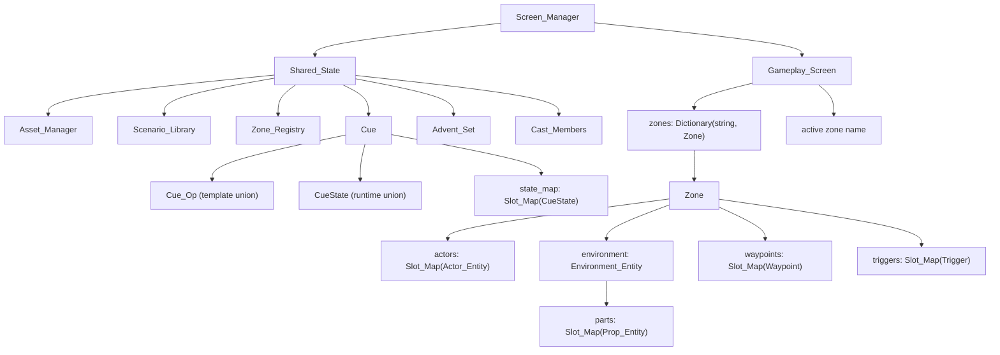

# Architecture

This is the reference for `fsharp-game`'s data architecture, derived from
`odin-game`. The goal is to reproduce odin-game's data-oriented design in F#,
leveraging F#'s structs and the GC rather than fighting them.

## Guiding principles

- Data-driven and cache-conscious: keep related runtime data in contiguous,
  fixed-size arrays of structs.
- No ECS framework — plain structs, slot maps, and procedural systems.
- Generational slot maps for O(1) add/get/free with stale-reference detection.
- Hot-path code is imperative; functional style is welcome off the hot path.
- Separate runtime state from authoring/template state and from the wire
  format.

## Core container: generational slot map

The foundational structure (odin-game `src/slot_map.odin`):

- A slot holds `{ entity, generation, alive, next_free }`.
- A slot map is a **fixed-size array of slots** plus `count` and a `free_head`
  free-list.
- Add/get/free are O(1); deletion reuses indices without index fix-ups, and a
  generation counter detects stale handles.
- `Slots` exposes the backing array as a `Span` so systems scan directly and write
  payloads in place through `&slots.[i]`; `Value` is the only mutable field, so a
  scan cannot desync the free list. Handle-addressed reads and writes go through
  `Get` (by `Handle`: index + generation). Undo restores through `Occupy`, which
  re-occupies a deleted entity's recorded (free) slot and restores its generation; a
  slot unexpectedly taken fails loudly rather than relocating.

```text
for i in 0..<N:
    if slots[i].alive: ...
```

This is the core locality win: per-zone entity storage is inline, not
heap-allocated per entity.

## Entity model

- `Entity_Kind` discriminates `Actor | Environment | Prop | Part | Waypoint | Trigger`.
- `Entity_Ref { kind, index, generation, epoch }` is a lightweight handle (not a
  pointer). Deleting bumps the slot generation, so a stale ref fails lookup
  instead of aliasing a reused slot. `epoch` scopes a Part ref to the environment
  that produced it (0 for other kinds): each environment's parts map starts its
  generations at 0, so without it a part ref could resolve against a same-index
  part in a different environment. Absence is `EntityRef option` in the F# port,
  not Odin's `NO_ENTITY` sentinel.
- `Entity` is the shared base: `name`, `transform`, `enabled`, `visible`,
  `selectable`, `draggable`.
- Specialized entities compose the base (Odin uses `using entity: Entity`):
  - `Actor_Entity` — renderer pointer, physics, debug flag.
  - `Environment_Entity` — its own `parts` slot map (the imported glTF parts),
    mesh indices, renderer, splat/grass pointers.
  - `Prop_Entity` — a placed prop: collision data, render-transform cache, water
    params. Environment parts reuse the same shape.
  - `Waypoint`, `Trigger` — compose the base like the rest, carrying no renderer,
    collider, or asset binding. A waypoint adds the ref of the waypoint its chain
    continues at; a trigger adds its volume, prompt, and flags.
- A part is addressed by `EntityKind.Part` into the current environment's own
  parts map, scoped by the ref's `epoch`, so environment churn never touches the
  zone's placed props/actors and a stale part ref can't alias another
  environment's part.

## Zone = world container

`Zone` owns one playable area: `actors`, `environment` (which owns its own
`parts`), `waypoints`, `triggers`, plus inline global settings (wind, lighting,
skydome, ocean). Zones are heap-allocated; their entity collections are
fixed-size inline arrays.

Two zone containers exist on purpose:

- `Zone_Map` — runtime. `Slot_Map(^Zone)` + an `active` index ("which zones
  exist, which is active").
- `Zone_Registry` — editor templates. Entries carry `environment_asset_id`,
  `settings`, `prop_template`, splat maps, and `template_saved` for
  authoring/persistence.

In the F# port the runtime container is folded into the gameplay screen: zones live
in a `Dictionary<string, Zone>` keyed by the zone's unique name, with `ActiveZone`
naming the active one (zones are addressed by identity and never bulk-iterated, so a
slot map buys nothing). Only the active zone's bodies are attached to the one shared
physics world: a switch detaches the outgoing zone with `BodyInterface.RemoveBody`
and re-attaches the incoming one with `AddBody`, then re-optimises the broadphase, so
inactive zones neither collide nor integrate without rebuilding any shape or body.
Deleting a zone destroys its bodies and releases its GPU resources. The player
designation and the undo history are held per zone.

## Systems

Systems are plain procedures that take `zone`/`screen`/`shared` + `dt` and
mutate data in place. `play_mode_systems_update` chains them in a fixed order:

```text
player_input → gravity → physics → animation → sway → trigger →
interaction → exposition → camera_follow → collider sync → clock → cue
```

Iteration is direct scan loops over the fixed arrays — no component registry or
archetypes.

## State management

- `Shared_State` holds cross-screen singletons: `cues`, `assets`,
  `scenario_library`, `selected_scenario_index`, `advents`, `cast_members`,
  `zone_registry`.
- `Screen_Manager` owns `Shared_State` plus one stateful struct per screen,
  with init/activate/deactivate/update/draw per screen.
- `Gameplay_Screen` holds per-gameplay hot state (`zones`, `player_locomotion`,
  `camera_follow`, `mode`, `clock`, `camera`, `interactable_trigger`, `fade`)
  and cold state (`exposition`, `editor`). Hot/cold fields are grouped.

## Persistence

Uses a DTO pattern: `Project_DTO`/`Project_Zone`/`Project_Prop`/
`Project_Scenario` structs with JSON tags, separate from the runtime model.
`project_save`/`project_load` convert between them; saves are atomic
(`.tmp` + rename). A missing file is not an error. Runtime/player save state is
out of scope — only cast, zone-registry templates, and the scenario library are
persisted.

## Assets

`Asset_Manager` holds `actors`, `environments`, `props` (dynamic arrays) plus an
LRU model cache and async loader. Assets are scanned from disk at startup and
parsed from s-syntax manifests, keyed by `id`.

## Scenario & Cue (template/runtime split)

- `Scenario_Library` → `Scenario` = fixed zones of authoring data plus a
  `cue_root`. Scenarios are immutable at runtime (heap maps, off hot path).
- `Cue` = `{ template_root, state_root, state_map }`.
- `Cue_Op` is a tagged union of op types (leaf data + recursive control flow
  via pointers: Sequence/Parallel/Fork/If).
- `CueState` is a *separate* union holding only runtime progress for the
  stateful ops. Template and running state are kept apart.



## Narrative engine (events → facts → rules)

`narrative/` is the **emergent** half of the story model; the scenario and cue
layer above is the scripted half. It is an event-sourced engine for an anime
high-school social simulation, in which the player directs drama rather than
steering relationship meters. Events are committed history; facts are what the
current rule set says that history currently implies.

- `cast/Roster.fs` — the closed roster of four `Character` cases, and the **one declaration of
  the cast**: hoisted out of the engine (`specs/032-cast-binding`) so that the engine and the game
  name the same cast without either owning it. Closed deliberately: a wrong case name does not
  compile, a misspelled character is not a character, and the cast being fixed is what lets that be
  a type rather than a table to keep in step. It is asset-free — the game binds a member and a look
  to an actor asset in `world/Casting.fs`, and nothing here names a portrait, an asset or an actor.
- `narrative/Vocabulary.fs` — one closed `Event` DU (8 cases), one closed `Fact`
  DU (7 cases), `FactKind` (the constructs as a value, which is what the index and a rule's reads are
  keyed by), and `Trait = Shy | HotHeaded`. The roster is `Roster`'s rather than this module's.
- `narrative/Canonical.fs` — canonical text `<Construct>(args)`: a **rendering** and nothing more,
  used by the report and by tests (research D34). Encoding matches on the construct and names its
  arguments with `nameof`, which measured about fifty times faster than asking the type what a value
  is (research D30). There is no decoder: nothing in the engine reads text, and nothing stores, keys
  or identifies a value by it (research D32, D34).
- `narrative/History.fs` — committed history: append-only, never rewritten, and held
  newest-first as a list so an append conses one event and copies nothing. An array was
  tried first, and then chunks of arrays; both copy what a list does not, in exchange for
  an iteration and an indexed lookup that nothing uses.
- `narrative/Facts.fs` — the current fact set: a `Map<Fact, Reason list>`, so a fact is its own
  identity and carries why it holds. Interchangeable participants are put in canonical order on the
  value as it is stored, a reason is identified by its rule and its premises as a set rather than by
  their text, and the participant index is keyed by `FactKind` rather than by a construct's name —
  with the harness, not the engine, sorting facts for a reader (research D33, D34).
- `narrative/Rules.fs` — the two rule categories, `Projection` (events → facts)
  and `Derivation` (facts → facts), plus a `let!`-based builder that records each
  rule's premises at binding time, so attribution cannot be restated wrongly.
- `narrative/Derive.fs` — the monotone fixpoint over the fact set, recomputed from
  the projected facts rather than maintained.
- `narrative/Units/{Cast,Friendship,Romance}.fs` — narrative units, each owning
  its rules while reading and concluding facts shared with every other unit.
- `narrative/Engine.fs` — the public surface: commit, read facts, and ask why.
- `narrative/Harness.fs` — a headless scenario harness, which is how rules are
  authored (write a rule, run scenarios, read the report), and a consequence of
  the engine being deliberately usable with no graphical interface.

Two properties the design depends on:

- **Determinism is structural.** Facts live in a `Map`, and the orderings the engine relies on are
  the values' own structural comparison — with `String.CompareOrdinal` wherever the *renderer* orders
  strings — because the default string comparer is culture-sensitive and would make the ordering
  guarantees false in a locale nobody tested in.
- **History is never rewritten when rules change.** A changed rule set means
  replaying the same event stream through the new rules, not editing the past;
  there is no way to assert a fact or to alter a committed event at all.

`cast/` is listed **first** in `fsharp-game.fsproj`, with `narrative/` immediately after it and
ahead of the game's own files. F# compiles in list order, so the roster sits low enough that the
engine can see it, while the engine still cannot reference the game — a compile error rather than
a convention. That is why the compile order departs from the `core → … → Engine` sequence
`docs/PROJECT_STRUCTURE.md` records.

**Open: is the narrative engine a roadmap phase of its own, or part of phase
10?** `specs/025-narrative-core` declines to settle whether it becomes a new
phase in `docs/ROADMAP.md` or extends phase 10 (story primitives — `world/`'s
waypoints, triggers, advent and cast); the roadmap's phase table has no entry for
the narrative engine today.

## F# port decisions

- **Slot map** → a generic sealed class holding a fixed `Slot` array plus the
  free-list head and count, mutated in place. It is deliberately *not* an
  immutable struct: copies would desync from the shared storage. `Slot`/`Handle`
  stay `[<Struct>]`, `Slots` is a `Span` (payload writes go through it), and `Get`
  returns a `byref` into the payload for handle-addressed access.
- **`using entity: Entity`** → no struct inheritance in F#; model as a nested
  `Entity` field inside each specialized record. The kinds that carry something
  derived (a body, a renderer) or runtime (a trigger's detection flag) also nest
  their **authored state** as a record of its own — `ActorState`, `PropState`,
  `TriggerState` — so an undo payload is that record's type and cannot hold a
  resource, and producing a live entity from it is the one place per kind that
  rebuilds them.
- **Inline `[N]u8` strings → `string`.** The runtime `Entity.name` in odin-game
  is already a heap `string`; the fixed `[N]u8` fields appear only in
  `Waypoint`, `Trigger`, `Zone`, cue/scenario templates, and the `Project_*`
  DTOs — i.e. editor/authoring/serialization data, not the per-frame hot path.
  So the port uses `string` everywhere and drops the fixed-size byte arrays.
- **DTO serialization** → `System.Text.Json` (with converters/attributes) or
  `FSharp.Data`. Keep the DTO-vs-runtime-model separation.
- **Systems** → top-level `unit`-returning functions mutating
  `Zone`/`GameplayScreen`/`SharedState`, called with `do`. This matches the
  AGENTS.md guidance.
- **Zone containers** → the runtime container is a name-keyed
  `Dictionary<string, Zone>` on `GameplayState` with an `ActiveZone` name (not a
  `Zone_Map` slot map: zones are addressed by identity and never bulk-iterated).
  `Zone_Registry` (authoring templates) stays a distinct structure.
- **Jolt ownership** → `PhysicsSystem` holds only *raw pointers* to the object-layer
  pair filter, broad-phase interface, and object-vs-broadphase filter, so the `World`
  must keep their managed wrappers (and its `PhysicsSystemSettings`) alive as fields.
  If the GC finalises them, native collision silently stops and dynamic bodies fall
  through all geometry. Shapes are different: a body ref-counts its shape natively, so
  a shape wrapper may be collected once the body exists.

The locality to preserve is the slot maps and fixed-size struct arrays — not
inlined strings.
