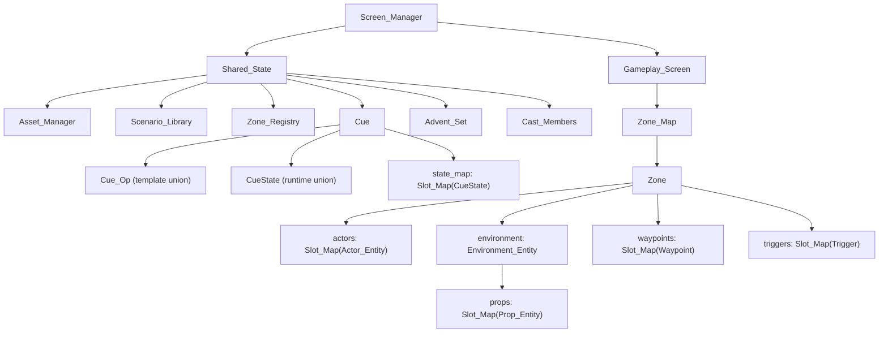

# Architecture

This is the reference for `fsharp-game`'s data architecture, derived from
`odin-game`. The goal is to reproduce odin-game's data-oriented design in F#,
leveraging F#'s structs and the GC rather than fighting them.

## Guiding principles

- Data-driven and cache-conscious: keep related runtime data in contiguous,
  fixed-size arrays of structs.
- No ECS framework — plain structs, slot maps, and procedural systems.
- Generational slot maps for O(1) add/get/free with stale-reference detection.
- Hot-path code is imperative; functional style is welcome off the hot path.
- Separate runtime state from authoring/template state and from the wire
  format.

## Core container: generational slot map

The foundational structure (odin-game `src/slot_map.odin`):

- A slot holds `{ entity, generation, alive, next_free }`.
- A slot map is a **fixed-size array of slots** plus `count` and a `free_head`
  free-list.
- Add/get/free are O(1); deletion reuses indices without index fix-ups, and a
  generation counter detects stale handles.
- Slot fields are exposed so systems write scan loops directly.

```text
for i in 0..<N:
    if slots[i].alive: ...
```

This is the core locality win: per-zone entity storage is inline, not
heap-allocated per entity.

## Entity model

- `Entity_Kind` discriminates `Actor | Environment | Prop | Waypoint | Trigger`.
- `Entity_Ref { kind, index }` is a lightweight handle (not a pointer), with a
  `NO_ENTITY` sentinel.
- `Entity` is the shared base: `name`, `transform`, `enabled`, `visible`,
  `selectable`, `draggable`.
- Specialized entities compose the base (Odin uses `using entity: Entity`):
  - `Actor_Entity` — renderer pointer, physics, debug flag.
  - `Environment_Entity` — its own `props` slot map, mesh indices, renderer,
    splat/grass pointers.
  - `Prop_Entity` — collision data, render-transform cache, water params.
  - `Waypoint`, `Trigger` — standalone (no `Entity` base).

## Zone = world container

`Zone` owns one playable area: `actors`, `environment` (which owns its own
`props`), `waypoints`, `triggers`, plus inline global settings (wind, lighting,
skydome, ocean). Zones are heap-allocated; their entity collections are
fixed-size inline arrays.

Two zone containers exist on purpose:

- `Zone_Map` — runtime. `Slot_Map(^Zone)` + an `active` index ("which zones
  exist, which is active").
- `Zone_Registry` — editor templates. Entries carry `environment_asset_id`,
  `settings`, `prop_template`, splat maps, and `template_saved` for
  authoring/persistence.

## Systems

Systems are plain procedures that take `zone`/`screen`/`shared` + `dt` and
mutate data in place. `play_mode_systems_update` chains them in a fixed order:

```text
player_input → gravity → physics → animation → sway → trigger →
interaction → exposition → camera_follow → collider sync → clock → cue
```

Iteration is direct scan loops over the fixed arrays — no component registry or
archetypes.

## State management

- `Shared_State` holds cross-screen singletons: `cues`, `assets`,
  `scenario_library`, `selected_scenario_index`, `advents`, `cast_members`,
  `zone_registry`.
- `Screen_Manager` owns `Shared_State` plus one stateful struct per screen,
  with init/activate/deactivate/update/draw per screen.
- `Gameplay_Screen` holds per-gameplay hot state (`zones`, `player_locomotion`,
  `camera_follow`, `mode`, `clock`, `camera`, `interactable_trigger`, `fade`)
  and cold state (`exposition`, `editor`). Hot/cold fields are grouped.

## Persistence

Uses a DTO pattern: `Project_DTO`/`Project_Zone`/`Project_Prop`/
`Project_Scenario` structs with JSON tags, separate from the runtime model.
`project_save`/`project_load` convert between them; saves are atomic
(`.tmp` + rename). A missing file is not an error. Runtime/player save state is
out of scope — only cast, zone-registry templates, and the scenario library are
persisted.

## Assets

`Asset_Manager` holds `actors`, `environments`, `props` (dynamic arrays) plus an
LRU model cache and async loader. Assets are scanned from disk at startup and
parsed from s-syntax manifests, keyed by `id`.

## Scenario & Cue (template/runtime split)

- `Scenario_Library` → `Scenario` = fixed zones of authoring data plus a
  `cue_root`. Scenarios are immutable at runtime (heap maps, off hot path).
- `Cue` = `{ template_root, state_root, state_map }`.
- `Cue_Op` is a tagged union of op types (leaf data + recursive control flow
  via pointers: Sequence/Parallel/Fork/If).
- `CueState` is a *separate* union holding only runtime progress for the
  stateful ops. Template and running state are kept apart.



## F# port decisions

- **Slot map** → a generic struct with a fixed `array` (or `Span`/`Memory`) plus
  free-list and generation counter. F# `[<Struct>]` types are the fit.
- **`using entity: Entity`** → no struct inheritance in F#; model as a nested
  `Entity` field inside each specialized record.
- **Inline `[N]u8` strings → `string`.** The runtime `Entity.name` in odin-game
  is already a heap `string`; the fixed `[N]u8` fields appear only in
  `Waypoint`, `Trigger`, `Zone`, cue/scenario templates, and the `Project_*`
  DTOs — i.e. editor/authoring/serialization data, not the per-frame hot path.
  So the port uses `string` everywhere and drops the fixed-size byte arrays.
- **DTO serialization** → `System.Text.Json` (with converters/attributes) or
  `FSharp.Data`. Keep the DTO-vs-runtime-model separation.
- **Systems** → top-level `unit`-returning functions mutating
  `Zone`/`GameplayScreen`/`SharedState`, called with `do`. This matches the
  AGENTS.md guidance.
- **Zone containers** → keep `Zone_Map` (runtime) and `Zone_Registry`
  (authoring templates) as distinct structures.

The locality to preserve is the slot maps and fixed-size struct arrays — not
inlined strings.
