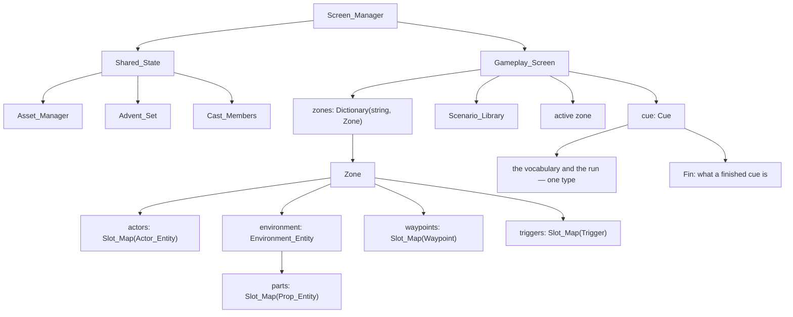

# Architecture

This is the reference for `fsharp-game`'s data architecture, derived from
`odin-game`. The goal is to reproduce odin-game's data-oriented design in F#,
leveraging F#'s structs and the GC rather than fighting them.

## Guiding principles

- Data-driven and cache-conscious: keep related runtime data in contiguous,
  fixed-size arrays of structs.
- No ECS framework — plain structs, slot maps, and procedural systems.
- Generational slot maps for O(1) add/get/free with stale-reference detection.
- Hot-path code is imperative; functional style is welcome off the hot path.
- Separate runtime state from authoring/template state and from the wire
  format.

## Core container: generational slot map

The foundational structure (odin-game `src/slot_map.odin`):

- A slot holds `{ entity, generation, alive, next_free }`.
- A slot map is a **fixed-size array of slots** plus `count` and a `free_head`
  free-list.
- Add/get/free are O(1); deletion reuses indices without index fix-ups, and a
  generation counter detects stale handles.
- `Slots` exposes the backing array as a `Span` so systems scan directly and write
  payloads in place through `&slots.[i]`; `Value` is the only mutable field, so a
  scan cannot desync the free list. Handle-addressed reads and writes go through
  `Get` (by `Handle`: index + generation). Undo restores through `Occupy`, which
  re-occupies a deleted entity's recorded (free) slot and restores its generation; a
  slot unexpectedly taken fails loudly rather than relocating.

```text
for i in 0..<N:
    if slots[i].alive: ...
```

This is the core locality win: per-zone entity storage is inline, not
heap-allocated per entity.

## Entity model

- `Entity_Kind` discriminates `Actor | Environment | Prop | Part | Waypoint | Trigger`.
- `Entity_Ref { kind, index, generation, epoch }` is a lightweight handle (not a
  pointer). Deleting bumps the slot generation, so a stale ref fails lookup
  instead of aliasing a reused slot. `epoch` scopes a Part ref to the environment
  that produced it (0 for other kinds): each environment's parts map starts its
  generations at 0, so without it a part ref could resolve against a same-index
  part in a different environment. Absence is `EntityRef option` in the F# port,
  not Odin's `NO_ENTITY` sentinel.
- `Entity` is the shared base: `name`, `transform`, `enabled`, `visible`,
  `selectable`, `draggable`.
- Specialized entities compose the base (Odin uses `using entity: Entity`):
  - `Actor_Entity` — renderer pointer, physics, debug flag.
  - `Environment_Entity` — its own `parts` slot map (the imported glTF parts),
    mesh indices, renderer, splat/grass pointers.
  - `Prop_Entity` — a placed prop: collision data, render-transform cache, water
    params. Environment parts reuse the same shape.
  - `Waypoint`, `Trigger` — compose the base like the rest, carrying no renderer,
    collider, or asset binding. A waypoint adds the ref of the waypoint its chain
    continues at; a trigger adds its volume, prompt, and flags.
- A part is addressed by `EntityKind.Part` into the current environment's own
  parts map, scoped by the ref's `epoch`, so environment churn never touches the
  zone's placed props/actors and a stale part ref can't alias another
  environment's part.

## Zone = world container

`Zone` owns one playable area: `actors`, `environment` (which owns its own
`parts`), `waypoints`, `triggers`, plus inline global settings (wind, lighting,
skydome, ocean). Zones are heap-allocated; their entity collections are
fixed-size inline arrays. A zone's authored **light** (`specs/043-zone-light-settings`)
and **sky** (`specs/092-zone-skydome`) are set today; wind and ocean are still to come.

Two zone containers exist on purpose:

- `Zone_Map` — runtime. `Slot_Map(^Zone)` + an `active` index ("which zones
  exist, which is active").
- `Zone_Registry` — **retired** (`specs/079-scenario-owned-zones`). A zone's **staging** — its environment asset,
  the environment's parts, its light and its placed props — now rides with a **scenario** (`world/ScenarioZone.fs`),
  so the separate store and its editor panel are gone. A zone is addressed by a **name** (`string`), not a closed
  union, and a zone that is named but not present is created by a fork.

In the F# port the runtime container is folded into the gameplay screen: zones live
in a `Dictionary<string, Zone>` keyed by their **name** — a zone is addressed by a name, as an actor or a
waypoint is (`specs/079-scenario-owned-zones`; the closed `Place` union retired) — with `ActiveZone : string`
naming the active one. A zone is either **present** (it has an entry in the map) or **absent**; the
active zone is always present (zones are addressed by name and never bulk-iterated, so a
slot map buys nothing). Only the active zone's bodies are attached to the one shared
physics world: a switch detaches the outgoing zone with `BodyInterface.RemoveBody`
and re-attaches the incoming one with `AddBody`, then re-optimises the broadphase, so
inactive zones neither collide nor integrate without rebuilding any shape or body.
Deleting a zone destroys its bodies and releases its GPU resources, unloading its environment through
the asset manager unless another present zone still uses that environment. The player
designation is held per zone; the **undo history is one**, on the gameplay screen
(`specs/048-unified-undo-stack`), because a zone move, an add and a delete are steps on the same timeline
as an entity edit — and a command names the **zone** it acts on (`specs/077-commands-carry-zone`), so a step
acts on its own zone rather than the active one and a batch may span zones. A cue drives the same world from its zone ops (`specs/062-zone-cue-ops`, trimmed by `specs/079`): it switches to a present
zone (`SetZone`) and makes a present zone absent (`RemoveZone`); bringing a zone in **with its staging** is a
scenario fork now (below), so the old `AddZone`/`PreloadZone` retired with the Zone Registry. A cue zone
change is a runtime effect (not an undo step), and each op is a no-op on a zone it cannot act on, so a cue is
safe to run more than once. The cue also drives the **cast** (`specs/072-actor-name-addressing`,
`specs/073-cue-actor-by-name`): `AddActor` brings an actor into a named place as a **new** actor, built from a
**discovered actor asset** and given a typed **name**, at a named waypoint — a name is a label, not an identity, so
a re-run places a second actor — and `RemoveActor` takes her out of a named place. Every actor cue op (the
lifecycle pair, the blends and the motion ops below, and the player toggles) addresses its actor by a plain
**string** — her `Name` — in an explicit **place** (`specs/075-cue-zone-selector`), resolved within that place's
zone by the same name scan a waypoint or trigger name uses, with no role on the actor and no index. The editor's
actor chooser offers the op's own place's live actors, and the clip/morph choosers read the chosen actor's asset.
An actor op resolves its actor by name **once**, when it begins; its in-flight `…State` (a move, a turn, a blend)
carries the resolved slot handle and place, so each tick is an O(1) slot-map lookup rather than a fresh scan, and
the op stays on the actor it began with (`specs/074`).
`specs/074-retire-cast` then retires the cast outright:
the look vocabulary, the slot → asset binding, the Cast panel and the roster itself leave the game — the `Character`
union moves into `narrative/`, and a portrait line's speaker becomes a plain **string**, resolved to her actor asset
by name in the asset manager. Like the zone ops, each is a runtime effect and a no-op on state it cannot act
on.
A third cue family drives an actor's motion and animation (`specs/066-actor-motion-cue-ops`): the blends fade
a clip or morph slot's weight over a duration (in the actor's own zone, active or not); the movement ops walk
an actor along a waypoint chain or turn her in place — **physics-driven** (the op writes the body's velocity
and facing and lets Jolt resolve it), so they act only while her zone is the active one, and an obstructed
move stops where the collision leaves it; and the player toggles bind or clear her as the zone's player
(the runtime form of the editor's "Set as Player"). The trigger toggles and `Print`
(`specs/067-print-trigger-cue-ops`) arm or disarm a named trigger in a named place — the runtime form of the
Inspector's checkbox, a no-op on an absent place or an already-set flag — and write a developer-facing line to
the console. A **scenario owns its zones** (`specs/079-scenario-owned-zones`): it carries each zone's **staging**
(environment, light and placed props) as well as its narrative entities, so `ForkScenario` (`specs/078-fork-scenario`)
**ensures** each zone by name — creating and staging an absent one, or restaging a present one — **appends** its
entities, and forks its cue beside the rest, as a runtime effect. Odin's other scenario ops
(`InlineScenario`/`ClearScenario`) and the camera-follow / interactions toggles remain the deferred cue families.

## Systems

Systems are plain procedures that take `zone`/`screen`/`shared` + `dt` and
mutate data in place. The reference's loop, `play_mode_systems_update`, chains them in a
fixed order:

```text
player_input → gravity → physics → animation → sway → trigger →
interaction → exposition → camera_follow → collider sync → clock → cue
```

The port follows this for the systems it has, with one deliberate deviation: the actor step —
blend the pose, then sway it (spec 091) — runs **last in `update`, after `cue`**, because a cue op
sets clip weights (`PlayClip`) and the blend has to see the weights the frame has just set. The
sway travels with it rather than sitting between `animation` and `trigger`: one pass over the pose,
not two.

Iteration is direct scan loops over the fixed arrays — no component registry or
archetypes.

## State management

- `Shared_State` holds state the engine itself, or more than one screen, may read: the GPU
  context, the asset manager and the named `advents` (the recorded milestone names, a string set). The test is
  **readership** — a member is here because something outside the gameplay screen needs it (the
  engine reads the GPU context; a journal or inventory screen may present a character and the flags),
  not because it is authored or persisted.
- `Screen_Manager` owns `Shared_State` plus one stateful struct per screen,
  with init/activate/deactivate/update/draw per screen.
- `Gameplay_Screen` owns the gameplay world and that world's configuration — the `zones`, the
  `scenarios` library the editor files a scene under (each scenario carrying its zones' staging) and the physics
  world their bodies attach to — beside its own runtime state: the `camera` and render buffers (view), the
  `cue` run, `dialogue`/exposition, `interactable_trigger`, `editor` and `fade`, plus the
  locomotion/`camera_follow` hot paths and `clock`. Hot/cold fields are grouped.

## Persistence

Uses a DTO pattern: `Project_DTO`/`Project_Zone`/`Project_Prop`/
`Project_Scenario` structs with JSON tags, separate from the runtime model.
`project_save`/`project_load` convert between them; saves are atomic
(`.tmp` + rename). A missing file is not an error. Runtime/player save state is
out of scope — only cast, zone-registry templates, and the scenario library are
persisted.

## Assets

`Asset_Manager` holds `actors`, `environments`, `props` (dynamic arrays) plus an
LRU model cache and async loader. Assets are scanned from disk at startup and
parsed from s-syntax manifests, keyed by `id`.

## Scenario & Cue (the cue *is* its run)

- `Scenario_Library` → `Scenario` = fixed zones of authoring data plus a
  `cue_root`. Scenarios are immutable at runtime (heap maps, off hot path). It lives on the
  **gameplay screen** (`specs/070-scenario-library`): a scenario is a plain **string name** and the contents are
  keyed by it in `world/ScenarioRegistry.fs`, an ordered map (Prime's `OMap`) iterating in the order names were
  added — there is **no closed vocabulary**, so `world/Scenario.fs` is retired (`specs/083-scenario-strings`).
  A scenario holds every present zone as a ref-free `ScenarioZone` (`world/ScenarioZone.fs` — a zone's **staging**
  and its **narrative entities** as arrays of authored states: actors, waypoints with their chains by index, and
  triggers; deliberately **not** the `ZoneContents` a delete carries, which keeps zone-scoped refs) and the cue. Its
  zones carry their staging (`specs/079-scenario-owned-zones`), and the contents carry no active place: that is the
  place's or the runtime state's.
  Adding, deleting, registering or clearing one is a step on the one undo history. **Running** one is **forking** it into the scene
  (`specs/078-fork-scenario`): `world/ScenarioFork.fs` appends the scenario's entities into its places (creating
  absent ones from the Zone Registry's template, without entering them) and returns the commands that reverse them,
  so the **Scenario** panel's **Fork** control is one undoable step while the `ForkScenario` cue op is a runtime
  effect that forks the scenario's cue beside the running one. A fork is deliberately non-idempotent — duplicates
  are the author's to avoid — and refuses, with a log and no change at all, when a target zone lacks room.
- `Cue` (`world/Cue.fs`) is **one type that is both the vocabulary and the run** —
  the control flow (`Sequence`/`Parallel`/`Fork`), the leaves, and the terminal
  `Fin`. It is an immutable value, and advancing it returns the next value, so the
  cue on the screen shrinks as it runs, down to `Fin` — what a finished cue is, and
  where it then rolls. There is no authored cue kept beside a run, no `CueState`
  union and no `state_map`: the reference's template/runtime split was measured and
  retired (`docs/CUE_MODEL_DECISION.md`, `specs/046`).
- A cue arrives at a running one by **fork** — it runs beside it. There is no join
  and no splice.
- A **trigger owns an authored cue** (a field on `TriggerState`, drawn inline in the
  Inspector), and fires it by forking it into the screen's running cue: on the rising
  edge of "player inside" for a non-interactable trigger, and on the interact key for
  the tracked interactable one (`specs/058-trigger-cue`). The authored value is never
  consumed, so the same trigger fires again on re-entry.
- The cue lives on the **gameplay screen**, not in `Shared_State` — a cue spans
  zones, so it cannot be a zone's, and it is not cross-screen state either.



## Narrative engine (events → facts → rules)

`narrative/` is the **emergent** half of the story model; the scenario and cue
layer above is the scripted half. It is an event-sourced engine for an anime
high-school social simulation, in which the player directs drama rather than
steering relationship meters. Events are committed history; facts are what the
current rule set says that history currently implies.

- `narrative/Roster.fs` — the closed roster of four `Character` cases, the narrative **engine's**
  vocabulary (`specs/074-retire-cast` moved it in from the old `cast/` cluster). Closed deliberately: a
  wrong case name does not compile, a misspelled character is not a character, and the cast being fixed
  is what lets that be a type rather than a table to keep in step. It is asset-free: nothing here names a
  portrait, an asset or an actor. The game no longer names the cast at all — a cue and a portrait line
  address their actor by a plain **string** (her `Name`), resolved by a scan of the present places
  (`specs/072`, `specs/073`) or the asset manager (`specs/074`), with no role on the actor and no index. A
  name is a label, not an identity, so duplicates are permitted and resolve to the first match.
- `narrative/Vocabulary.fs` — one closed `Event` DU (8 cases), one closed `Fact`
  DU (7 cases), `FactKind` (the constructs as a value, which is what the index and a rule's reads are
  keyed by), and `Trait = Shy | HotHeaded`. The roster is `Roster`'s rather than this module's.
- `narrative/Canonical.fs` — canonical text `<Construct>(args)`: a **rendering** and nothing more,
  used by the report and by tests (research D34). Encoding matches on the construct and names its
  arguments with `nameof`, which measured about fifty times faster than asking the type what a value
  is (research D30). There is no decoder: nothing in the engine reads text, and nothing stores, keys
  or identifies a value by it (research D32, D34).
- `narrative/History.fs` — committed history: append-only, never rewritten, and held
  newest-first as a list so an append conses one event and copies nothing. An array was
  tried first, and then chunks of arrays; both copy what a list does not, in exchange for
  an iteration and an indexed lookup that nothing uses.
- `narrative/Facts.fs` — the current fact set: a `Map<Fact, Reason list>`, so a fact is its own
  identity and carries why it holds. Interchangeable participants are put in canonical order on the
  value as it is stored, a reason is identified by its rule and its premises as a set rather than by
  their text, and the participant index is keyed by `FactKind` rather than by a construct's name —
  with the harness, not the engine, sorting facts for a reader (research D33, D34).
- `narrative/Rules.fs` — the two rule categories, `Projection` (events → facts)
  and `Derivation` (facts → facts), plus a `let!`-based builder that records each
  rule's premises at binding time, so attribution cannot be restated wrongly.
- `narrative/Derive.fs` — the monotone fixpoint over the fact set, recomputed from
  the projected facts rather than maintained.
- `narrative/Units/{Cast,Friendship,Romance}.fs` — narrative units, each owning
  its rules while reading and concluding facts shared with every other unit.
- `narrative/Engine.fs` — the public surface: commit, read facts, and ask why.
- `narrative/Harness.fs` — a headless scenario harness, which is how rules are
  authored (write a rule, run scenarios, read the report), and a consequence of
  the engine being deliberately usable with no graphical interface.

Two properties the design depends on:

- **Determinism is structural.** Facts live in a `Map`, and the orderings the engine relies on are
  the values' own structural comparison — with `String.CompareOrdinal` wherever the *renderer* orders
  strings — because the default string comparer is culture-sensitive and would make the ordering
  guarantees false in a locale nobody tested in.
- **History is never rewritten when rules change.** A changed rule set means
  replaying the same event stream through the new rules, not editing the past;
  there is no way to assert a fact or to alter a committed event at all.

`narrative/Roster.fs` is listed **first** among the narrative files in `fsharp-game.fsproj`, with the
rest of `narrative/` after it and ahead of the game's own files. F# compiles in list order, so the roster
sits low enough that the engine can see it, while the engine still cannot reference the game — a compile
error rather than a convention. That is why the compile order departs from the `core → … → Engine` sequence
`docs/PROJECT_STRUCTURE.md` records.

**Open: is the narrative engine a roadmap phase of its own, or part of phase
10?** `specs/025-narrative-core` declines to settle whether it becomes a new
phase in `docs/ROADMAP.md` or extends phase 10 (story primitives — `world/`'s
waypoints, triggers and advent); the roadmap's phase table has no entry for
the narrative engine today.

## F# port decisions

- **Slot map** → a generic sealed class holding a fixed `Slot` array plus the
  free-list head and count, mutated in place. It is deliberately *not* an
  immutable struct: copies would desync from the shared storage. `Slot`/`Handle`
  stay `[<Struct>]`, `Slots` is a `Span` (payload writes go through it), and `Get`
  returns a `byref` into the payload for handle-addressed access.
- **`using entity: Entity`** → no struct inheritance in F#; model as a nested
  `Entity` field inside each specialized record. The kinds that carry something
  derived (a body, a renderer) or runtime (a trigger's detection flag) also nest
  their **authored state** as a record of its own — `ActorState`, `PropState`,
  `TriggerState` — so an undo payload is that record's type and cannot hold a
  resource, and producing a live entity from it is the one place per kind that
  rebuilds them.
- **Inline `[N]u8` strings → `string`.** The runtime `Entity.name` in odin-game
  is already a heap `string`; the fixed `[N]u8` fields appear only in
  `Waypoint`, `Trigger`, `Zone`, cue/scenario templates, and the `Project_*`
  DTOs — i.e. editor/authoring/serialization data, not the per-frame hot path.
  So the port uses `string` everywhere and drops the fixed-size byte arrays.
- **DTO serialization** → `System.Text.Json` (with converters/attributes) or
  `FSharp.Data`. Keep the DTO-vs-runtime-model separation.
- **Systems** → top-level `unit`-returning functions mutating
  `Zone`/`GameplayScreen`/`SharedState`, called with `do`. This matches the
  AGENTS.md guidance.
- **Zone containers** → the runtime container is a name-keyed
  `Dictionary<string, Zone>` on `GameplayState` with an `ActiveZone` name (not a
  `Zone_Map` slot map: zones are addressed by name and never bulk-iterated). A zone's staging lives with the
  scenario that authors it (`specs/079-scenario-owned-zones`); the old `Zone_Registry` is retired.
- **Jolt ownership** → `PhysicsSystem` holds only *raw pointers* to the object-layer
  pair filter, broad-phase interface, and object-vs-broadphase filter, so the `World`
  must keep their managed wrappers (and its `PhysicsSystemSettings`) alive as fields.
  If the GC finalises them, native collision silently stops and dynamic bodies fall
  through all geometry. Shapes are different: a body ref-counts its shape natively, so
  a shape wrapper may be collected once the body exists.

The locality to preserve is the slot maps and fixed-size struct arrays — not
inlined strings.

## Failure routing (programmer error vs user-reachable state)

`specs/080-user-path-hardening` draws the line the *Fail Loudly* principle implies but did not spell out. Every
failure is routed by one question: **can only a programming error produce this state?**

- **Yes** → fail fast. Stale slot handles, a double free, `Occupy` on a taken slot, and a broken internal
  invariant keep their `failwith`/`invalidOp`/`assert`. These are bugs, and the failure is the point.
- **No** — authored content, a scene, an asset file, or a play session can reach it → handle it without ending
  the run, in one of three ways:
  - **perform nothing + report** — the cue engine's existing contract, extended to the camera ops, the history
    runner (a recorded step whose place a runtime cue has since removed is skipped and reported), and the
    creation surfaces (a create at a fixed capacity is refused and reported).
  - **skip or degrade + report** — the asynchronous asset path's contract, extended to the eager asset scan (a
    malformed asset is omitted and the scan continues) and to a missing font (text is disabled).
  - **report + controlled teardown** — the frame loop and the entry point: an unexpected failure names the
    operation that failed and ends the run through the normal teardown, rather than aborting silently.

Reports use the one-line `eprintfn` convention (see `world/CueEngine.fs`), emitted once per event and never per
frame. **Cue undoability** — whether a cue's runtime effects become history steps — is deliberately *not* part
of this boundary and remains a separate design question.
