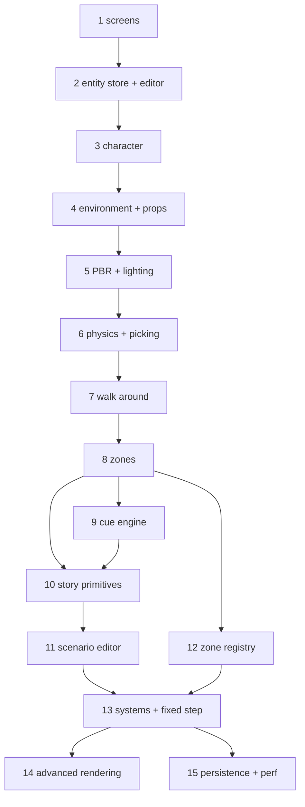

# fsharp-game — Roadmap

**Status**: Draft (2026-08-27).

This roadmap is derived from **odin-game's git history** (the "what" and the
proven build order) and **ocaml-game's editor design** (the "how"), adapted to
F# + SDL3/SDL_gpu + ImGui + Box3D. It deliberately departs from ocaml-game's
foundation-first milestone order in favour of keeping something runnable at
every step. It puts the **app shell (screens) first**, then the **"walk around an
environment with physics"** and **PBR** milestones early, before any
content-authoring (cues/scenarios).

## Vision

A narrative, story-driven 3D game built data-oriented: playable **zones**
(terrain, water, actors, props, waypoints, triggers), scripted **cues**
(Sequence/Parallel/Fork sequences), **scenarios** assembled from zones + cast
members, **adventure flags** for story state, physics (capsule actors +
box/BVH props), and a full **in-engine editor** to author all of it.

## Principles

- **Something runnable at every step.** Each phase ends with a visible result
  you can look at or play; it is never a pure abstraction.
- **Screens first.** Stand up the app shell (screen manager + main menu +
  gameplay screen, UI-only) before any 3D — it's cheap and de-risks the structure.
- **Get a character on screen as the first 3D result**, not "math + camera +
  triangle" in the abstract.
- **Get to "walk around an environment with physics" early** (phase 7). A
  playable character in a physical world is the backbone everything else hangs
  off.
- **Get PBR in early** (phase 5) — establish the real visual baseline *before*
  the cue/scenario content-authoring, so the editor and authored content are
  built against the actual look, not placeholder shading.
- **Bring the editor in early** — right after the entity store.
- **Physics early** — colliders + raycast picking are part of the core loop.
- **Refactor after it works.** The slot map, zones, immutable cue, and systems
  extraction in odin-game were *refactors* on top of a working game, not
  prerequisites. We port the *final* shape directly, but still build it
  incrementally.
- **Port the final architecture, not the intermediate states** — see
  `docs/ARCHITECTURE.md` for the target data model.

## Current state

- SDL3 window + SDL_gpu device + swapchain loop with a software 60 FPS cap
  (`Program.fs`).
- Dear ImGui wired through the SDL_gpu backend, docking-enabled
  (`ImGui.fs`, `ImGuiSdl3.fs`, `native/`).
- Box3D referenced (Happypig375 bindings) but not yet used.
- Target data architecture documented in `docs/ARCHITECTURE.md`.

## The phases

Each phase is a coherent, committable increment. "Result" is what you can see or
play at the end of the phase. Phases 1–7 form the **playable-and-visible** spine
(shell → editor → character → world → PBR → physics → walking); phases 8+ are
content-authoring and polish on top.

| # | Phase | Result | Reference |
|---|-------|--------|-----------|
| **1** | **Screens + main menu** | screen manager, main menu ↔ gameplay (UI-only shell) | `odin-game/src/{screen,main_menu_screen,gameplay_screen}.odin`; `ocaml-game` M4 |
| **2** | **Entity store + editor** | select/edit/spawn entities in an editor | `odin-game/src/{slot_map,entity,editor*}.odin`; `ocaml-game/lib/core/{slot_map,entity,zone}.ml` |
| **3** | **Animated character on screen** | an animated actor in a 3D viewport | `odin-game` IQM loading; `ocaml-game/lib/core/{iqm,actor,assets}.ml` |
| **4** | **Environment + props** | a static environment + prop assets you can see | `odin-game/src/{environment,environment_gltf,environment_render}.odin`; `ocaml-game/lib/core/gltf.ml` |
| **5** | **PBR + lighting** | metallic-roughness shading (GGX), materials, sun/directional light | `odin-game/src/environment_render.odin`, `docs/PBR_PLAN.md`; `ocaml-game` M13 |
| **6** | **Physics + picking** | capsule character + box/BVH prop colliders, raycast click-select | `odin-game/src/physics.odin`; `ocaml-game` M6 (Box3D + raycast) |
| **7** | **Walk around** | player locomotion + camera follow; walk the character around the environment with physics | `odin-game` `player_input`/`camera_follow`/`gravity` systems; `ocaml-game` M11.1–M11.2 |
| **8** | **Zones** | multiple zones, switch between them | `odin-game/src/{zone_map,zone_registry}.odin` (runtime part) |
| **9** | **Cue engine + editor** | author and run a scripted sequence | `odin-game/src/{cue,cue_editor}.odin`; `ocaml-game/lib/core/cue.ml`, `docs/CUE_DESIGN.md` |
| **10** | **Story primitives** | waypoints, triggers, advent, cast | `odin-game/src/{cast,advent}.odin` + zone waypoints/triggers; `ocaml-game` M7 |
| **11** | **Scenario editor** | assemble a scenario from zones + cast + cues | `odin-game/src/{scenario,scenario_editor}.odin`; `ocaml-game` M9 |
| **12** | **Zone registry + editor** | author zone templates/settings | `odin-game/src/{zone_registry,zone_editor}.odin`; `ocaml-game` M10 |
| **13** | **Systems + fixed timestep + immutable cue** (refactor) | named systems, live-edit-safe cues | `odin-game` systems-extraction commits; `ocaml-game` M11 / D-010 |
| **14** | **Advanced rendering** | shadows → water → grass → sky → ocean → sway → cel-shading | `odin-game/src/{shadow,water,grass,skydome,ocean,sway}.odin`; one spec each |
| **15** | **Persistence + perf** | save/load `project.json`, async loading, LRU cache | `odin-game/src/project.odin`; `ocaml-game` M12/M14 |

The phases are **dependency-ordered**, but several are intentionally parallel
after the core (e.g. 10/11 vs 12, and the sub-features of 14).

## Sequencing

The **playable-and-visible spine** is `1 → 2 → 3 → 4 → 5 → 6 → 7` (screens →
editor → character → environment/props → PBR → physics → walk around). After
that, the content-authoring path is `8 → 9 → 10 → 11 → 12 → 13`, and `14`/`15`
are polish.

## F#-specific notes

- **Phase 3 is the "hard" plumbing step.** odin-game had raylib's
  `LoadModel`/`DrawMesh` to make "character on screen" trivial; SDL_gpu has no
  such helper, so phase 3 must build a minimal mesh-draw path (vertex/index
  buffers + one graphics pipeline + one shader) and a model loader. Phase 4
  reuses that path for static geometry; phase 5 upgrades its shader to PBR.
- **Model loading** — port `ocaml-game/lib/core/iqm.ml` (actors) and a scoped
  glTF parser (environments/props). The IQM parser already emits flat
  struct-of-arrays, which feeds SDL_gpu buffers directly. Use `System.IO.BinaryReader`
  for little-endian reads; keep the data as `float32`/`single`, not `float`.
- **Math** — small hand-rolled `[<Struct>]` `Vec3`/`Quat`/`Mat4` (matches the
  data-oriented ethos; avoids a dependency).
- **Asset manifests** — port `ocaml-game/lib/core/assets.ml` (scan
  `actors/`/`environments/`/`props/` + JSON manifests) as the asset manager
  (needed by phases 2 and 4).
- **Physics** — `Box3D` (Happypig375) behind `physics/Physics.fs`, starting with
  capsule bodies (character) + box/hull shapes (props) and `b3World_Step`.
- **PBR** — glTF materials (metallic-roughness) map directly onto SDL_gpu
  pipelines; no external shading library needed. Keep it minimal (GGX direct +
  directional light) rather than a full PBR framework.
- **Editor** — follow `ocaml-game/docs/EDITOR_DESIGN.md` and `DECISIONS.md`
  (one docking workspace, one Inspector, command/undo model, template/runtime
  cue split, "just enough" ImGui binding).

## References

- **odin-game** — `src/` (working implementation), `docs/*_PLAN.md`
  (per-feature design rationale, incl. `PBR_PLAN.md`).
- **ocaml-game** — `lib/core/` (slot map, entity, zone, cue, iqm, gltf, assets),
  `docs/{ROADMAP,DECISIONS,EDITOR_DESIGN,CUE_DESIGN,SYSTEMS_PHYSICS_DESIGN}.md`,
  `specs/` (27 completed specs as evidence).
- **fsharp-game** — `docs/ARCHITECTURE.md` (target data model),
  `docs/PROJECT_STRUCTURE.md` (layout), `docs/EDITOR_DESIGN.md` (editor),
  `AGENTS.md` (style), `ImGui.fs`/`ImGuiSdl3.fs`/`native/` (ImGui + SDL_gpu).

## Next step

**Phase 1 — screens + main menu** (`/speckit-specify`): a screen manager, a main
menu, and a UI-only gameplay screen on the existing ImGui + SDL_gpu loop. This is
cheap (no 3D yet) and establishes the app shell that phases 2–7 build on, with
phase 3 (animated Akane on screen) being the first real 3D plumbing step.
