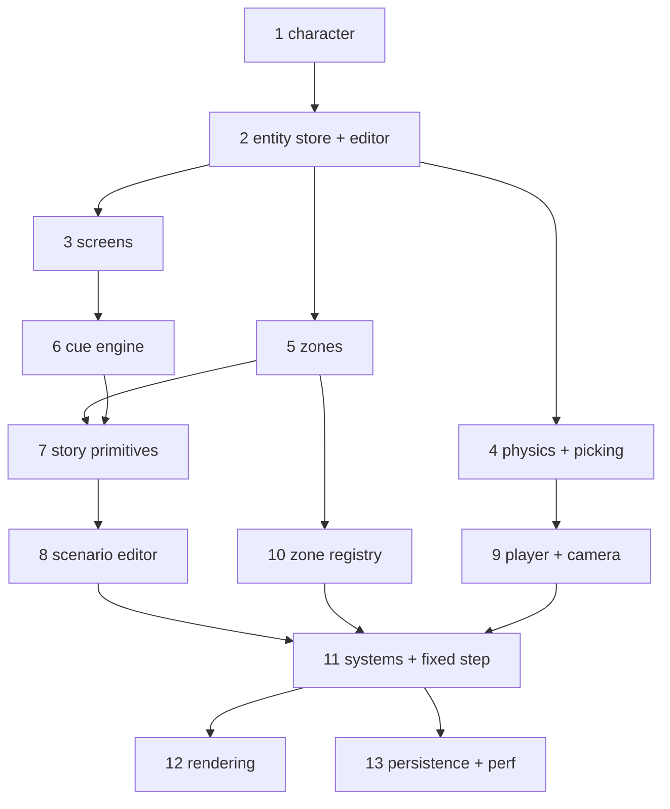

# fsharp-game — Roadmap

**Status**: Draft (2026-08-27).

This roadmap is derived from **odin-game's git history** (the "what" and the
proven build order) and **ocaml-game's editor design** (the "how"), adapted to
F# + SDL3/SDL_gpu + ImGui + Box3D. It deliberately departs from ocaml-game's
foundation-first milestone order in favour of keeping something runnable at
every step.

## Vision

A narrative, story-driven 3D game built data-oriented: playable **zones**
(terrain, water, actors, props, waypoints, triggers), scripted **cues**
(Sequence/Parallel/Fork sequences), **scenarios** assembled from zones + cast
members, **adventure flags** for story state, physics (capsule actors +
box/BVH props), and a full **in-engine editor** to author all of it.

## Principles

- **Something runnable at every step.** Each phase ends with a visible result
  you can look at or play; it is never a pure abstraction.
- **Get a character on screen first**, not "math + camera + triangle" in the
  abstract.
- **Bring the editor in early** — it starts right after the entity store, not
  deferred to a late milestone.
- **Physics early** — colliders + raycast picking are part of the core loop, not
  an afterthought.
- **Refactor after it works.** The slot map, zones, immutable cue, and systems
  extraction in odin-game were *refactors* on top of a working game, not
  prerequisites. We port the *final* shape directly, but still build it
  incrementally.
- **Port the final architecture, not the intermediate states** — see
  `docs/ARCHITECTURE.md` for the target data model.

## Current state

- SDL3 window + SDL_gpu device + swapchain loop with a software 60 FPS cap
  (`Program.fs`).
- Dear ImGui wired through the SDL_gpu backend, docking-enabled
  (`ImGui.fs`, `ImGuiSdl3.fs`, `native/`).
- Box3D referenced (Happypig375 bindings) but not yet used.
- Target data architecture documented in `docs/ARCHITECTURE.md`.

## The phases

Each phase is a coherent, committable increment. "Result" is what you can see or
play at the end of the phase. References point at the working source to port.

| # | Phase | Result | Reference |
|---|-------|--------|-----------|
| **1** | **Animated character on screen** | an animated actor in a 3D viewport | `odin-game` IQM loading; `ocaml-game/lib/core/iqm.ml` + `actor.ml` + `assets.ml` |
| **2** | **Entity store + inspector** | select/edit/spawn entities in an editor | `odin-game/src/slot_map.odin`, `entity.odin`, `editor*.odin`; `ocaml-game/lib/core/{slot_map,entity,zone}.ml` |
| **3** | **Screens + main menu** | main menu ↔ gameplay | `odin-game/src/screen.odin`, `main_menu_screen.odin`, `gameplay_screen.odin` |
| **4** | **Physics + click-picking** | click an entity, collider picked | `odin-game/src/physics.odin`; `ocaml-game` M6 (Box3D + raycast) |
| **5** | **Zones** | multiple zones, switch between them | `odin-game/src/zone_map.odin`, `zone_registry.odin` (runtime part) |
| **6** | **Cue engine + editor** | author and run a scripted sequence | `odin-game/src/cue.odin`, `cue_editor.odin`; `ocaml-game/lib/core/cue.ml`, `docs/CUE_DESIGN.md` |
| **7** | **Story primitives** | waypoints, triggers, advent, cast | `odin-game/src/{waypoint? (in zone), cast.odin, advent.odin}`; `ocaml-game` M7 |
| **8** | **Scenario editor** | assemble a scenario from zones + cast + cues | `odin-game/src/scenario.odin`, `scenario_editor.odin`; `ocaml-game` M9 |
| **9** | **Player + camera** | walk a physics-driven character | `odin-game` `player_input`/`camera_follow`/`physics` systems; `ocaml-game` M11.1–M11.2 |
| **10** | **Zone registry + editor** | author zone templates/settings | `odin-game/src/zone_registry.odin`, `zone_editor.odin`; `ocaml-game` M10 |
| **11** | **Systems + fixed timestep + immutable cue** (refactor) | named systems, live-edit-safe cues | `odin-game` systems-extraction commits; `ocaml-game` M11 / D-010 |
| **12** | **Rendering** | grass → PBR → shadows → water → sky → ocean → sway → cel-shading | `odin-game/src/{grass,water,ocean,skydome,shadow,terrain,sway}.odin`; one spec each |
| **13** | **Persistence + perf** | save/load `project.json`, async loading, LRU cache | `odin-game/src/project.odin`; `ocaml-game` M12/M14 |

The phases are **dependency-ordered**, but several are intentionally parallel
after the core (e.g. 7/8 vs 9, and the rendering sub-features of 12).

## Sequencing

The **critical path** is `1 → 2 → 4 → 9 → 11 → 12` (character → editor →
physics → player → systems → rendering). The cue/scenario/registry chain
(`2 → 6 → 7 → 8 → 10 → 11`) is the content-authoring path.

## F#-specific notes

- **Step 1 is the only "hard" upfront step.** odin-game had raylib's
  `LoadModel`/`DrawMesh` to make "character on screen" trivial; SDL_gpu has no
  such helper, so step 1 must build a minimal mesh-draw path (vertex/index
  buffers + one graphics pipeline + one shader) and a model loader. After that,
  everything maps 1:1.
- **Model loading** — port `ocaml-game/lib/core/iqm.ml` (actors) and a scoped
  glTF parser (environments/props). The IQM parser already emits flat
  struct-of-arrays, which feeds SDL_gpu buffers directly. Use `System.IO.BinaryReader`
  for little-endian reads; keep the data as `float32`/`single`, not `float`.
- **Math** — small hand-rolled `[<Struct>]` `Vec3`/`Quat`/`Mat4` (matches the
  data-oriented ethos; avoids a dependency).
- **Asset manifests** — port `ocaml-game/lib/core/assets.ml` (scan
  `actors/`/`environments/`/`props/` + JSON manifests) as the M3 asset manager.
- **Editor** — follow `ocaml-game/docs/EDITOR_DESIGN.md` and `DECISIONS.md`
  (one docking workspace, one Inspector, command/undo model, template/runtime
  cue split, "just enough" ImGui binding).

## References

- **odin-game** — `src/` (working implementation), `docs/*_PLAN.md`
  (per-feature design rationale).
- **ocaml-game** — `lib/core/` (slot map, entity, zone, cue, iqm, gltf, assets),
  `docs/{ROADMAP,DECISIONS,EDITOR_DESIGN,CUE_DESIGN,SYSTEMS_PHYSICS_DESIGN}.md`,
  `specs/` (27 completed specs as evidence).
- **fsharp-game** — `docs/ARCHITECTURE.md` (target data model), `AGENTS.md`
  (style), `ImGui.fs`/`ImGuiSdl3.fs`/`native/` (the ImGui + SDL_gpu foundation).

## Next step

**Phase 1 — animated Akane on screen** (`/speckit-specify`): minimal math +
editor camera + a GPU mesh-draw path + an IQM loader, drawing the `Akane` actor
with an animation. This is the only phase with genuine "new plumbing" risk;
everything after builds on it.
