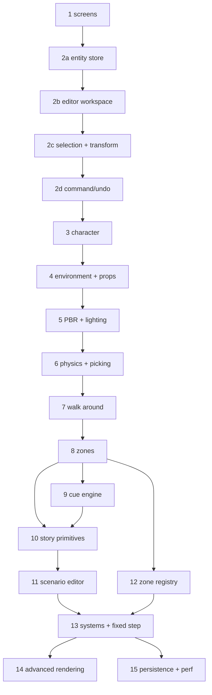

# fsharp-game — Roadmap

**Status**: Draft (2026-08-27).

This roadmap is derived from **odin-game's git history** (the "what" and the
proven build order) and **ocaml-game's editor design** (the "how"), adapted to
F# + SDL3/SDL_gpu + ImGui + Jolt Physics. It deliberately departs from ocaml-game's
foundation-first milestone order in favour of keeping something runnable at
every step. It puts the **app shell (screens) first**, then the **"walk around an
environment with physics"** and **PBR** milestones early, before any
content-authoring (cues/scenarios).

## Vision

A narrative, story-driven 3D game built data-oriented: playable **zones**
(terrain, water, actors, props, waypoints, triggers), scripted **cues**
(Sequence/Parallel/Fork sequences), **scenarios** assembled from zones + cast
members, **adventure flags** for story state, physics (capsule actors +
box/BVH props), and a full **in-engine editor** to author all of it.

## Principles

- **Something runnable at every step.** Each phase ends with a visible result
  you can look at or play; it is never a pure abstraction.
- **Screens first.** Stand up the app shell (screen manager + main menu +
  gameplay screen, UI-only) before any 3D — it's cheap and de-risks the structure.
- **Get a character on screen as the first 3D result**, not "math + camera +
  triangle" in the abstract.
- **Get to "walk around an environment with physics" early** (phase 7). A
  playable character in a physical world is the backbone everything else hangs
  off.
- **Get PBR in early** (phase 5) — establish the real visual baseline *before*
  the cue/scenario content-authoring, so the editor and authored content are
  built against the actual look, not placeholder shading.
- **Bring the editor in early** — right after the entity store.
- **Physics early** — colliders + raycast picking are part of the core loop.
- **Refactor after it works.** The slot map, zones, immutable cue, and systems
  extraction in odin-game were *refactors* on top of a working game, not
  prerequisites. We port the *final* shape directly, but still build it
  incrementally.
- **Port the final architecture, not the intermediate states** — see
  `docs/ARCHITECTURE.md` for the target data model.

## Current state

- Phase 1 (screens + main menu) is complete: `Engine.fs` run loop, `screen/`
  screen manager + main menu + gameplay placeholder, and an on-screen frame rate
  counter (`screen/DebugOverlay.fs`).
- SDL3 window + SDL_gpu device + swapchain loop with a software 60 FPS cap.
- Dear ImGui wired through the SDL_gpu backend, docking-enabled
  (`render/ImGui.fs`, `render/ImGuiSdl3.fs`, `native/`).
- Jolt Physics (JoltPhysicsSharp) wired in: `physics/Physics.fs` (world, box/capsule
  bodies, raycast), colliders for actors/props, and accurate collider picking.
- Target data architecture documented in `docs/ARCHITECTURE.md`.

## The phases

Each phase is a coherent, committable increment. "Result" is what you can see or
play at the end of the phase. Phases 1–7 form the **playable-and-visible** spine
(shell → editor → character → world → PBR → physics → walking); phases 8+ are
content-authoring and polish on top.

| # | Phase | Result | Reference |
|---|-------|--------|-----------|
| **1** | **Screens + main menu** | screen manager, main menu ↔ gameplay (UI-only shell) | `odin-game/src/{screen,main_menu_screen,gameplay_screen}.odin`; `ocaml-game` M4 |
| **2a** | **Entity store** | generational slot map + entity model, verified by tests | `odin-game/src/{slot_map,entity}.odin`; `ocaml-game/lib/core/{slot_map,entity}.ml` |
| **2b** | **Editor workspace shell** | docking, viewport, outliner, inspector, asset browser (empty scene) | `odin-game/src/editor*.odin`; `ocaml-game` M5 |
| **2c** | **Selection + transform** | raycast select, move/rotate/scale gizmos, spawn/delete/duplicate | `odin-game/src/editor*.odin`; `ocaml-game` M5 |
| **2d** | **Command/undo** | undo/redo for every editor mutation | `ocaml-game` D-011; `state/Command.fs` |
| **3** | **Animated character on screen** | an animated actor in a 3D viewport | `odin-game` IQM loading; `ocaml-game/lib/core/{iqm,actor,assets}.ml` |
| **4** | **Environment + props** | a static environment + prop assets you can see | `odin-game/src/{environment,environment_gltf,environment_render}.odin`; `ocaml-game/lib/core/gltf.ml` |
| **5** | **PBR + lighting** | metallic-roughness shading (GGX), materials, sun/directional light | `odin-game/src/environment_render.odin`, `docs/PBR_PLAN.md`; `ocaml-game` M13 |
| **6** | **Physics + picking** | capsule character + box/BVH prop colliders, raycast click-select | `odin-game/src/physics.odin`; `ocaml-game` M6 (Box3D + raycast) |
| **7** | **Walk around** | player locomotion + camera follow; walk the character around the environment with physics | `odin-game` `player_input`/`camera_follow`/`gravity` systems; `ocaml-game` M11.1–M11.2 |
| **8** | **Zones** | multiple zones: add, select, delete, switch | `odin-game/src/{zone_map,zone_registry}.odin` (runtime part); `specs/024` |
| **9** | **Cue engine + editor** | author and run a scripted sequence | `odin-game/src/{cue,cue_editor}.odin`; `ocaml-game/lib/core/cue.ml`, `docs/CUE_DESIGN.md` |
| **10** | **Story primitives** | waypoints, triggers, advent, cast | `odin-game/src/{cast,advent}.odin` + zone waypoints/triggers; `ocaml-game` M7 |
| **11** | **Scenario editor** | assemble a scenario from zones + cast + cues | `odin-game/src/{scenario,scenario_editor}.odin`; `ocaml-game` M9 |
| **12** | **Zone registry + editor** | author zone templates/settings | `odin-game/src/{zone_registry,zone_editor}.odin`; `ocaml-game` M10 |
| **13** | **Systems + fixed timestep + immutable cue** (refactor) | named systems, live-edit-safe cues | `odin-game` systems-extraction commits; `ocaml-game` M11 / D-010 |
| **14** | **Advanced rendering** | shadows → water → grass → sky → ocean → sway → cel-shading | `odin-game/src/{shadow,water,grass,skydome,ocean,sway}.odin`; one spec each |
| **15** | **Persistence + perf** | save/load `project.json`, async loading, LRU cache | `odin-game/src/project.odin`; `ocaml-game` M12/M14 |

The phases are **dependency-ordered**, but several are intentionally parallel
after the core (e.g. 10/11 vs 12, and the sub-features of 14).

## Phase details

Each phase lists the concrete **deliverables** (modules + behaviour) and the
**"done when"** acceptance criteria. Phase 1 is complete.

### 1 · Screens + main menu ✅

**Goal**: the app shell — screen manager, main menu, and a UI-only gameplay
screen on the existing ImGui + SDL_gpu loop.

**Deliverables**
- `state/Screen.fs` — `ScreenKind` + `ScreenTransition`.
- `screen/ScreenManager.fs` — owns the active screen, dispatches update/draw,
  applies the transition at frame end.
- `screen/MainMenuScreen.fs` (Play/Quit) and `screen/GameplayScreen.fs`
  (UI-only placeholder).
- `state/SharedState.fs` / `state/GameplayState.fs` — empty state seams for
  later phases.
- `Engine.fs` (run loop) split out of `Program.fs`, which becomes a thin entry
  point. Move `ImGui.fs`/`ImGuiSdl3.fs` into `render/`.

**Done when**: launch lands on the menu; Play switches to the gameplay
placeholder; Quit (or window close) exits cleanly. *(complete — `specs/001`)*

### 2a · Entity store

**Goal**: the data core — generational slot map + entity model, the foundation
every later phase builds on (no visible result yet; verified by tests).

**Deliverables**
- `core/SlotMap.fs` — generational slot map: a sealed class over a fixed slot
  array (`{ value, generation, alive, next_free }`), free-list, generation
  counter; O(1) add/get/free with stale-reference detection, mutated in place.
  A read-only `Slots` span for scans, a `byref` `Get` (by `Handle`: index +
  generation), and a
  generation-restoring `Occupy` for undo (re-occupy the deleted entity's recorded
  slot, which is always free; a taken slot raises).
- `world/Entity.fs` — `Entity_Kind` (`Actor|Environment|Prop|Part|Waypoint|Trigger`),
  `Entity_Ref { kind, index, generation, epoch }` (absence via `option`), base
  `Entity` (`name`, `transform`, `enabled`, `visible`, `selectable`, `draggable`),
  and the specialized entities (each embeds a nested `Entity`; no struct
  inheritance in F#).

**Done when**: `test/SlotMapTests.fs` proves add/get/free, free-list reuse, and
stale-handle rejection.

### 2b · Editor workspace shell ✅

**Goal**: the editor window layout with an (empty) navigable 3D viewport and a
populated asset browser.

**Deliverables**
- `world/Assets.fs` — asset manager: scan `actors/`/`environments/`/`props/` + s-syntax
  manifests, keyed by `id`.
- `render/DebugDraw.fs` — line/wireframe primitive (grid; later gizmos/overlays).
- `render/Camera.fs` — editor camera (pitch/yaw/pan/zoom).
- Docking workspace: `editor/Editor.fs` (docking + menu bar + shortcuts),
  `state/EditorState.fs`, `editor/Viewport.fs`, `editor/Outliner.fs`,
  `editor/Inspector.fs`, `editor/AssetBrowser.fs`.
- Backtick (`` ` ``) play/edit toggle, hiding/showing the workspace while the
  viewport grid stays visible.

**Done when**: the editor opens with dockable Viewport (grid + orbit camera),
Outliner, Inspector, and Asset Browser panels, and the browser lists discovered
assets. *(complete — `specs/003`)*

### 2c · Selection + transform

**Goal**: interact with entities in the viewport.

**Deliverables**
- `editor/Raycast.fs` — minimal screen-ray → sphere/box selection.
- Selection + focus (`F`), delete (`Del`), duplicate (`Ctrl+D`).
- Translate/rotate/scale gizmos (axis picking reuses the raycast).
- Spawn from the Asset Browser into the active zone.

**Done when**: you can spawn an entity, select it, and move/rotate/scale it with
gizmos (rendered as debug-draw markers).

### 2d · Command/undo

**Goal**: make every editor mutation undoable/redoable.

**Deliverables**
- `state/Command.fs` — value-storing commands (`apply`/`undo`), not closures;
  `EntityRef`-based entity commands survive deletion.
- Undo/redo stack + `Ctrl+Z` / `Ctrl+Shift+Z`.
- Continuous-edit coalescing (a gizmo/slider drag = one undo step).

**Done when**: spawn/delete/duplicate/transform are all undoable and redoable,
and a gizmo drag coalesces into a single undo step.

### 3 · Animated character on screen

**Goal**: the first real 3D result — an animated actor in a 3D viewport. This is
the hard plumbing step (SDL_gpu has no `LoadModel`/`DrawMesh` helper).

**Deliverables**
- `render/Gpu.fs` — device/swapchain/pass wrapper; vertex+index buffers, one
  graphics pipeline, one shader.
- `render/Mesh.fs` — GPU buffers + draw path.
- `core/Iqm.fs` — IQM binary parser emitting flat struct-of-arrays
  (`System.IO.BinaryReader`, little-endian, `float32` data).
- `world/Actor.fs` — IQM model + animation/morph state.
- `world/ActorRender.fs` — skinned actor rendering.

**Done when**: an animated character (e.g. Akane) is visible and animating in
the viewport via the asset manifest.

### 4 · Environment + props

**Goal**: static world geometry, reusing the phase-3 mesh-draw path.

**Deliverables**
- `core/Gltf.fs` — scoped glTF parser (environments/props).
- `world/Zone.fs` — the world container: `actors`, `environment` (owning its own
  `parts` slot map), `waypoints`, `triggers`, plus inline global settings.
- `world/Entity.fs` — `Environment_Entity` (owning its parts map) / `Prop_Entity`
  / `Part`.
- `world/EnvironmentRender.fs` — static environment + prop rendering.

**Done when**: a static environment and prop assets are visible in the viewport.

### 5 · PBR + lighting

**Goal**: establish the real visual baseline before any content authoring.

**Deliverables**
- Upgrade the phase-3 pipeline/shader to metallic-roughness GGX.
- glTF material mapping (metallic-roughness) onto SDL_gpu pipelines.
- Directional (sun) light parameters + the SPIR-V/GLSL shader.

**Done when**: environment/character render with PBR materials under a
directional light.

### 6 · Physics + picking

**Goal**: physical world plus accurate selection.

**Deliverables**
- `physics/Physics.fs` — Jolt adapter: world, capsule character body, box prop
  colliders, and `PhysicsSystem.Update` (step).
- Collider↔render transform sync.
- Accurate raycast picking (screen-ray → collider/BVH), replacing the phase-2
  minimal raycast.

**Done when**: character/props have colliders and click-select hits physical
shapes.

### 7 · Walk around ✅

**Goal**: the playable backbone — walk the character around an environment with
physics.

**Deliverables**
- `world/Systems.fs` — player systems gated on a bound player: `playerInput`
  (tank controls), `cameraFollow`, `animate`, plus `syncActors`, the non-gated
  body→entity sync for every actor.
- Dynamic, rotation-locked actor capsules — gravity and collision come from the
  physics step, and the actor's existing body is the player body.
- A deliberate *Set as Player* editor action; no enter/leave-play callbacks.
- The fixed-order play-mode chain: `player_input → physics → sync → camera_follow`
  (grows in phase 13).

**Done when**: you can walk the character around the environment with collisions
and a following camera. *(complete — `specs/016`)*

### 8 · Zones ✅

**Goal**: multiple zones with one active; add, select, delete, and switch.

**Deliverables**
- A name-keyed `Dictionary<string, Zone>` on `GameplayState` plus `ActiveZone`
  (no `world/ZoneMap.fs` — a dictionary suffices for identity-addressed zones).
- Zone switch path: detach the outgoing zone's bodies and re-attach the incoming
  zone's (`RemoveBody`/`AddBody` + broadphase optimize) in the one shared world.
- Per-zone player designation and undo history, plus add/select/delete in the
  Outliner's Zones section.
- Deleting a zone releases its bodies and GPU resources; the last zone is protected.

**Done when**: multiple zones exist and you can add, select, delete, and switch
between them at runtime. *(complete — `specs/024`)*

### 9 · Cue engine + editor

**Goal**: author and run a scripted sequence.

**Deliverables**
- `world/Cue.fs` — `Cue_Op` template union (`Sequence|Parallel|Fork|If` + leaf
  ops) and a separate `CueState` runtime union + `state_map`.
- Runtime cue execution.
- `editor/CueEditor.fs` + `editor/CueTree.fs` — recursive tree-list editor (not a
  node graph).
- Enforce the template/runtime split (D-010) so undo targets the immutable
  template while the runtime re-derives from it.

**Done when**: you can author and run a scripted sequence in the cue editor.

### 10 · Story primitives

**Goal**: waypoints, triggers, adventure flags, and cast.

**Deliverables**
- `Waypoint` / `Trigger` entities in `world/Entity.fs` (or `world/Zone.fs`).
- `world/Advent.fs` — named flag set.
- `world/Cast.fs` — name → asset id map.
- `editor/CastPanel.fs` / `editor/AdventPanel.fs` docked panels.
- Trigger→cue wiring inline in the Inspector.

**Done when**: you can place waypoints/triggers, wire triggers to cues, set
adventure flags, and manage the cast.

### 11 · Scenario editor

**Goal**: assemble scenarios from zones + cast + cues.

**Deliverables**
- `world/Scenario.fs` — scenario library; a scenario = zones + cast + `cue_root`
  (immutable at runtime).
- `editor/ScenarioEditor.fs` — library + cue/scene Inspector tabs.

**Done when**: you can assemble and run a scenario.

### 12 · Zone registry + editor

**Goal**: author zone templates/settings.

**Deliverables**
- `world/ZoneRegistry.fs` — editor zone templates (environment asset id, settings,
  prop templates, splat maps, `template_saved`).
- `editor/ZoneEditor.fs`.

**Done when**: you can author zone templates/settings in the editor.

### 13 · Systems + fixed timestep + immutable cue (refactor)

**Goal**: deterministic stepping and a clean systems seam — a refactor on top of
the working game, not a rewrite.

**Deliverables**
- `world/Systems.fs` — named play-mode systems chained in the fixed order.
- Fixed-timestep loop (accumulator + fixed `dt`), decoupling simulation from
  render (replaces the software 60 FPS cap).
- Formalise the immutable-cue-template guarantee from phase 9.

**Done when**: systems are named/chained, simulation steps at a fixed `dt`, and
cues stay live-edit-safe.

### 14 · Advanced rendering

**Goal**: visual polish — each sub-feature is its own runnable increment/spec.

**Deliverables** (in order): shadows → water → grass → sky → ocean → sway →
cel-shading.
- `render/Shadow.fs`, `render/Water.fs`, `render/Grass.fs`, `render/Skydome.fs`,
  `render/Ocean.fs`, `render/Terrain.fs`, `render/TerrainSplat.fs`,
  `render/SceneTarget.fs` (offscreen FBO), `render/Exr.fs` (OpenEXR).

**Done when**: each sub-feature lands as a visible, committable increment.

### 15 · Persistence + perf

**Goal**: save/load and performance.

**Deliverables**
- `world/Project.fs` — `Project_DTO`/`Project_Zone`/`Project_Prop`/
  `Project_Scenario` DTOs (`System.Text.Json`), separate from the runtime model.
- Atomic save/load (`project.json`, `.tmp` + rename); missing file is not an error.
- Async asset loading + LRU model cache.

**Done when**: cast, zone-registry templates, and the scenario library round-trip
through `project.json`; assets load async with an LRU cache.

## Sequencing

The **playable-and-visible spine** is
`1 → 2a → 2b → 2c → 2d → 3 → 4 → 5 → 6 → 7` (screens → entity store → editor
workspace → selection/transform → command/undo → character → environment/props →
PBR → physics → walk around). After that, the content-authoring path is
`8 → 9 → 10 → 11 → 12 → 13`, and `14`/`15` are polish.

## F#-specific notes

- **Phase 3 is the "hard" plumbing step.** odin-game had raylib's
  `LoadModel`/`DrawMesh` to make "character on screen" trivial; SDL_gpu has no
  such helper, so phase 3 must build a minimal mesh-draw path (vertex/index
  buffers + one graphics pipeline + one shader) and a model loader. Phase 4
  reuses that path for static geometry; phase 5 upgrades its shader to PBR.
- **Model loading** — port `ocaml-game/lib/core/iqm.ml` (actors) and a scoped
  glTF parser (environments/props). The IQM parser already emits flat
  struct-of-arrays, which feeds SDL_gpu buffers directly. Use `System.IO.BinaryReader`
  for little-endian reads; keep the data as `float32`/`single`, not `float`.
- **Math** — use `System.Numerics` (`Vector3`/`Quaternion`/`Matrix4x4`) rather
  than hand-rolling. It ships in the BCL (no dependency), is SIMD-accelerated,
  and its types are value types (no GC). Watch the convention: `Matrix4x4` is
  row-major/row-vector, so keep it consistent with SDL_gpu (transpose as needed).
- **Asset manifests** — port `ocaml-game/lib/core/assets.ml` (scan
  `actors/`/`environments/`/`props/` + s-syntax manifests) as the asset manager
  (needed by phase 2b and phase 4).
- **Physics** — `JoltPhysicsSharp` behind `physics/Physics.fs`, starting with
  capsule bodies (character) + mesh shapes (props/environment), accurate raycast
  picking, and `PhysicsSystem.Update` (step).
- **PBR** — glTF materials (metallic-roughness) map directly onto SDL_gpu
  pipelines; no external shading library needed. Keep it minimal (GGX direct +
  directional light) rather than a full PBR framework.
- **Editor** — follow `ocaml-game/docs/EDITOR_DESIGN.md` and `DECISIONS.md`
  (one docking workspace, one Inspector, command/undo model, template/runtime
  cue split, "just enough" ImGui binding).

## References

- **odin-game** — `src/` (working implementation), `docs/*_PLAN.md`
  (per-feature design rationale, incl. `PBR_PLAN.md`).
- **ocaml-game** — `lib/core/` (slot map, entity, zone, cue, iqm, gltf, assets),
  `docs/{ROADMAP,DECISIONS,EDITOR_DESIGN,CUE_DESIGN,SYSTEMS_PHYSICS_DESIGN}.md`,
  `specs/` (27 completed specs as evidence).
- **fsharp-game** — `docs/ARCHITECTURE.md` (target data model),
  `docs/PROJECT_STRUCTURE.md` (layout), `docs/EDITOR_DESIGN.md` (editor),
  `AGENTS.md` (style), `ImGui.fs`/`ImGuiSdl3.fs`/`native/` (ImGui + SDL_gpu).

## Next step

**Phase 9 — cue engine + editor** (`/speckit-specify`): `world/Cue.fs` (a `Cue_Op`
template union and a separate `CueState` runtime union + `state_map`), runtime cue
execution, and `editor/CueEditor.fs`/`editor/CueTree.fs`, so you can author and run a
scripted sequence. (Phase 8 — zones — is complete; `specs/024`.)
