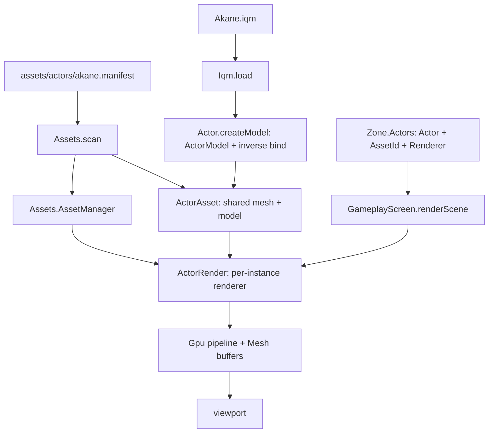

# Data Model: Animated Character on Screen

Phase 3 adds three layers on top of the existing entity store: an IQM **parser**
(`core/Iqm.fs`), the **animation sampling** logic (`world/Actor.fs`), and the
**GPU mesh + skinning** path (`render/{Gpu,Mesh}.fs` + `world/ActorRender.fs`).
The asset manager (`world/Assets.fs`) gains an eager actor loader so a spawned
actor resolves its IQM file through a shared per-asset `ActorAsset`.



## IQM parser — `core/Iqm.fs`

A straight port of `ocaml-game/lib/core/iqm.ml`, reading little-endian fields at
absolute offsets via `System.Buffers.Binary`. Geometry is `float32`; blend
indices/weights are raw `byte` arrays (for the `Ubyte4`/`Ubyte4Norm` vertex
attributes). Data loading only — no sampling or skinning here.

```fsharp
type VertexFormat = Float | Ubyte
type VertexKind   = Position | Texcoord | Normal | Tangent
                  | BlendIndices | BlendWeights

type VertexArray =
    { Kind : VertexKind
      Format : VertexFormat
      Size : int
      Offset : int }

type Mesh =
    { Name : string
      Material : int
      FirstVertex : int
      NumVertices : int
      FirstTriangle : int
      NumTriangles : int }

type Joint =
    { Name : string
      Parent : int
      Translate : Vector3
      Rotate : Quaternion
      Scale : Vector3 }

type Pose =
    { Parent : int
      ChannelMask : int
      ChannelOffset : float32 array   // length 10
      ChannelScale : float32 array }  // length 10

type Anim =
    { Name : string
      FirstFrame : int
      NumFrames : int
      FrameRate : float32
      Loop : bool }                   // from IQM_LOOP flag

type Model =
    { Meshes : Mesh array
      Positions : float32 array
      Normals : float32 array option
      Uvs : float32 array option
      Tangents : float32 array option
      BlendIndices : byte array option   // ubyte4 -> raw bytes
      BlendWeights : byte array option   // ubyte4 -> raw bytes (GPU normalizes)
      Triangles : int array
      Joints : Joint array
      Poses : Pose array
      Anims : Anim array
      FrameChannels : int array          // uint16 -> int, num_frames * num_framechannels
      NumFrameChannels : int
      PoseChannelOffsets : int array }   // per-pose offset into a frame's channels

val load : path:string -> Model
```

- Header is 124 bytes; magic `0x45544E49` ("INTE", little-endian), version 2.
- Only the six vertex-array kinds above are accepted; `COLOR`/custom/unknown
  kinds and any non-`float`/`ubyte` format raise.
- A missing `POSITION` array raises.
- `PoseChannelOffsets` records, per pose, the running count of set bits in each
  pose's `ChannelMask` (in increasing channel order). The sampler uses it as the
  base offset into a frame's packed `FrameChannels` group.

## Asset manager — `world/Assets.fs`

The on-disk manifest keeps the flat `Id`/`Name`/`Model` shape; actor assets are
loaded eagerly at scan time. Props/environments are metadata-only this phase.

```fsharp
[<SymbolicExpansion>]
type private Manifest =
    { Id : string
      Name : string
      Model : string }

type PropAsset =
    { Id : string; Name : string; ModelPath : string }

type EnvironmentAsset =
    { Id : string; Name : string; ModelPath : string }

type AssetManager =
    { Device : Gpu.Device
      Actors : Dictionary<string, ActorAsset.ActorAsset>
      Props : Dictionary<string, PropAsset>
      Environments : Dictionary<string, EnvironmentAsset> }

val scan : root:string -> device:Gpu.Device -> AssetManager
val createActorRender : manager:AssetManager -> assetId:string -> ActorRender.ActorRender
```

- `readManifest` falls back to the file stem for `Id`, to `Id` for `Name`, and to
  `""` for `Model`.
- `loadActors` (called by `scan`) parses each actor's IQM, checks it fits
  `Gpu.BonesMax`, computes `ActorModel`, uploads the static mesh, and stores a
  `ActorAsset`. It raises if an actor has no model path or exceeds `BonesMax`.
- `createActorRender` resolves an already-loaded `ActorAsset` by id and creates a
  per-instance `ActorRender`.

## Shared actor asset — `world/ActorAsset.fs`

Split out of the manager so `ActorRender` can depend on it without a cycle back
into `Assets`. Mirrors odin-game's `Actor_Asset`.

```fsharp
type ActorAsset =
    { Id : string
      Name : string
      ModelPath : string
      Mesh : Mesh.Mesh
      Model : Actor.ActorModel }
```

## Animation (sampling) — `world/Actor.fs`

The loaded actor (shared per asset) and the per-instance animation state.

```fsharp
type ActorModel =
    { Model : Iqm.Model
      InverseBind : Matrix4x4 array }   // inverse bind-pose world matrix per joint

[<Struct>]
type AnimationSlot =
    { AnimIndex : int
      mutable Frame : float32
      PlaybackFps : float32
      Weight : float32
      Loop : bool
      Enabled : bool }

type PoseFrame =
    { Local : Matrix4x4 array     // per-joint local transform
      World : Matrix4x4 array     // per-joint world transform
      Skinning : Matrix4x4 array }// per-joint world * inverseBind

val createModel : Iqm.Model -> ActorModel
val findAnimIndex : ActorModel -> string -> int option
val createSlot : Iqm.Model -> int -> bool -> AnimationSlot
val createPoseFrame : Iqm.Model -> PoseFrame
val advanceInPlace : ActorModel -> byref<AnimationSlot> -> float32 -> unit
val advance : ActorModel -> AnimationSlot -> float32 -> AnimationSlot
val samplePose : ActorModel -> int -> float32 -> bool -> PoseFrame -> unit
```

### Pose sampling

`Pose` channels are indexed `0..2` translation, `3..6` rotation (x,y,z,w),
`7..9` scale. A frame's channel value is dequantized:

```text
value[c] = channel_offset[c] + framechannel * channel_scale[c]
```

The frame's packed channels are read at
`(anim.FirstFrame + frame) * NumFrameChannels + PoseChannelOffsets[pose]`. For a
time `t` between frame `N` and `N+1`, translation/scale are lerped and the
rotation is slerped (mirrors odin-game `sample_animation_pose`).

### Bone matrices (the skinning output)

- `local[j]` = `T · R · S` from the sampled translate/rotate/scale (bind pose at
  load time).
- `world[j]` = `world[parent] · local[j]` (root parent = identity).
- `Skinning[j]` = `InverseBind[j] · world[j]` — the matrix that maps bind-pose
  vertices to the animated pose. Written in the engine's row-vector convention;
  uploaded raw (same `Matrix4x4`↔GLSL transpose handling as `viewProjection`).

`samplePose` writes `Local`/`World`/`Skinning` into the caller's `PoseFrame`.
`advanceInPlace`/`advance` advance the slot's `Frame` clock (`frame += dt * fps`,
loop or clamp). The per-vertex weighted blend is done in `mesh.vert`;
`ActorRender.upload` writes `Skinning` into a `mat4 bones[]` storage buffer.
Skinning stays in IQM's Z-up space; the Z-up → engine Y-up conversion is applied
after skinning in `ActorRender.draw` (see `research.md` Decision 18).

## GPU mesh path — `render/{Gpu,Mesh}.fs` + `world/ActorRender.fs`

`render/Gpu.fs` wraps the SDL_gpu handles (`Device`/`Buffer`/`TransferBuffer`/
`CommandBuffer`/`RenderPass`/`Pipeline`/`Texture`) plus buffer/transfer-buffer
creation, a one-shot upload helper, matrix/vector writers, and the mesh pipeline
+ depth texture. `render/Mesh.fs` owns the (static) vertex/index buffers for one
model and the draw call; `world/ActorRender.fs` owns per-instance animation state
and the bone palette upload.

```fsharp
// render/Mesh.fs
[<Struct>]
type Mesh =
    { Device : Gpu.Device
      VertexBuffer : Gpu.Buffer
      IndexBuffer : Gpu.Buffer
      IndexCount : int
      PerDrawUniformBytes : byte array        // 160 B, reused
      VertexBinding : SDL.GPUBufferBinding array
      IndexBinding : SDL.GPUBufferBinding }

val create : device:Gpu.Device -> positions:float32 array -> normals:float32 array
             -> uvs:float32 array -> boneIds:byte array -> boneWeights:byte array
             -> indices:int array -> Mesh
val draw : m:Mesh -> renderPass:Gpu.RenderPass -> cmd:Gpu.CommandBuffer -> pipeline:Gpu.Pipeline
           -> viewProjection:Matrix4x4 -> model:Matrix4x4 -> lightDir:Vector3
           -> baseColor:Vector4 -> unit

// world/ActorRender.fs
[<Struct>]
type ActorRender =
    { Asset : ActorAsset.ActorAsset
      mutable Animation : Actor.AnimationSlot
      Pose : Actor.PoseFrame
      BoneBuffer : Gpu.Buffer           // GraphicsStorageRead, BonesMax * 64
      BoneTransfer : Gpu.TransferBuffer // upload transfer buffer, same size
      BoneBytes : byte array }          // BonesMax * 64, reused

val create : device:Gpu.Device -> asset:ActorAsset.ActorAsset -> ActorRender
val advanceInPlace : byref<ActorRender> -> dt:float32 -> unit
val upload : r:ActorRender -> cmd:Gpu.CommandBuffer -> unit
val draw : r:ActorRender -> renderPass:Gpu.RenderPass -> cmd:Gpu.CommandBuffer -> pipeline:Gpu.Pipeline
           -> viewProjection:Matrix4x4 -> model:Matrix4x4 -> lightDir:Vector3
           -> baseColor:Vector4 -> unit
val release : r:ActorRender -> unit
```

- Vertex layout `float3 position, float3 normal, float2 uv, ubyte4 boneIds,
  ubyte4Norm weights` (40-byte stride); uploaded once at `Mesh.create`.
- Index buffer `uint32`, uploaded once.
- `PerDraw` uniform (160 B) = `viewProjection` (64) + `model` (64) + `lightDir`
  (16) + `baseColor` (16), pushed into vertex-uniform slot 0.
- `ActorRender.upload` samples the pose, writes `Pose.Skinning` into `BoneBytes`,
  and copies it to the bone storage buffer in a copy pass; `draw` binds that
  storage buffer (vertex storage slot 0) and issues one indexed draw.
- `ActorRender.draw` composes the IQM Z-up → engine Y-up conversion into the model
  matrix (`upAxisFix = CreateRotationX(-π/2)`, applied as `upAxisFix * model`)
  before `Mesh.draw`; it is a fixed rotation, not per-vertex work (see
  `research.md` Decision 18).
- `ActorRender.create` resolves the `Idle` clip by name (falls back to the first
  clip, then a disabled slot in bind pose). `release` frees the instance's bone
  storage + transfer buffers only — the shared `ActorAsset` is manager-owned.

## Entity association — `world/Entity.fs` / `world/Zone.fs`

`Actor` carries its asset id **and** its per-instance renderer:

```fsharp
[<Struct>]
type Actor =
    { Base : Entity
      AssetId : string
      mutable Renderer : ActorRender.ActorRender }
```

```fsharp
// world/Zone.fs
type Zone = { Name : string; mutable Actors : SlotMap<Actor>; mutable Environment : Environment }

val spawnActor : zone:Zone -> assets:Assets.AssetManager -> entity:Entity -> assetId:string -> EntityRef
val spawnProp : zone:Zone -> entity:Entity -> EntityRef
val setActorWithAsset : zone:Zone -> assets:Assets.AssetManager -> ref:EntityRef -> entity:Entity -> assetId:string -> unit
val removeEntity : zone:Zone -> ref:EntityRef -> unit
val entityAt : zone:Zone -> ref:EntityRef -> Entity option
val assetIdAt : zone:Zone -> ref:EntityRef -> string
val setEntity : zone:Zone -> ref:EntityRef -> entity:Entity -> unit
```

`spawnActor` and `setActorWithAsset` create the actor's renderer eagerly.
`removeEntity` releases the renderer's per-instance GPU buffers. `setEntity`
preserves an actor's `AssetId`/`Renderer` when writing a base-entity transform.

`GameplayScreen.renderScene` iterates the zone's alive actors: it uploads each
actor's bone palette in the copy-pass phase, then draws the debug grid and each
mesh inside the scene render pass.

## Relationships

- `Iqm` depends on the BCL + `System.Numerics` only.
- `Gpu`/`Mesh` depend on SDL3 + `System.Numerics`.
- `Actor` depends on `Iqm` (data) — no GPU, no `Zone`.
- `ActorAsset` depends on `Actor` + `Mesh`; `ActorRender` depends on `ActorAsset`
  + `Actor` + `Mesh` + `Gpu`.
- `Assets` depends on `ActorAsset`/`ActorRender`/`Actor`/`Iqm`/`Mesh`/`Gpu`.
- `Entity` depends on `ActorRender` (for `Actor.Renderer`); `Zone` depends on
  `Entity` + `Assets` + `SlotMap`.
- `GameplayScreen` depends on `ActorRender` + `Actor` + `Assets` + `Zone` +
  `Camera` + `DebugDraw` + `Gpu`.
- Compile order (`.fsproj`): `core/SlotMap.fs` → `core/Iqm.fs` → `core/Input.fs`
  → `render/{Gpu,Mesh,ImGui,ImGuiSdl3,Camera,DebugDraw}.fs` →
  `world/{Actor,ActorAsset,ActorRender,Assets,Entity,Zone}.fs` →
  `state/{Screen,SharedState,Command,EditorState,GameplayState}.fs` →
  `editor/*.fs` → `screen/*.fs` → `Engine.fs` → `Program.fs`.
