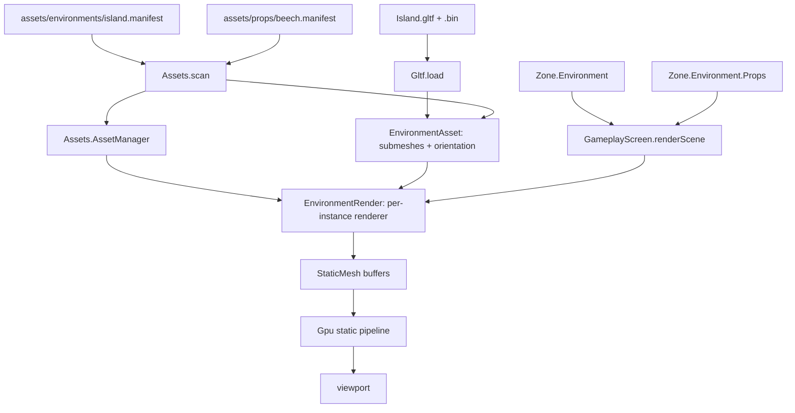

# Data Model: Environment + Props

Phase 4 adds three layers on top of the phase-3 mesh path: a scoped glTF
**parser** (`core/Gltf.fs`), a **static** (unskinned) GPU mesh path
(`render/StaticMesh.fs` + a static pipeline in `render/Gpu.fs`), and the
**environment/prop asset + entity** wiring (`world/{EnvironmentAsset,
EnvironmentRender,Assets,Entity,Zone}.fs`). The environment is a single zone
field; props live in the zone's existing `props` slot map and share loaded models.



## glTF parser — `core/Gltf.fs`

A scoped port of `ocaml-game/lib/core/gltf.ml` (which scopes the format as
external `.bin` buffers, buffer views, `float32` POSITION/NORMAL/TEXCOORD_0,
u8/u16/u32 indices, materials, and node transforms; everything else raises). The
`.gltf` JSON is read with `System.Text.Json`; the `.bin` with
`System.IO.BinaryReader`. Geometry is `float32`; indices are widened to `int`
(u32).

```fsharp
type Submesh =
    { Name : string
      Material : int
      BaseColor : Vector4          // from material baseColorFactor (default 1,1,1,1)
      Positions : float32 array
      Normals : float32 array
      Uvs : float32 array
      Indices : int array }        // u8/u16 widened to u32

type Model =
    { Submeshes : Submesh array
      Bounds : Bounds }            // min/max over all baked positions

type Bounds = { Min : Vector3; Max : Vector3 }

val load : path:string -> Model
```

- `Positions`/`Normals`/`Uvs` are flat (`float32[]`, length `3n`/`2n`).
- Node transforms are baked to world space (positions by the full `T·R·S`,
  normals by the rotation only); the node tree is not retained.
- Raises on data-URI buffers, sparse accessors, `skins`/`animations`, non-triangle
  primitives, a missing `POSITION`, a non-`float32` attribute, and an unsupported
  index component type.

## Static GPU mesh — `render/{Gpu,StaticMesh}.fs`

`render/Gpu.fs` gains a static pipeline (`createStaticPipeline`, position/normal/
uv only, 24-byte stride, depth-tested) alongside the phase-3 skinned pipeline.
`render/StaticMesh.fs` owns the static vertex/index buffers and the draw call,
reusing the phase-3 `PerDraw` uniform layout (160 bytes:
`viewProjection` + `model` + `lightDir` + `baseColor`).

```fsharp
// render/StaticMesh.fs
[<Struct>]
type StaticMesh =
    { Device : Gpu.Device
      VertexBuffer : Gpu.Buffer
      IndexBuffer : Gpu.Buffer
      IndexCount : int
      PerDrawUniformBytes : byte array
      VertexBinding : SDL.GPUBufferBinding array
      IndexBinding : SDL.GPUBufferBinding }

val create : device:Gpu.Device -> positions:float32 array -> normals:float32 array
             -> uvs:float32 array -> indices:int array -> StaticMesh
val draw : m:StaticMesh -> renderPass:Gpu.RenderPass -> cmd:Gpu.CommandBuffer -> pipeline:Gpu.Pipeline
           -> viewProjection:Matrix4x4 -> model:Matrix4x4 -> lightDir:Vector3
           -> baseColor:Vector4 -> unit

// render/Gpu.fs (added)
val createStaticPipeline : Device -> SDL.GPUTextureFormat -> SDL.GPUTextureFormat -> Pipeline
```

- Vertex layout `float3 position, float3 normal, float2 uv` (24-byte stride);
  uploaded once at `StaticMesh.create`.
- Index buffer `uint32`, uploaded once.
- `draw` pushes the `PerDraw` uniform (with a per-submesh `baseColor`) and issues
  one indexed draw — no bone storage buffer.

## Shared static asset — `world/EnvironmentAsset.fs`

One runtime type for both environments and props (a prop is a static model with
identity orientation), split out of `Assets` so `EnvironmentRender` can depend on
it without a cycle.

```fsharp
type EnvironmentAsset =
    { Id : string
      Name : string
      ModelPath : string
      Orientation : Quaternion
      Submeshes : StaticMesh.StaticMesh array }
```

## Static rendering — `world/EnvironmentRender.fs`

The per-instance renderer, owned inline by the environment entity and by each
prop entity. Mirrors odin-game's `Environment_Renderer`.

```fsharp
[<Struct>]
type EnvironmentRender =
    { Asset : EnvironmentAsset.EnvironmentAsset
      OrientationMatrix : Matrix4x4 }   // CreateFromQuaternion asset.Orientation

val create : device:Gpu.Device -> asset:EnvironmentAsset.EnvironmentAsset -> EnvironmentRender
val draw : r:EnvironmentRender -> renderPass:Gpu.RenderPass -> cmd:Gpu.CommandBuffer -> pipeline:Gpu.Pipeline
           -> viewProjection:Matrix4x4 -> model:Matrix4x4 -> lightDir:Vector3 -> unit
val release : r:EnvironmentRender -> unit
```

- `draw` composes `model * r.OrientationMatrix` (the environment's authored
  orientation) and iterates the asset's submeshes, drawing each with its parsed
  `BaseColor`.
- `release` is a no-op in phase 4 (no per-instance GPU buffers — the shared
  `EnvironmentAsset` holds the static buffers and is manager-owned), but is kept
  as the seam where per-prop buffers would free later.

## Asset manager — `world/Assets.fs`

The manifest gains a `Model` field (all kinds) and `OrientationDegrees` (Euler,
environments). Environment/prop assets are now loaded eagerly, not metadata-only.

```fsharp
[<SymbolicExpansion>]
type private Manifest =
    { Id : string
      Name : string
      Model : string
      OrientationDegrees : Vector3 }   // zero for actors/props

type AssetManager =
    { Device : Gpu.Device
      Actors : Dictionary<string, ActorAsset.ActorAsset>
      Props : Dictionary<string, EnvironmentAsset.EnvironmentAsset>
      Environments : Dictionary<string, EnvironmentAsset.EnvironmentAsset> }

val scan : root:string -> device:Gpu.Device -> AssetManager
val createActorRender : manager:AssetManager -> assetId:string -> ActorRender.ActorRender
val createEnvironmentRender : manager:AssetManager -> assetId:string -> EnvironmentRender.EnvironmentRender
```

- `readManifest` falls back to the file stem for `Id`, `Id` for `Name`, `""` for
  `Model`, and zero for `OrientationDegrees`.
- `scan` loads actors (phase 3) plus environments and props: each `Model` path is
  parsed via `Gltf.load` and uploaded via `StaticMesh.create`, producing an
  `EnvironmentAsset` with `Orientation = CreateFromYawPitchRoll` from the manifest's
  `OrientationDegrees`. It raises if a kind has no `Model` path.

## Entity association — `world/{Entity,Zone}.fs`

`Prop` and `Environment` gain an asset id **and** an inline renderer (parallel to
`Actor`):

```fsharp
[<Struct>]
type Prop =
    { Base : Entity
      AssetId : string
      mutable Renderer : EnvironmentRender.EnvironmentRender }

[<Struct>]
type Environment =
    { Base : Entity
      AssetId : string
      mutable Renderer : EnvironmentRender.EnvironmentRender
      mutable Props : SlotMap<Prop> }

// world/Zone.fs
type Zone = { Name : string; mutable Actors : SlotMap<Actor>; mutable Environment : Environment }

val spawnActor : zone:Zone -> assets:Assets.AssetManager -> entity:Entity -> assetId:string -> EntityRef
val spawnProp : zone:Zone -> assets:Assets.AssetManager -> entity:Entity -> assetId:string -> EntityRef
val setEnvironment : zone:Zone -> assets:Assets.AssetManager -> assetId:string -> unit
val setActorWithAsset : zone:Zone -> assets:Assets.AssetManager -> ref:EntityRef -> entity:Entity -> assetId:string -> unit
val removeEntity : zone:Zone -> ref:EntityRef -> unit
val entityAt : zone:Zone -> ref:EntityRef -> Entity option
val assetIdAt : zone:Zone -> ref:EntityRef -> string
val setEntity : zone:Zone -> ref:EntityRef -> entity:Entity -> unit
```

- `spawnProp` creates the prop's renderer eagerly from its asset id (like
  `spawnActor`). `setActorWithAsset` re-creates an actor or prop renderer from the
  id on apply/undo.
- `setEnvironment` unloads any existing environment and sets
  `{ Base; AssetId; Renderer; Props = fresh slot map }`.
- `setEntity` preserves an actor/prop's `AssetId`/`Renderer` when writing a
  base-entity transform; `removeEntity` releases the renderer's buffers.

## Scene pass — `screen/GameplayScreen.fs`

`renderScene` draws the debug grid, then the environment (if it has a renderer),
then each prop, then each actor — all in the same scene render pass, using the
static pipeline for environment/props and the skinned pipeline for actors.

## Relationships

- `Gltf` depends on the BCL (`System.Text.Json`) + `System.Numerics` only.
- `StaticMesh` depends on `Gpu` (SDL3) + `System.Numerics`.
- `EnvironmentAsset` depends on `Gltf` + `StaticMesh`; `EnvironmentRender` depends
  on `EnvironmentAsset` + `StaticMesh` + `Gpu`.
- `Assets` depends on `ActorAsset`/`ActorRender`/`Actor`/`Iqm`/`EnvironmentAsset`/
  `EnvironmentRender`/`Gltf`/`StaticMesh`/`Mesh`/`Gpu`.
- `Entity` depends on `ActorRender` + `EnvironmentRender`; `Zone` depends on
  `Entity` + `Assets` + `SlotMap`.
- `GameplayScreen` depends on `ActorRender` + `EnvironmentRender` + `Assets` +
  `Zone` + `Camera` + `DebugDraw` + `Gpu`.
- Compile order (`.fsproj`): `core/{SlotMap,Iqm,Gltf,Input}.fs` →
  `render/{Gpu,Mesh,StaticMesh,ImGui,ImGuiSdl3,Camera,DebugDraw}.fs` →
  `world/{Actor,ActorAsset,ActorRender,EnvironmentAsset,EnvironmentRender,Assets,
  Entity,Zone}.fs` → `state/*.fs` → `editor/*.fs` → `screen/*.fs` → `Engine.fs` →
  `Program.fs`.
