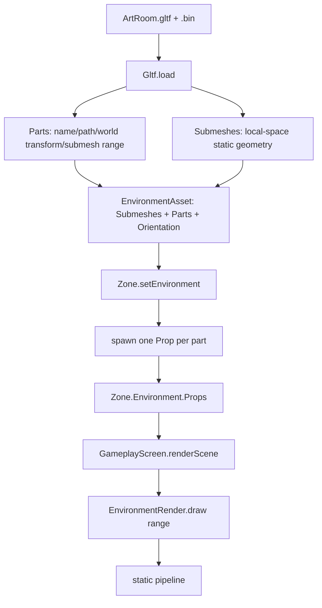

# Data Model: Environment Parts as Props

Phase 11 changes the environment from "one baked static mesh" to "a container of
props, one per glTF node with a mesh". The shared static submeshes are now in
*local* space, and each part carries its world transform so it can become a
movable prop.



## glTF parser — `core/Gltf.fs`

`Gltf.load` now returns local-space submeshes and a `Part` list, instead of
baking node transforms into positions/normals.

```fsharp
type Submesh =
    { Name : string
      Material : int
      BaseColor : Vector4
      Positions : float32 array   // node-local space (no world bake)
      Normals : float32 array
      Uvs : float32 array
      Indices : int array }

type Part =
    { Name : string
      HierarchyPath : string
      World : Matrix4x4            // accumulated S*R*T up the parent chain
      SubmeshIndex : int
      SubmeshCount : int }         // primitive count of the node's mesh

type Model =
    { Submeshes : Submesh array
      Parts : Part array
      Bounds : Bounds }
```

- `Submeshes` are appended in **mesh-index order** (each unique mesh read once),
  so a mesh referenced by several nodes is uploaded once and shared by every part
  that references it; each part records that mesh's contiguous range.
- A node with no mesh produces no part but still contributes its transform to its
  children (via the accumulated `World`).
- `World` is the accumulated node transform in System.Numerics row-vector order:
  `local * parentWorld`, where `local = S * R * T` (apply the node's scale, rotate,
  translate, then its ancestors').
- Raises on `matrix` nodes, sparse accessors, skins/animations, non-triangle
  primitives, missing `POSITION`, non-`float32` attributes, and unsupported index
  component types (unchanged from phase 4).

## Shared static asset — `world/EnvironmentAsset.fs`

```fsharp
type EnvironmentPart =
    { Name : string
      HierarchyPath : string
      World : Matrix4x4
      SubmeshIndex : int
      SubmeshCount : int }

type EnvironmentAsset =
    { Id : string
      Name : string
      ModelPath : string
      Orientation : Quaternion
      Submeshes : StaticSubmesh array
      Parts : EnvironmentPart array }   // empty for placed prop assets
```

## Static rendering — `world/EnvironmentRender.fs`

```fsharp
[<Struct>]
type EnvironmentRender =
    { Asset : EnvironmentAsset.EnvironmentAsset
      OrientationMatrix : Matrix4x4
      SubmeshIndex : int
      SubmeshCount : int }          // range of asset.Submeshes this instance draws

val create : asset:EnvironmentAsset.EnvironmentAsset -> orientation:Quaternion
             -> submeshIndex:int -> submeshCount:int -> EnvironmentRender
val draw : r:EnvironmentRender -> renderPass:Gpu.RenderPass -> cmd:Gpu.CommandBuffer
           -> pipeline:Gpu.Pipeline -> viewProjection:Matrix4x4 -> model:Matrix4x4
           -> lightDir:Vector3 -> unit
val release : r:EnvironmentRender -> unit
```

- `draw` composes `model * r.OrientationMatrix` and iterates
  `SubmeshIndex .. SubmeshIndex + SubmeshCount - 1`.
- For a placed prop asset the range is the whole asset and orientation is
  identity; for an environment part the range is the part's and orientation is the
  environment's.

## Entity association — `world/{Entity,Zone}.fs`

```fsharp
[<Struct>]
type AssetBinding =
    { AssetId : string                 // "" = environment part; else actor/prop id
      SubmeshIndex : int
      SubmeshCount : int }

[<Struct>]
type Prop =
    { Base : Entity
      AssetId : string                 // "" = environment part; else prop asset id
      SubmeshIndex : int
      SubmeshCount : int
      mutable Renderer : EnvironmentRender.EnvironmentRender }

[<Struct>]
type Environment =
    { Base : Entity
      AssetId : string
      Orientation : Quaternion         // from the loaded asset
      mutable Props : SlotMap<Prop> } // now also holds imported parts
```

`AssetBinding` is what undo/redo commands carry to (re)create an entity's
renderer: an actor/prop asset id or `""` for an environment part, plus the
submesh range. `state/Command.fs` adds a `SetEnvironment` command
(`PreviousAssetId * NewAssetId`) so loading/replacing an environment is undoable.

- `Zone.setEnvironment` decomposes each `EnvironmentPart.World` via
  `Matrix4x4.Decompose` into `Transform { Position; Rotation; Scale }`, and spawns
  a prop (`spawnPropBinding`, `AssetId = ""`, the part's submesh range, and that
  transform). It keeps placed props (non-empty `AssetId`) and drops the previous
  environment's parts (empty `AssetId`); an empty asset id clears the environment.
- `Zone.spawnProp` (placed prop path) uses `AssetId` non-empty and
  `SubmeshIndex = 0`/`SubmeshCount = 0` — the renderer derives the whole-asset
  range from the prop asset.
- `Zone.bindingAt` returns the `AssetBinding` (`AssetId` + submesh range) for a
  ref; `setEntity`/`removeEntity`/`setActorWithAsset` preserve the binding across
  edits/undo.

## Asset manager — `world/Assets.fs`

- `loadStaticModel` parses via `Gltf.load` and, for environments, copies
  `model.Parts` into `EnvironmentAsset.Parts` (placed props keep an empty parts
  list).
- `createPropRender` (placed prop) → full range, identity orientation.
- `createPartRender` (environment part) → the part's range, environment orientation.

## Scene pass — `screen/GameplayScreen.fs`

`renderScene` drops the direct environment draw (the environment entity draws
nothing). It draws each alive prop in `Zone.Environment.Props` — which now
includes both placed props and imported parts — via `EnvironmentRender.draw` with
the prop's entity transform and the static pipeline.

## Relationships

- `Gltf` depends on the BCL + `System.Numerics` only.
- `EnvironmentAsset` depends on `Gltf` + `StaticMesh`; `EnvironmentRender` depends
  on `EnvironmentAsset` + `StaticMesh` + `Gpu`.
- `Assets` depends on `Actor*`/`Iqm`/`Environment*`/`Gltf`/`StaticMesh`/`Mesh`/`Gpu`.
- `Entity` depends on `ActorRender` + `EnvironmentRender`; `Zone` depends on
  `Entity` + `Assets` + `SlotMap`.
- Compile order is unchanged; only the module contents change (no new files except
  test data).
