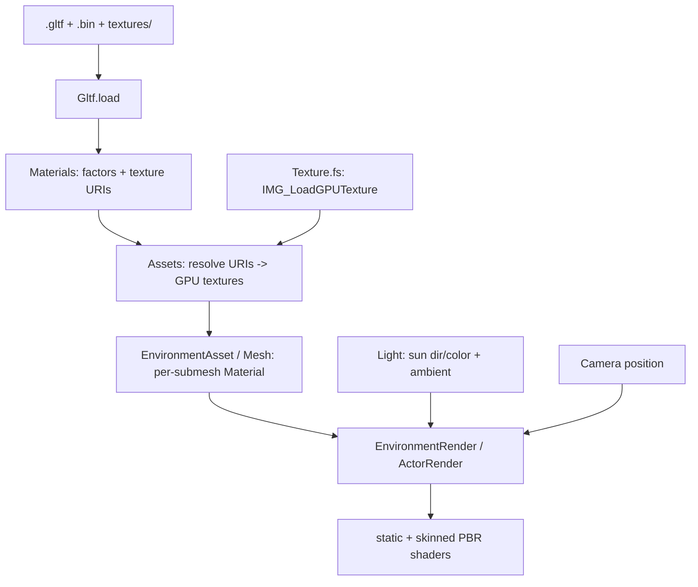

# Data Model: PBR + Lighting

Phase 12 replaces the flat Lambert shading with metallic-roughness GGX. The glTF
parser gains a per-material record (factors + texture references), a new
`render/Texture.fs` uploads decoded images as GPU samplers, and both shaders shade
with the same BRDF under one scene light.



## glTF parser — `core/Gltf.fs`

`Gltf.load` gains a materials array and texture reference resolution. `Submesh`
keeps its `Material` index into that array.

```fsharp
type TextureRef =
    { Uri : string }            // image uri relative to the .gltf directory

type Material =
    { BaseColor : Vector4        // baseColorFactor (default 1,1,1,1)
      Metallic : float32         // metallicFactor  (default 1.0)
      Roughness : float32        // roughnessFactor (default 1.0)
      Emissive : Vector3         // emissiveFactor  (default 0,0,0)
      AlbedoTexture : TextureRef option
      MetallicRoughnessTexture : TextureRef option
      NormalTexture : TextureRef option
      EmissiveTexture : TextureRef option }

type Model =
    { Submeshes : Submesh array
      Parts : Part array
      Materials : Material array
      Bounds : Bounds }
```

- `Submesh.Material` indexes `Model.Materials` (or `-1` → default material).
- Texture references resolve `textures[].source` → `images[].uri`; embedded
  (`data:`/`bufferView`) images raise.
- Samplers are not parsed; a fixed linear/repeat sampler is created for every
  texture in `render/Texture.fs`.

## Texture upload — `render/Texture.fs`

```fsharp
type Texture =
    { Device : Gpu.Device
      Handle : Gpu.Texture        // SDL_GPUTexture
      Sampler : Gpu.Sampler }     // SDL_GPUSampler

val load : device:Gpu.Device -> path:string -> Texture
```

- `load` calls `SDL3.Image.LoadGPUTexture(device, copyPass, path, &w, &h)` and
  creates a `SDL.GPUSampler` (linear filtering, repeat wrap).
- A URI-keyed cache (in `Assets`) avoids re-decoding/uploading shared textures.

## Runtime material — `render/Texture.fs`

```fsharp
type Material =
    { BaseColor : Vector4
      Metallic : float32
      Roughness : float32
      Emissive : Vector3
      HasAlbedo : bool
      HasNormal : bool
      HasMetallicRoughness : bool
      HasEmissive : bool
      Bindings : SDL.GPUTextureSamplerBinding array }

val makeMaterial : white:Texture -> baseColor:Vector4 -> metallic:float32 ->
  roughness:float32 -> emissive:Vector3 -> albedo:Texture option ->
  normal:Texture option -> metallicRoughness:Texture option ->
  emissiveTex:Texture option -> Material

val defaultMaterial : white:Texture -> baseColor:Vector4 -> Material
```

- The runtime `Material` replaces `StaticSubmesh.BaseColor`; it carries the scalar
  factors plus the `has*` booleans and four sampler bindings (absent maps use a
  shared white placeholder).

```fsharp
// world/EnvironmentAsset.fs
type StaticSubmesh =
    { Mesh : StaticMesh
      Material : Texture.Material }
```

- Static geometry (environments/props) has one runtime `Material` per
  `StaticSubmesh`, resolved from the glTF material index.
- The actor's materials are per-submesh: each IQM mesh names an albedo texture via
  its `Material` string (parsed in `core/Iqm.fs`); `Assets` resolves that name
  relative to the actor's `akane/` texture subdirectory and builds a dielectric
  `Material` (metallic 0, roughness ~0.8), or falls back to a default dielectric
  material when the name is empty.

## Shaders + uniforms

- **Vertex**: model matrix, view-projection, normal matrix (mat3); outputs world
  position, world normal, UV. Skinned path also applies the bone palette.
- **Fragment (shared BRDF)**: sun direction/color, ambient, camera position;
  per-material base color + metallic/roughness/emissive factors; albedo/normal/
  metallic-roughness/emissive samplers + `has*` flags (metallic-roughness is
  sampled `.g` for roughness, `.b` for metallic).
- Normal maps use a derivative tangent frame (no `TANGENT` attribute).

## Light — `render/Texture.fs`

```fsharp
[<Struct>]
type Light =
    { Direction : Vector3        // toward the sun
      Color : Vector3
      Ambient : Vector3 }
```

- `Light` is defined in `render/Texture.fs`; one value is constructed in
  `GameplayScreen.renderScene` and threaded into both renderers; camera position
  comes from the existing `Camera`.

## Relationships

- `Gltf` → BCL + `System.Numerics` only (texture *URIs*, no GPU).
- `Texture` → `Gpu` + `SDL3.Image` (decode/upload/sampler); defines the runtime
  `Material` and `Light` records.
- `Assets` → `Gltf` + `Texture` + `StaticMesh`/`Mesh` (resolves URIs → GPU, builds
  per-submesh materials for static geometry and actors).
- `EnvironmentAsset` → `Texture` + `StaticMesh` (per-submesh runtime material).
- `Mesh` → `Texture` (actor per-submesh `Material`, built from IQM material names).
- Compile order: insert `render/Texture.fs` after `render/Gpu.fs` (before
  `StaticMesh`/`Mesh`), keeping `core → render → world` one-directional.
