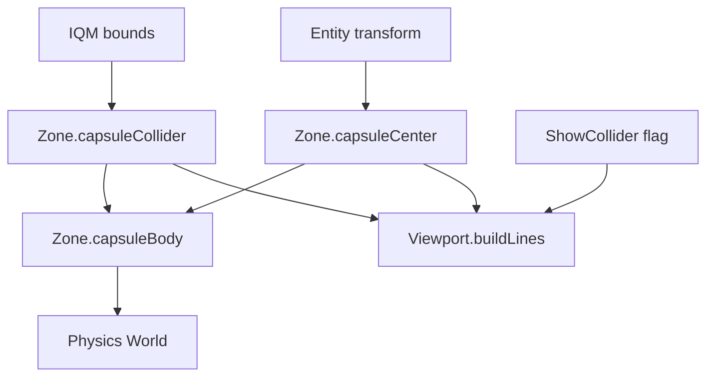

# Data Model: Actor Capsule Collider

Phase 14 adds a per-actor collider-visibility flag and corrects the actor capsule
so it matches `odin-game`: a fixed torso radius, the actor's full height, and the
capsule's base at the entity (feet) position.



## Actor — `world/Entity.fs`

```fsharp
[<Struct>]
type CapsuleCollider =
    { Radius : float32        // fixed actor radius (0.35)
      HalfHeight : float32 }  // cylinder half-height: height / 2 - Radius

[<Struct>]
type Actor =
    { Base : Entity
      AssetId : string
      Physics : PhysicsAttachment<CapsuleCollider> option
      ShowCollider : bool                              // NEW: editor overlay flag
      mutable Renderer : ActorRender.ActorRender }
```

- `ShowCollider` is editor-only visual state; it defaults to `false` at spawn and
  is toggled from the inspector.
- `CapsuleCollider` semantics are unchanged from phase 13 (Jolt `CapsuleShape`
  half-height convention); only how the values are derived changes.

## Collider derivation & placement — `world/Zone.fs`

```fsharp
let defaultActorColliderRadius = 0.35f

// height = bounds.Max.Z - bounds.Min.Z (IQM is Z-up)
let capsuleCollider (bounds: Gltf.Bounds) : CapsuleCollider =
    let height = bounds.Max.Z - bounds.Min.Z
    let halfHeight = max 0.0f (height / 2.0f - defaultActorColliderRadius)
    { Radius = defaultActorColliderRadius; HalfHeight = halfHeight }

// entity position is the feet; offset up by the capsule's half extent
let capsuleCenter (transform: Transform) (collider: CapsuleCollider) : Vector3 =
    transform.Position + Vector3(0.0f, collider.HalfHeight + collider.Radius, 0.0f)

let private capsuleBody (world: Physics.World) (collider: CapsuleCollider) (transform: Transform) : Physics.BodyId =
    Physics.createCapsuleBody world (capsuleCenter transform collider) collider.HalfHeight collider.Radius
```

- `capsuleCenter` is the single source of truth for where the capsule sits, used
  by both the physics body and the debug overlay so they cannot drift apart.

## Overlay — `render/DebugDraw.fs` + `editor/Viewport.fs`

- `DebugDraw.capsule dd center halfHeight radius color` appends a line wireframe
  (cylinder silhouette, two equator circles, and hemisphere silhouette arcs).
- `Viewport.buildLines` draws the capsule for an actor when `ShowCollider` is set
  and the actor has a physics attachment, using `Zone.capsuleCenter`.

## Relationships

- `Entity.Actor` → `CapsuleCollider` (owned shape data) + `ShowCollider` (editor flag).
- `Zone` → `Entity` + `Physics` (derive shape, place body, share the center helper).
- `Viewport` → `Zone` + `DebugDraw` (draw the overlay at the shared center).
- `Inspector` → `Zone` (read/write the actor slot to toggle `ShowCollider`).
- No new compile-order dependencies; all changes are within existing modules.
