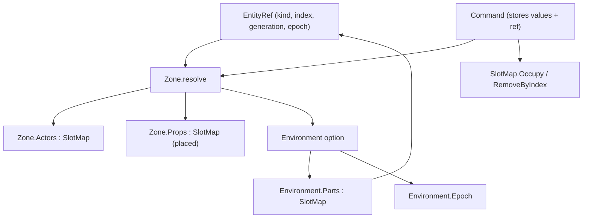

# Data Model: Entity Reference Integrity

Phase 15 makes an entity reference name a specific *incarnation*, moves
environment parts into the environment's own store, and makes undo restore a
deleted entity into its recorded slot.



## Entity reference — `world/Entity.fs`

```fsharp
[<Struct>]
type EntityKind =
    | Actor | Environment | Prop | Part | Waypoint | Trigger

[<Struct>]
type EntityRef =
    { Kind : EntityKind
      Index : uint32
      Generation : uint32   // slot incarnation; bumped on free
      Epoch : uint32 }      // owning environment (0 for non-part kinds)

val actorRef : index:uint32 -> generation:uint32 -> EntityRef
val propRef  : index:uint32 -> generation:uint32 -> EntityRef
val partRef  : epoch:uint32 -> index:uint32 -> generation:uint32 -> EntityRef
```

- Absence is `EntityRef option` (no sentinel).
- A value type, so the per-frame selection comparison stays allocation-free.

## Slot map — `core/SlotMap.fs`

```fsharp
[<Struct>]
type Slot<'T> = { mutable Value : 'T; Generation : uint32; Alive : bool; NextFree : uint32 }

[<Struct>]
type Handle = { Index : uint32; Generation : uint32 }

[<Sealed>]
type SlotMap<'T when 'T : struct>(capacity: uint) =
    member Slots : ReadOnlySpan<Slot<'T>>                       // read-only scan view
    member Count : uint32
    member Add : value:'T -> Handle
    member Get : handle:Handle -> byref<'T>
    member Get : index:uint32 * generation:uint32 -> byref<'T>
    member Free : handle:Handle -> unit
    member IteriAlive : (uint32 -> uint32 -> 'T -> unit) -> unit
    // editor-facing
    member IsAlive    : index:uint32 * generation:uint32 -> bool
    member IsOccupied : index:uint32 -> bool
    member TryGet     : index:uint32 * generation:uint32 -> 'T option
    member Occupy     : index:uint32 * generation:uint32 * value:'T -> unit
    member RemoveByIndex : index:uint32 * generation:uint32 * cleanup:('T -> unit) option -> unit
```

- `Get` raises on out-of-range or stale; `Occupy` raises on an already-alive slot.
- `IsOccupied` ignores generation — it answers "is *anyone* here", which is what a
  restore (`Occupy`) needs; `IsAlive` answers "is it still the original entity".
- `IteriAlive` passes index, generation, and value by copy.

## Environment — `world/Entity.fs`, `world/Zone.fs`

```fsharp
[<Struct>]
type Environment =
    { Base : Entity
      AssetId : string
      Orientation : Quaternion
      Epoch : uint32                 // identifies this environment
      Parts : SlotMap<Prop> }        // the imported parts
```

```fsharp
type Zone =
    { Name : string
      Actors : SlotMap<Actor>
      mutable Environment : Environment option
      Props : SlotMap<Prop>          // placed props only
      mutable NextEnvironmentEpoch : uint32
      BodyToEntity : Dictionary<Physics.BodyId, EntityRef> }
```

Resolution helpers (all generation-/epoch-checked):

```fsharp
val partsFor    : Zone -> EntityRef -> SlotMap<Prop> option   // Some only when ref.Epoch = loaded epoch
val isAlive     : Zone -> EntityRef -> bool
val tryEntityAt : Zone -> EntityRef -> Entity option
val bindingAt   : Zone -> EntityRef -> AssetBinding           // raises for stale/foreign refs
val setTransform : Zone -> Physics.World -> EntityRef -> Transform -> unit
val removeEntity : Zone -> Physics.World -> EntityRef -> unit
val setActorWithAsset : Zone -> Physics.World -> Assets.AssetManager -> EntityRef -> Entity -> AssetBinding -> unit
```

## Commands — `state/Command.fs`

```fsharp
type Command =
    | Spawn    of Ref : EntityRef * Entity : Entity * Binding : AssetBinding
    | Delete   of Ref : EntityRef * Entity : Entity * Binding : AssetBinding
    | Duplicate of Ref : EntityRef * Entity : Entity * Binding : AssetBinding
    | Transform of Ref : EntityRef * Before : Transform * After : Transform
    | SetEnvironment of Previous : Environment option * Next : Environment option
```

| Command | apply | undo |
|---|---|---|
| `Spawn` / `Duplicate` | `setActorWithAsset ref entity binding` (`Occupy`) | `removeEntity ref` |
| `Delete` | `removeEntity ref` | `setActorWithAsset ref entity binding` (`Occupy`) |
| `Transform` | `setTransform ref after` (inert if stale) | `setTransform ref before` |
| `SetEnvironment` | `setEnvironment next` | `setEnvironment previous` |

- `SetEnvironment` stores whole `Environment` values (not asset ids), so undoing a
  swap reactivates the exact environment and revives its part refs.
- `UndoStack.push` merges consecutive `Transform`s only when the full refs are
  equal — i.e. same incarnation and epoch — keeping the first `Before` and latest
  `After`.

## Spawning — `editor/Spawning.fs`

```fsharp
val spawnActor  : SharedState -> byref<GameplayState> -> Entity -> assetId:string -> unit
val spawnProp   : SharedState -> byref<GameplayState> -> Entity -> assetId:string -> unit
val duplicate   : SharedState -> byref<GameplayState> -> source:EntityRef -> Entity -> unit
```

- The only call site of `Zone.spawn*`. Each helper immediately pushes the command
  that reverses the creation (`Spawn`/`Duplicate`) and selects the new entity.
- `duplicate` dispatches on kind (Actor/Prop/Part) and fails loudly for a kind with
  no duplicable entity.

## Relationships

- `Zone` → one `SlotMap` per kind (actors, placed props) and one `Environment`
  (which owns its parts map). A `Part` ref resolves only through the loaded
  environment whose epoch it carries.
- `Command` stores values + refs and mutates the zone in place through the `Zone`
  seam; `Spawning` is the only creator and always pairs with a command.
- `Selection`/`Editor` drop a Part selection that a swap has made unresolvable.
- Compile order: `SlotMap` → `Entity` → `Zone` → `Command` → `Spawning` →
  `Selection`/`Editor`/`Viewport`/`Outliner`/`Inspector`/`AssetBrowser` →
  screens. One directional; no cycle.
