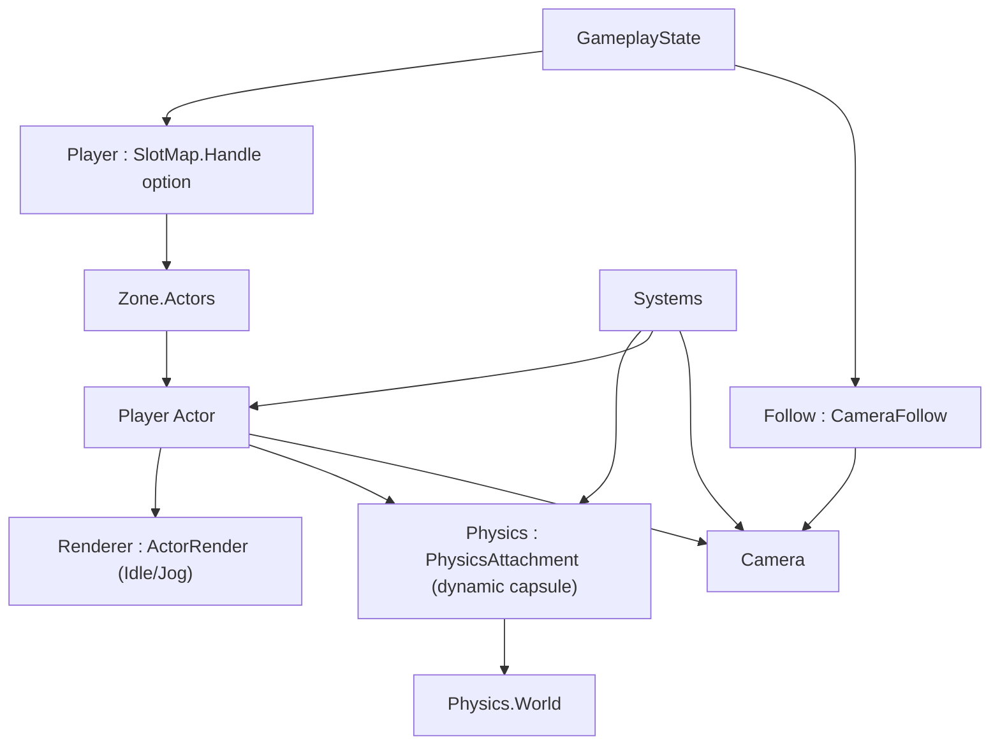

# Data Model: Walk Around

Phase 7 adds a player binding and a play-mode system chain that drives the actor's
existing dynamic capsule body. The binding is a value-type `SlotMap.Handle option`
(index + generation). There is no separate character object and no locomotion copy:
while playing, the actor's physics body and entity transform are the source of
truth. Camera-follow parameters are the only new gameplay state.



## Player binding — `state/GameplayState.fs`

```fsharp
[<Struct>]
type GameplayState =
    { ...
      mutable Player : SlotMap.Handle option   // top level; index+generation into Zone.Actors
      mutable Follow : Systems.CameraFollow }   // camera-follow parameters
```

- `Player` is a slot handle into `Zone.Actors` (index + generation), resolved with
  `Actors.IsAlive` + `Actors.Get` (by reference); it is the only gate for the player
  systems. `None` ⇒ every player system is inert.
- It is not an `EntityRef`: the player is always an actor, so the editor-facing
  kind/epoch fields would be dead weight. An index+generation handle is enough to
  make a deleted or recycled slot fail resolution.
- `Set as Player` records only this handle. It does not create or change physics,
  seed motion state, or register any callback. Play/edit is a flag that includes or
  excludes the systems.
- The binding is play-binding state, **not** an undoable scene command.

### Binding lifecycle

| Event | Effect |
|---|---|
| *Set as Player* on an actor | `Player <- Some handle` (replaces any previous binding) |
| *Set as Player* on a non-actor | rejected loudly (expected-use guard) |
| Bound actor deleted | binding unchanged; `Actors.IsAlive` fails ⇒ systems inert (no clear step) |
| Bound actor's slot recycled by a different entity | generation mismatch ⇒ systems inert |
| Enter/leave play mode | binding unchanged; nothing is created, reset, or destroyed |

## Player body — the actor's dynamic capsule

No new state: the player's position, velocity, and facing live on the actor's
existing `PhysicsAttachment<CapsuleCollider>` body and its entity `Transform`.

- The capsule body is **dynamic** with rotation locked (`AllowedDOFs` = translations
  only) and sleeping disabled, so it receives gravity and collision but stays
  upright.
- The body's position is the capsule centre; the entity's `Transform.Position` is
  the feet (`centre - (HalfHeight + Radius) * up`).
- Facing is the body's yaw about world `+Y`; the locomotion system reads it from the
  actor's transform and writes it back. The actor renderer's Z-up fix is applied
  after the entity transform, so a yaw about `+Y` turns the character horizontally.
- The editor's `Zone.setTransform` recreates the body, so an actor moved while
  editing keeps body and transform consistent without an enter-play sync.

## Camera-follow state — `world/Systems.fs`

```fsharp
[<Struct>]
type CameraFollow =
    { mutable Yaw : float32   // mirrors the player's facing (derived each frame)
      Pitch : float32         // elevation above the pivot; default 0.35 rad (~20deg)
      Distance : float32      // offset back from the player; default 4.0
      Height : float32 }      // pivot above the player's feet; default 1.7
```

- `Yaw` is derived from the player's facing; nothing drives it directly.
- `Pitch`, `Distance`, and `Height` are tuning constants for this phase, starting
  from the defaults above.

## Tuning constants

Starting values for this phase (single constant per axis; no sprint/variants):

| Constant | Value | Unit |
|---|---|---|
| Jog speed | 3.5 | units/s |
| Turn rate | 2.5 | rad/s (~143deg/s) |
| Camera pitch (elevation) | 0.35 | rad |
| Camera distance | 4.0 | units |
| Camera height | 1.7 | units |

Gravity is not a tuning constant here: it is the physics world's gravity
(`-9.81` on `Y`), applied to the dynamic body by the physics step.

## Physics adapter — `physics/Physics.fs`

```fsharp
// Changed: actor capsules become dynamic with rotation locked (translations only).
val createCapsuleBody : world:World -> position:Vector3 -> halfHeight:float32 -> radius:float32 -> BodyId

// Added: read/write the actor body that locomotion drives.
val getBodyVelocity : world:World -> BodyId -> Vector3
val setBodyVelocity : world:World -> BodyId -> velocity:Vector3 -> unit
val setBodyRotation : world:World -> BodyId -> rotation:Quaternion -> unit
val getBodyTransform : world:World -> BodyId -> Vector3 * Quaternion
```

- The adapter stays a leaf: no `Entity`, `Zone`, or GPU dependency.
- `createMeshBody`/`step`/`destroyBody`/`setBodyTransform`/`raycast` are unchanged.
- `World` additionally retains the collision filters and `PhysicsSystemSettings` it was
  created from: Jolt's `PhysicsSystem` keeps raw pointers to them, so a collected filter
  wrapper silently disables collision (dynamic actors fall through the world).
- No `CharacterVirtual` wrapper and no per-player creation: the existing actor body
  is the player body.

## System chain

Run by `GameplayScreen.update` for the whole of play mode (and never while editing),
in this order:

| Order | System | Reads | Writes | Inert when |
|---|---|---|---|---|
| 1 | `playerInput` | `Physics`, `Zone`, `Player`, `Input`, `dt` | actor body velocity (xz) + rotation | no player / stale |
| — | `Physics.step` | world (gravity + collisions) | world | while editing |
| 2 | `syncActors` | `Physics`, `Zone` | every actor's entity transform (in place) | while editing |
| 3 | `cameraFollow` | `Zone`, `Player`, `Follow` | `Follow.Yaw`, `Camera` | no player / stale |
| 4 | `animate` | `Zone`, `Player`, `Input` | actor animation slot | no player / stale |

Each player system resolves the bound player with `isPlayerLive` and returns without
touching anything when it is absent or stale. `syncActors` is not player-gated: it runs
for every actor whenever the world steps. The world is stepped for all of play mode
(`Physics.step`), so a play session with no player still simulates.

## Validation rules

- *Set as Player* only accepts an actor; a non-actor target raises (constitution
  II).
- A player asset must provide `Idle` and `Jog` clips; a missing clip raises
  (content bug, not a silent fallback).
- `syncActors` writes every actor's entity transform only; it never touches a body (the
  body is authoritative while playing). Body recreation remains the editor's
  `Zone.setTransform` path. It is not player-gated: all actors are simulated, so an
  unsynced one would keep rendering where it was placed while its collider moved away.
- `Physics.step` runs for all of play mode and not while editing, so dynamic actors
  do not fall while the editor is open; a play session with no player bound still
  simulates the world but drives no character.
- The idle/jog choice is derived from held movement keys (`W`/`A`/`S`/`D`).

## Relationships

- `Systems` → `Entity`, `Zone`, `Physics`, `Camera`, `Input` (no `state/`).
- `GameplayState` → `Systems` (composes `CameraFollow`).
- `GameplayScreen` → `Systems` + `SharedState` (drives the order and the play gate).
- Compile order: `world/Systems.fs` after `world/Zone.fs`, before `state/`.
- `ActorRender` gains a clip-switch helper; `Physics` gains body
  velocity/rotation/transform accessors and makes actor capsules dynamic.
