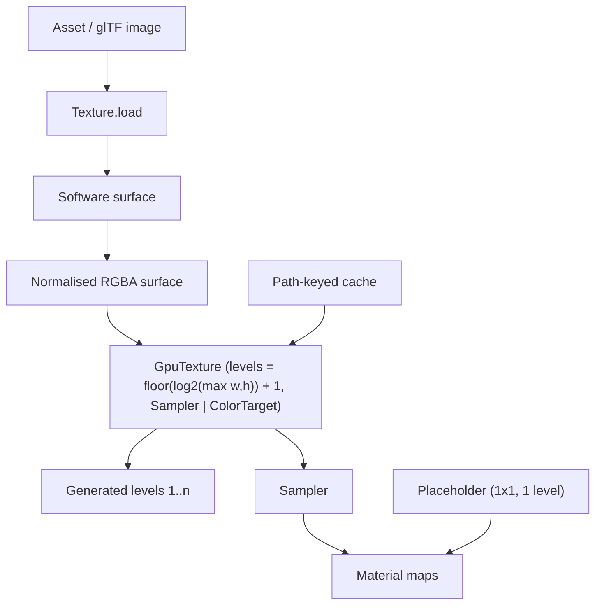

# Data Model: Texture Mipmaps

The feature adds no new state. It changes how one existing entity — a decoded
texture — is created: from a single-level GPU texture to one with a complete
level chain. The shared placeholder stays as it is.



## Texture — `render/Texture.fs`

```fsharp
[<Struct>]
type Texture =
    { Device : Gpu.Device
      Handle : Gpu.Texture        // created with a full level chain
      Sampler : Gpu.Sampler }     // unchanged: linear/linear/linear, repeat
```

- `Handle` is created with `NumLevels = floor(log2(max(Width, Height))) + 1` and
  usage `Sampler | ColorTarget`, so its level chain runs from the base image to
  1×1 (`ColorTarget` is required by level generation).
- `Sampler` is unchanged; it already samples levels.
- The only fields are the existing ones — no level count or size is stored,
  because nothing reads them after creation.

### Level chain

| Property | Rule |
|---|---|
| Level count | `floor(log2(max(width, height))) + 1`, minimum 1 |
| Level 0 | the decoded, normalised image (FR-003) |
| Levels 1..n | generated by SDL at load, outside any pass (FR-002) |
| Non-square / NPOT | sized to the largest dimension (FR-005) |
| 1×1 placeholder | exactly one level; no generation (FR-009) |

### Upload staging (transient)

| Value | Purpose |
|---|---|
| Software surface | decoded pixels; source of level 0 |
| Normalised layout | 32-bit RGBA byte order, shared by all textures (FR-004) |
| Packed rows | surface rows with pitch padding removed before upload |

These are load-time locals, not retained state.

## Material maps — `render/Texture.fs` / `world/Assets.fs`

- A `Material` binds up to four textures (albedo, normal, metallic-roughness,
  emissive) in fixed order; each present map is a texture with a completed chain.
- Absent maps use the shared 1×1 placeholder, which is valid without a chain.
- `world/Assets.fs` caches textures by absolute path, so a map shared by several
  materials or assets is prepared once (FR-008). No change is needed there.

## Validation rules

- A decode, conversion, or texture-creation failure raises with the source path
  (constitution II, FR-007); there is no mip-less fallback.
- Preparation runs at load only; the per-frame path neither creates textures nor
  generates levels (FR-008, SC-004).
- The placeholder is never routed through the surface/conversion path.

## Relationships

- `Texture.load` → SDL_image (decode) → SDL surface helpers (normalise) →
  SDL_gpu (create, upload, generate).
- `world/Assets.fs` → `Texture.load`, memoised by path.
- Pipelines and shaders are unchanged: the sampler already expects levels.
