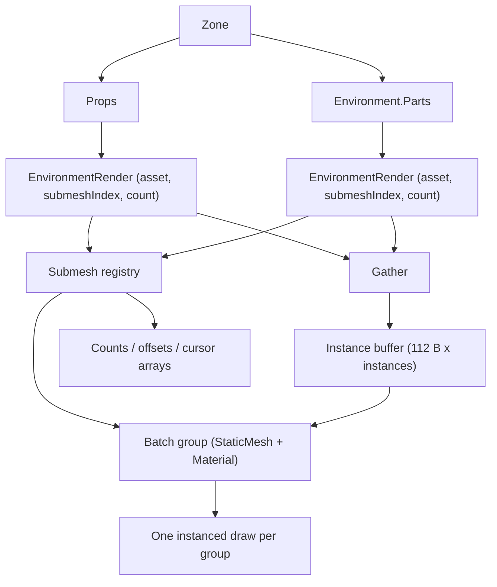

# Data Model: Instanced Static Draws

The feature adds a per-frame instance buffer and a dense submesh registry. It
adds no persistent world state: `EnvironmentRender` remains the per-instance data
holder and the existing `StaticMesh` buffers are reused unchanged.

## Submesh identity and registry — `world/EnvironmentBatch.fs`

A dense, grow-only registry gives each **distinct shared submesh** an integer
slot. The identity is the submesh as uploaded (its `StaticMesh` buffers); parts
and props that reference the same `StaticSubmesh` collapse to the same slot.

| Field | Meaning |
|---|---|
| `Mesh : StaticMesh` | the shared vertex/index buffers (slot 0 of the draw) |
| `Material : Texture.Material` | the material (fragment uniform + samplers) |

- Key: the uploaded submesh's identity, established at asset load. Two assets that
  share a submesh *index* but not the submesh get **different** slots (FR-002).
- Slots are appended as new submeshes are first seen; the registry only grows.
- A lookup miss for a submesh that exists is a bug and raises (constitution II).

## Instance data — `render/InstanceBuffer.fs`

Per instance, 112 bytes, all `Float4`, fed through vertex-buffer slot 1
(`InputRate = Instance`, `InstanceStepRate = 0`):

| Location | Contents | Offset |
|---|---|---|
| 3 | model row 0 | 0 |
| 4 | model row 1 | 16 |
| 5 | model row 2 | 32 |
| 6 | model row 3 | 48 |
| 7 | normal row 0 | 64 |
| 8 | normal row 1 | 80 |
| 9 | normal row 2 | 96 |

`model = Entity.modelMatrix transform * r.OrientationMatrix`; `normal = normalMatrix model`.
Rows are written in the existing component order, so the shader rebuilds the same
matrices as the previous pushed uniform (FR-003, FR-005).

Grow-only GPU `Vertex` buffer + transfer buffer + reused CPU staging `byte array`.
The buffer starts empty; the first `gather` sizes it to the scene's instance
count, so it does not grow each frame. If the scene later grows, the new buffer
is created and the old one is retained on a retired list until it can no longer
be referenced by an in-flight frame, then released. Growth is not a per-frame
cost (FR-010).

## Gather plan (pure) — testable headless

Per frame, over the union of `Zone.Props` and `environment.Parts`:

| Step | Input | Output |
|---|---|---|
| Count | each instance's registry slot | `counts : int[]` indexed by slot |
| Prefix-sum | `counts` | `starts : int[]` (group byte offset = `start * 112`) |
| Ensure | total instance count | instance buffer capacity ≥ total (sizes it on the first gather) |
| Reclaim | retired buffers from earlier growth | buffers older than `MAX_FRAMES_IN_FLIGHT` released |
| Fill | instances + `cursor : int[]` (copy of `starts`) | model/normal rows in the staging buffer |

This arithmetic is pure and is the unit-tested core
(`test/EnvironmentBatchTests.fs`), including the case where two assets contribute
the same submesh index but must land in different slots.

## Batch group

| Field | Meaning |
|---|---|
| `Slot` | registry slot (identity) |
| `Start` | first instance index for the group (`starts.[slot]`) |
| `Count` | number of instances (`counts.[slot]`) |
| `Mesh`, `Material` | from the registry slot |

A group with `Count = 0` draws nothing. The draw issues
`DrawGPUIndexedPrimitives(IndexCount, Count, 0, 0, 0)` after binding slot 0 (the
submesh's vertex buffer), slot 1 (the instance buffer at `Start * 112`), and the
index buffer, with `viewProj` pushed once for the whole block and the material
pushed per group.

## Validation rules

- Two assets with the same submesh index MUST occupy different registry slots
  (FR-002); the test asserts this.
- A submesh range that runs past its asset's `Submeshes` raises.
- A grown instance buffer's predecessor MUST NOT be released while a submitted
  frame may still reference it (keep it on the retired list until it is safe).
- Registry slots are dense; counts/starts arrays are resized only when the
  registry grows, never per frame.
- The gather covers both props and environment parts (FR-006).

## Relationships

- `EnvironmentBatch` → `Zone`, `Entity`, `EnvironmentRender`, `StaticMesh`,
  `Texture`, `Gpu`, `InstanceBuffer`, `Camera`.
- `screen/GameplayScreen.renderScene` owns the batch: gather + upload in a copy
  pass, then one `EnvironmentBatch.render` inside the scene pass.
- `render/InstanceBuffer.fs` → `Gpu` only (no `world` dependency).
- Actors (`ActorRender`, mesh pipeline) and debug draws are unchanged.
