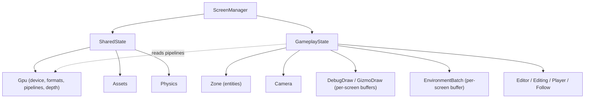

# Data Model: Shared Render Resources

The feature moves fields between two existing state records; it introduces no new
entity. The boundary it draws:

- **Shared state** (reference type, lives for the app): the device and its
  derived render resources, the asset manager, and the physics world.
- **Screen state** (per screen): that screen's entities, view, per-screen render
  buffers, and editor/play state.



## SharedState — `state/SharedState.fs`

```fsharp
type SharedState =
    { mutable Gpu : Gpu.Gpu    // moved in: the single owner of device-derived resources
      Assets : Assets.AssetManager
      Physics : Physics.World }
```

- `Gpu` bundles the device, the swapchain and depth formats, the mesh and static
  pipelines, and the depth target. It is the **only** owner of the pipelines.
- The field is mutable so the depth target can be recreated on resize through the
  same owner.
- `create` now takes the `Gpu` context (which carries the device), so
  `Assets.scan` reads the device from it — no separate device argument.

## GameplayState — `state/GameplayState.fs`

```fsharp
[<Struct>]
type GameplayState =
    { mutable Camera : Camera.Camera
      mutable DebugDraw : DebugDraw.DebugDraw
      mutable GizmoDraw : DebugDraw.DebugDraw
      Batch : EnvironmentBatch.EnvironmentBatch
      Zone : Zone.Zone
      mutable Editor : EditorState.EditorState
      mutable Editing : bool
      mutable Player : SlotMap.Handle option
      mutable Follow : Systems.CameraFollow }
```

- **Removed**: `MeshPipeline`, `StaticPipeline` (they now live on `SharedState.Gpu`).
- **Kept**: every field that describes the screen — entities (`Zone`), view
  (`Camera`), per-screen render buffers (`DebugDraw`, `GizmoDraw`, `Batch`), and
  editor/play state.
- `create` takes shared state (for the device the per-screen buffers need) and no
  longer receives pipelines.

## Ownership table

| Resource | Owner | Reason |
|---|---|---|
| Device, swapchain format, depth format | `SharedState.Gpu` | device-wide, created once |
| Mesh pipeline, static pipeline | `SharedState.Gpu` | device-wide, shared by any scene |
| Depth target | `SharedState.Gpu` (mutable) | recreated on resize; must be the one the pass reads |
| `DebugDraw`, `GizmoDraw` | `GameplayState` | per-screen view buffers |
| `EnvironmentBatch` | `GameplayState` | per-screen static-scene renderer for its zone |
| `Camera` | `GameplayState` | screen view state |
| `Zone`, editor/play state | `GameplayState` | screen entities + interaction |

## Render entry point

`GameplayScreen.renderScene` gains the shared state so it can read the pipelines:

```fsharp
// Before: renderScene (state) (pass)                      — read state.MeshPipeline / state.StaticPipeline
// After:  renderScene (shared) (state) (pass)             — read shared.Gpu.MeshPipeline / shared.Gpu.StaticPipeline
```

`ScreenManager.renderScene` already has `m.Shared` and passes it through.

## Validation rules

- No device-level render resource may be a field of `GameplayState` (SC-001).
- Each pipeline MUST be referenced from exactly one owning value; no copies
  (SC-002).
- Depth-target recreation MUST mutate `SharedState.Gpu` in place, so the target
  the pass reads is the current one (FR-005).
- Per-screen buffers MUST remain on `GameplayState` and obtain the device from
  shared state (FR-006, SC-005).
- Creation order unchanged: the GPU context is created after the device and
  released before it (FR-008).

## Relationships

- `ScreenManager` → `SharedState` (owns) + `GameplayState` (owns).
- `GameplayState` reads device resources through `SharedState` at construction and
  at render time; it does not own them.
- `world/`, `render/`, physics, and commands are unchanged.
