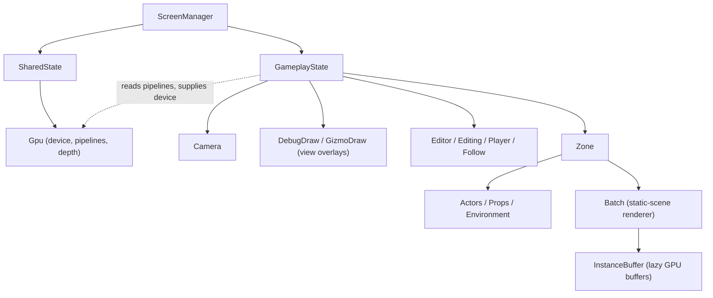

# Data Model: Zone-Owned Static Batch

The feature moves one field from the screen state to the zone and makes the
batch's GPU buffers lazy. No entity is added; the ownership boundary becomes:

- **Zone**: its entities *and* the batch that renders its static scene.
- **Screen state**: the screen's view (camera), its view overlays (debug lines,
  gizmos), and editor/play state.



## Zone — `world/Zone.fs`

```fsharp
type Zone =
    { Name : string
      Actors : SlotMap<Actor>
      mutable Environment : Environment option
      Props : SlotMap<Prop>
      Batch : EnvironmentBatch.EnvironmentBatch   // added: the zone's static-scene renderer
      mutable NextEnvironmentEpoch : uint32
      BodyToEntity : Dictionary<Physics.BodyId, EntityRef> }

// Unchanged: no device, so headless zones stay valid.
val create : unit -> Zone

// Convenience: gather this zone's static scene through its own batch.
val gatherStatic : device:Gpu.Device -> zone:Zone -> unit
```

- `Batch` is created device-free by `create` (`EnvironmentBatch.create ()`).
- `gatherStatic` passes the zone's `Props` and its environment's `Parts` to the
  batch, so the batch type need not reference `Zone` (breaking the compile cycle).

## Static-scene batch — `world/EnvironmentBatch.fs` (moved before `Zone.fs`)

```fsharp
type EnvironmentBatch = { Instances : InstanceBuffer.InstanceBuffer; Registry; Counts; Starts; Cursor; … }

val create : unit -> EnvironmentBatch                       // device-free, allocates nothing

// CPU pass: register identities, count, ensure capacity (allocates on first use),
// prefix-sum, and fill transforms from the given maps.
val gather  : device:Gpu.Device -> batch:EnvironmentBatch ->
              props:SlotMap<Prop> -> parts:SlotMap<Prop> voption -> unit

val upload  : device:Gpu.Device -> batch:EnvironmentBatch -> cmd:Gpu.CommandBuffer -> unit
val render  : batch:EnvironmentBatch -> renderPass:Gpu.RenderPass -> cmd:Gpu.CommandBuffer ->
              pipeline:Gpu.Pipeline -> viewProjection:Matrix4x4 -> light:Light -> cameraPos:Vector3 -> unit
val release : device:Gpu.Device -> batch:EnvironmentBatch -> unit
```

- No `Zone` parameter — the gather walks the maps it is given.
- The device is required only where GPU memory is touched (`gather` to size the
  buffer, `upload`, `release`).

## Instance buffer — `render/InstanceBuffer.fs`

```fsharp
[<Struct>]
type InstanceBuffer =
    { mutable Buffer : Gpu.Buffer            // IntPtr.Zero until first ensure
      mutable Transfer : Gpu.TransferBuffer
      mutable Capacity : int
      mutable Staging : byte array
      mutable Retired : (Gpu.Buffer * Gpu.TransferBuffer * int) list }

val create  : unit -> InstanceBuffer                                       // no device, no allocation
val ensure  : device:Gpu.Device -> buf:byref<InstanceBuffer> -> instances:int -> unit
val upload  : device:Gpu.Device -> buf:InstanceBuffer -> cmd:Gpu.CommandBuffer -> usedBytes:int -> unit
val reclaim : device:Gpu.Device -> buf:byref<InstanceBuffer> -> unit
val release : device:Gpu.Device -> buf:byref<InstanceBuffer> -> unit       // frees current + retired
val binding : buf:InstanceBuffer -> start:int -> SDL.GPUBufferBinding
```

- `Device` moved off the struct (it is passed where needed), so an unrendered
  buffer never needs a device.

## GameplayState — `state/GameplayState.fs`

```fsharp
[<Struct>]
type GameplayState =
    { mutable Camera : Camera.Camera
      mutable DebugDraw : DebugDraw.DebugDraw
      mutable GizmoDraw : DebugDraw.DebugDraw
      Zone : Zone.Zone
      mutable Editor : EditorState.EditorState
      mutable Editing : bool
      mutable Player : SlotMap.Handle option
      mutable Follow : Systems.CameraFollow }

val create : debugDraw:DebugDraw.DebugDraw -> gizmoDraw:DebugDraw.DebugDraw -> GameplayState
```

- **Removed**: `Batch`. **Reverted**: `create` no longer takes shared state (it
  only needed it for the batch's device).

## Ownership table

| Resource | Owner | Reason |
|---|---|---|
| Static-scene batch (registry, counts, instance buffer) | `Zone` | derived entirely from the zone's content |
| Instance buffer GPU memory | `Zone` (via its batch) | freed with the zone; allocated lazily |
| Camera | `GameplayState` | the screen's view state |
| Debug lines, gizmos | `GameplayState` | view overlays, not zone content |
| Pipelines, device, depth | `SharedState.Gpu` | device-wide (unchanged from 019) |

## Validation rules

- `Zone.create ()` MUST NOT allocate GPU memory or require a device (FR-004).
- Each zone MUST own a distinct batch instance (FR-002).
- `gather`/`upload`/`release` MUST be called with the batch's own zone's maps,
  never another zone's (FR-002).
- `release` MUST free the current buffer and any retired buffers (FR-005) and MUST
  run before the device is destroyed.
- Compile order: `EnvironmentBatch.fs` before `Zone.fs`; `Zone.fs` before `Systems`.
  `EnvironmentBatch` must not reference `Zone` (edge case: no cycle).

## Relationships

- `Zone` → `EnvironmentBatch` (owns), `EnvironmentRender` (via `Prop.Renderer`).
- `EnvironmentBatch` → `InstanceBuffer`, `StaticMesh`, `Texture`, `Gpu`;
  `gather` reads `SlotMap<Prop>` and `Entity.modelMatrix`.
- `GameplayScreen.renderScene` → `shared` (device + pipelines) and `state.Zone`
  (the batch).
- No change to physics, commands, or the entity model.
