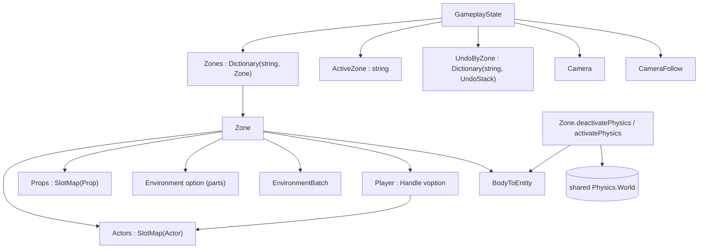

# Data Model: Multiple Zones

Phase 8 turns the single `GameplayState.Zone` into a name-keyed dictionary of zones
with one active zone, moves the player designation onto the zone, and scopes undo
history per zone. A zone is unchanged internally (its actor/prop/environment/parts
slot maps and its static-scene batch); it gains a player designation and a physics
lifecycle for being deactivated, reactivated, and released on deletion.



## Zone container — `state/GameplayState.fs`

There is no separate `ZoneMap` type or module; the map is a dictionary and the
active zone is its key, both held on `GameplayState`.

```fsharp
[<Struct>]
type GameplayState =
    { mutable Camera : Camera.Camera
      mutable DebugDraw : DebugDraw.DebugDraw
      mutable GizmoDraw : DebugDraw.DebugDraw
      Zones : Dictionary<string, Zone>          // name -> zone; the key is the identity
      mutable ActiveZone : string               // exactly one active zone name
      mutable Editor : EditorState.EditorState
      mutable Editing : bool
      mutable Follow : Systems.CameraFollow
      UndoByZone : Dictionary<string, Command.UndoStack> }  // per-zone history

// The active zone (one dictionary lookup).
val activeZone : state:GameplayState -> Zone

// Switch the active zone: save the outgoing undo stack, swap physics, clear the
// zone-scoped selection/drag/nudge, load the incoming undo stack, re-frame camera.
// An unknown name raises.
val switchZone : shared:SharedState.SharedState -> state:byref<GameplayState> -> name:string -> unit

// Add a new empty zone under `name` and make it active. An empty or duplicate name
// raises.
val addZone : shared:SharedState.SharedState -> state:byref<GameplayState> -> name:string -> unit

// Delete a zone and release everything it owns. Raises when it is the last zone or
// the name is unknown. Deleting the active zone first makes another zone active.
val deleteZone : shared:SharedState.SharedState -> state:byref<GameplayState> -> name:string -> unit
```

- `create` seeds one zone named `main` (the app's starting world) and sets
  `ActiveZone` to it.
- `addZone` inserts an empty zone and makes it active (spec FR-003); it rejects an
  empty or duplicate name.
- `deleteZone` rejects deleting the last zone; if the name is active it first
  switches to another zone (which detaches the outgoing bodies and re-frames the
  camera), then calls `Zone.release` on the deleted zone and removes its `Zones`
  and `UndoByZone` entries (research Decision 11).
- `switchZone` validates the name (`Zones.ContainsKey`; unknown raises), no-ops when
  the name is already active, deactivates the outgoing zone's bodies, flips
  `ActiveZone`, then activates the incoming zone's bodies.
- `Player` is removed from `GameplayState`; the designation now lives on the active
  zone (research Decision 4).
- `UndoByZone` keeps each zone's `UndoStack`, keyed by the zone name; the live
  stack is still `Editor.Undo`, swapped in on a switch (research Decision 5).
  `switchZone` and `addZone` clear `Selection`, `Drag`, and `NudgeBefore` (all
  zone-scoped) and re-frame the camera; `deleteZone` discards the deleted zone's
  stack (research Decision 8, Decision 11).
- The zones list sorts by name because dictionary enumeration order is unspecified.

### Naming input — `render/ImGui.fs` + `state/EditorState.fs`

- `render/ImGui.fs` gains an `inputText` P/Invoke over cimgui's `igInputText`
  (already exported by the vendored library).
- `EditorState` gains `NewZoneName : byte[]` — one reusable UTF-8 buffer, allocated
  once in `create`. The Zones section decodes it up to the first NUL and clears it
  on a successful add.

## Zone additions — `world/Zone.fs`

```fsharp
type Zone =
    { Actors : SlotMap<Actor>
      mutable Environment : Environment option
      Props : SlotMap<Prop>
      Batch : EnvironmentBatch.EnvironmentBatch
      mutable NextEnvironmentEpoch : uint32
      BodyToEntity : Dictionary<Physics.BodyId, EntityRef>
      mutable Player : Handle voption }  // designation: which actor is the avatar

// Detach every body the zone owns from the shared simulation (RemoveBody), so it
// neither collides nor is stepped. Bodies, shapes, renderers, and Physics
// attachments are left intact.
val deactivatePhysics : zone:Zone -> world:Physics.World -> unit

// Re-attach every body (AddBody) and rebuild the broadphase.
val activatePhysics : zone:Zone -> world:Physics.World -> unit

// Release everything the zone owns for deletion: destroy its bodies, release its
// actors'/props'/parts' renderers, release its EnvironmentBatch, clear BodyToEntity.
val release : zone:Zone -> world:Physics.World -> device:Gpu.Device -> unit
```

- The zone stores no name; its name is its key in `GameplayState.Zones`, so there
  is no second copy that could desync.
- `Player` is a `SlotMap.Handle` (index + generation) into `Actors` — not an
  `EntityRef`, since the player is always an actor and the kind/epoch fields would
  be dead weight. `ValueNone` means the zone drives no character. A deleted or
  recycled actor makes the designation inert via `Actors.IsAlive`; no clear step.
- `deactivatePhysics`/`activatePhysics` call `Physics.removeBody`/`addBody` on each
  attached body (actors, placed props, environment parts); nothing is destroyed or
  rebuilt, so mesh-shape BVHs and `Physics` attachments survive a switch and
  renderers are never touched. Activation finishes with `OptimizeBroadPhase`
  (adding many bodies one at a time degrades the broadphase).
- `release` is only for deletion: it destroys the zone's bodies and frees its GPU
  resources, so add/delete cycles do not leak (spec FR-015).

## Systems — `world/Systems.fs`

The player systems drop the `player` parameter and read `zone.Player`:

```fsharp
val isPlayerLive : zone:Zone -> bool
val playerInput  : world:Physics.World -> zone:Zone -> input:Input -> dt:float32 -> unit
val cameraFollow : zone:Zone -> follow:byref<CameraFollow> -> camera:byref<Camera.Camera> -> unit
val animate      : zone:Zone -> input:Input -> unit
```

`playerHandleOf : EntityRef -> Handle` is unchanged (the editor still uses it to
designate an actor).

## Editor — `editor/Outliner.fs` and `screen/GameplayScreen.fs`

- The Outliner draws a **Zones** collapsing header at the top, above the scene
  objects: one select row per zone (the active one marked, with a *Del* button),
  plus a name text field and an *Add Zone* button. Selecting a row calls
  `GameplayState.switchZone`; *Del* calls `GameplayState.deleteZone`; *Add Zone*
  calls `GameplayState.addZone` with the typed name (offered only when the name is
  non-empty and unused).
- `GameplayScreen.update`/`renderScene` resolve the active zone once with
  `GameplayState.activeZone state` and use it (and its batch) for the frame.
- `Editor`, `Outliner`, `Inspector`, `AssetBrowser`, `Selection`, and `Spawning`
  resolve the active zone the same way instead of reading `state.Zone`.

## State transitions — switching zones

| From | Action | Effect |
|---|---|---|
| editing, zone A active | select zone B | A's bodies detached; `ActiveZone <- B`; B's bodies attached + broadphase optimized; selection/drag cleared; undo stack swapped; camera re-framed on B |
| editing, zone A active | add zone C (typed name) | C inserted and made active; A's bodies detached; selection/drag cleared; fresh undo stack; camera to origin |
| editing, same zone selected | select zone A | no-op |
| editing | add zone with an empty/duplicate name | rejected; no zone created |
| editing, zone A active | delete inactive zone B | B's bodies destroyed and GPU resources released; B removed; `A` stays active; camera unchanged |
| editing, zone A active | delete active zone A (B remains) | switch to B (A's bodies detached, B's attached, camera re-framed); then A destroyed and released and removed |
| editing, one zone only | delete it | rejected; the project keeps one active zone |
| play mode | — | switching is unavailable (the zones section draws only while editing) |

## Validation rules

- Invalid editor actions are prevented at the source: the Zones section does not
  offer *Add Zone* for an empty or already-used name, nor *Del* for the last zone.
  The container guards below are therefore preconditions (a UI-skipping caller is a
  bug), not expected-failure handling.
- Adding a zone with an empty or already-used name raises (`invalidOp`); the editor
  does not offer the add in that case.
- Switching to an unknown zone name raises (`invalidOp`).
- Deleting the last remaining zone raises (`invalidOp`); deleting an unknown zone
  raises. A deleted zone's undo history is discarded (deletion is not undoable).
- A non-actor cannot be designated: `Systems.playerHandleOf` raises for a non-actor
  kind (unchanged from phase 7).
- `Zone.activatePhysics` is only meaningful while the zone's `Environment` (if any)
  is still installed; the switch path never clears it, so part colliders resolve.
- A designation whose actor was deleted or whose slot was recycled is inert (the
  generation fails `Actors.IsAlive`); no explicit clearing occurs.
- Inactive zones' bodies are detached from the simulation (not added to the
  broadphase); `BodyToEntity` still maps them, but a raycast reaches only attached
  bodies.

## Relationships and compile order

- `GameplayState` → `Zone`, `Command` (for `UndoStack`), `Systems` (camera follow),
  `EditorState`, `Camera`, and `Dictionary`. Compiles last in `state/`; no new
  `world/` module is introduced.
- `Outliner` → `GameplayState` + `SharedState`. Compiles after `state/`.
- `Engine` → iterates `manager.Gameplay.Zones.Values` for shutdown and uses
  `GameplayState.activeZone` for the stats line.
- `render/ImGui.fs` gains `inputText`; `state/EditorState.fs` gains the name buffer.
