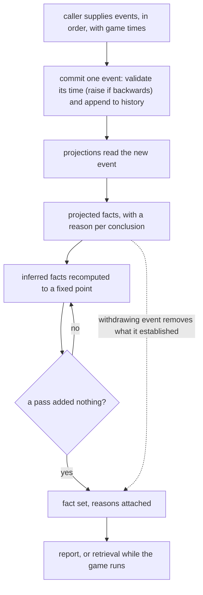

# Phase 1 Data Model: Narrative Core

**Feature**: `025-narrative-core` | **Date**: 2026-09-16 | **Spec**: [spec.md](./spec.md) | **Plan**: [plan.md](./plan.md) | **Research**: [research.md](./research.md)

Terminology follows the spec: a **derived fact** is any fact, projected from an event
or inferred from other facts. Where this document needs to distinguish how one was
arrived at it says *projected* or *inferred* (research D7).

---

## 1. The vocabulary

The vocabulary is closed: these types are the whole of it. Names are unique across all
of them, so a construct's name identifies it unambiguously in canonical text.

### Character

```fsharp
type Character =
    | Aiko | Akane | Shinji | Yuki            // the four the scenarios and quickstart use
    | Ayumi | Daichi | Haruka | Hina | Kaito | Kaede | Mei | Misaki
    | Naoki | Natsuki | Ren | Rin | Sakura | Shouta | Sora | Tsubasa
```

The roster: everyone who can exist in the story, and twenty of them, which is the cast size
the success criteria are stated at (research D28). A union rather than a `string`, so a name
cannot be misspelled, so matching on a character is exhaustive, and so no part of a
character's identity depends on a string comparison.

A character's name is its case name, which is what canonical text writes. Nothing reads that
text back, so the name need not be a stable identifier across versions: renaming a case is
safe, because there is no saved history for it to invalidate (research D32). It is a distinct
type from an ordinary `string` field, which is what lets `Vocabulary` name the participants
of a construct as characters rather than as text.

Being in the roster is not the same as being in the story: an `Arrived` event records that a
character entered it, but gates nothing, so a character can be in the roster long before she
walks into it, and any event may name any roster member (spec Amendments, 2026-09-19).

### Trait

```fsharp
type Trait = Shy | HotHeaded
```

### Event

| Construct | Fields | Participants | Interchangeable |
|---|---|---|---|
| `Arrived` | `Character` | 1 | — |
| `TraitAssigned` | `Character`, `Trait` | 1 | — |
| `FriendshipStarted` | `Character`, `Character` | 2 | — |
| `FriendshipEnded` | `Character`, `Character` | 2 | — |
| `CrushStarted` | `Character`, `Character` | 2 | — |
| `CrushEnded` | `Character`, `Character` | 2 | — |
| `RelationshipStarted` | `Character`, `Character` | 2 | — |
| `RelationshipEnded` | `Character`, `Character` | 2 | — |

No event declares its participants interchangeable. History records what happened,
including who acted, so an event's argument order is part of the record — normalising it
would report the wrong actor. The normalisation belongs on the facts a projection
concludes, which is where a withdrawal looks for what to remove (research D22).

### Fact

| Construct | Fields | Participants | Interchangeable |
|---|---|---|---|
| `HasTrait` | `Character`, `Trait` | 1 | — |
| `Friends` | `Character`, `Character` | 2 | yes |
| `AttractedTo` | `Character`, `Character` | 2 | — |
| `InRelationship` | `Character`, `Character` | 2 | yes |
| `JealousOf` | `Character`, `Character` | 2 | — |
| `FriendshipThreatened` | `Character`, `Character` | 2 | — |
| `BottledUpFeelings` | `Character`, `Character` | 2 | — |

### Construct metadata — read from the construct or stated once

Construct metadata is either read from the construct or stated once, never described ahead of
time (research D21, D30, D31):

| Property | How | Read by |
|---|---|---|
| Name | `nameof` where the encoder writes it | the encoder, and nothing else |
| Participants | stated once, in `Vocabulary.factParticipants` | the participant index, and a character's own facts |
| Construct, as a value | `Vocabulary.factKind`, a closed union of the fact constructs | the participant index, and the pass restriction (research D34) |
| Interchangeable | a reordering arm in `Vocabulary.sortParticipants`, which names every case, so adding a construct is reported there | storage: every fact passes through it on add, withdraw and lookup |

Nothing describes a construct in advance: there is no record of a construct's shape, because the
only thing that would read one is a registry to keep in step (research D31). A construct's *name* is
now read by the encoder and by nothing else — the index and the pass restriction use `factKind`, so
no longer keys anything by a rendering (research D34).

What is *not* derived at all is the encoded text itself. Asking the type what a value is cost
~17 µs a call against ~0.3 µs written out, and that difference was nearly all of a commit's time
(research D30).

---

## 2. History

### GameTime

```fsharp
[<Struct>]
type GameTime = GameTime of int   // minutes since the simulation's origin
```

Supplied by the caller with every event (spec FR-024). Pre-existing setup uses negative
values. The engine has no clock.

### CommittedEvent

| Field | Type | Notes |
|---|---|---|
| `Index` | `int` | dense, assigned in commit order; breaks ties between equal game times (spec FR-023) |
| `Time` | `GameTime` | must not be less than the preceding event's; a commit that would violate this raises `TimeWentBackwards` |
| `Event` | `Event` | immutable once committed |

### History

Append-only and ordered. Never modified, removed or reordered — not by later
events and not when the rule set changes (spec FR-002). Held newest-first as a list, so an append
conses one event and copies nothing already committed, and a new event's index comes from the
newest event's own index, which is the committed count (research D29).
Canonical text renders it one committed event per line, in commit order (research D1); it is
output only, not a format anything reads back.

---

## 3. Current facts

### Premise

A reason cites what its rule applied to, which differs by category: a projection applies
an *event*, a derivation applies *facts*.

```fsharp
type Premise =
    | FromEvent of Event
    | FromFact  of Fact
```

### Reason

| Field | Type | Notes |
|---|---|---|
| `Rule` | `RuleId` | the rule's name, unique across the rule set |
| `Premises` | `Premise list` | the order the rule bound them in; canonicalised for identity |

Identity of a reason is the rule together with the premises it applied to *as a set* — F#'s
structural comparison, not a text rendering (research D34). Two reasons applying the same rule to
the same premises are the same reason and only one is retained (spec FR-010). A reason whose
premises stop holding stops being offered (spec FR-012).

### FactSet

A `Map<Fact, Reason list>`: a fact, and why it holds. The fact is its own identity, so there is no
second representation of it to disagree with, and the comparison is F#'s structural one on the value
(research D33). The reasons are canonically ordered, and a fact's interchangeable participants are put
in canonical order *as it is stored* — `Vocabulary.sortParticipants`, which is where
interchangeability is declared.

Order for anything a reader sees is a rendering decision and is made where rendering happens: a read
path reports the map's own order — the value's structural order, which follows the vocabulary's
*declaration* order — so `Facts.toList` and `Facts.ofCharacter` are comprehensions rather than sorts,
and `Harness.report` sorts by canonical text ordinally (research D34). Comparison is ordinal
throughout, because the default comparer is culture-sensitive and would make spec FR-021 false in a
locale nobody tested in.

Beside it, an **index of facts by construct and participant**, keyed by `FactKind` and a `Character`
rather than by a construct's name, built once for the projected set and extended as each fixpoint pass
concludes. It exists so a rule whose premise can be settled by an argument it has already bound looks
the facts up instead of re-scanning every fact of that construct (research D7). It is derived, never
authored.

### Canonical text

```
Construct(arg, arg, ...)
```

Construct name, then each argument in field order, separated by `, `. A `Character`
renders as its name, a `Trait` as its case name. Where the construct declares its
participants interchangeable, the arguments are already in canonical order *on the value* —
`Vocabulary.sortParticipants` put them there as the fact was stored — so the two ways of writing
such a fact are one fact and render identically (spec FR-009, clarification 1; research D22, D33).

Nothing stores, keys or identifies a value by this text (research D34).

---

## 4. Rules

A rule is one of two categories and can be nothing else (spec FR-017), which the type
system enforces rather than a validation pass (research D10).

| | Projection | Derivation |
|---|---|---|
| Reads | the event being committed | the fact set |
| Writes | facts, instantiated through the establishing event's bindings | facts |
| Optional | a withdrawing event that removes what it established (D19) | — |
| Satisfies | spec FR-008's first half | spec FR-008's second half |

Both carry a name, and the constructs they mention are derived from their premises, which
is what lets a later fixpoint pass skip rules that cannot have changed (research D7).

A rule's premises are captured by the builder from its bindings rather than written by
hand, so attribution is a property of the notation (research D24).

---

## 5. Run state

### Engine

| Field | Type | Notes |
|---|---|---|
| `History` | append-only | section 2 |
| `Facts` | `FactSet` | section 3 |
| `Rules` | `Rule list` | section 4 |
| `Bound` | `int` | completed premise matches allowed per commit; default 1,000,000 (research D9) |

### Scenario

| Field | Type | Notes |
|---|---|---|
| `Name` | `string` | |
| `InitialHistory` | `(GameTime * Event) list` | the starting situation as pre-existing events (spec FR-003). A scenario names an arrival as an `Arrived` event |
| `Steps` | `(GameTime * Event) list` | committed in order |

### Report

History and facts in canonical form, every fact followed by the rules and premises
supporting it. Stable and diffable, so a failed assertion can attach it whole (spec
FR-026, FR-028). The same retention is what the running game reads when it asks why a
fact holds (spec FR-010, clarification 2).

---

## 6. Flow



---

## 7. Validation rules

Each is a failure, raised as an exception naming what it was about (spec FR-028), rather than a
silently tolerated condition. The two a commit can raise — `TimeWentBackwards` and
`DerivationBoundExceeded` — leave the caller a usable engine, because a commit that raises has
changed nothing (spec FR-013).

| Rule | Trigger | Source |
|---|---|---|
| Construct names unique | checked once at startup over the whole vocabulary | canonical text must be unambiguous |
| Game times non-decreasing | a commit whose time precedes the previous one | research D8 |
| Derivation bound | completed premise matches exceed `Bound` | spec FR-014 |
| Rule names unique | a rule set with two rules of the same name | reason identity, spec FR-010 |

Not a failure, deliberately: an event no rule matches is accepted and concludes nothing
(spec FR-006); an event naming a character who has not arrived is accepted, because naming any
roster member is admissible (spec Amendments, 2026-09-19); a withdrawing event with nothing to
withdraw is a no-op (research D19);
and semantic oddity — an ending for something that never began — is history recording
what happened, with the rules deciding what it means. An event the vocabulary does not
have is not a failure either, and not a tolerated condition: it cannot be built, because
events arrive as typed values from a closed union.

---

## 8. State transitions

| From | Event | To |
|---|---|---|
| a fact is absent | a rule concludes it | reported, with that reason attached |
| a fact is reported | another rule concludes it | reported once, with both reasons attached (spec FR-009) |
| a fact is reported | its reason's premises stop holding | still reported if another reason survives, otherwise absent (spec FR-011) |
| a projected fact is reported | the withdrawing event arrives | absent |
| an inferred fact is reported | recomputation no longer concludes it | absent |
| a fact is reported | the rule set is replaced | recomputed; history untouched (spec FR-020) |

Never: a committed event changing, being removed, or being reordered (spec FR-002).
