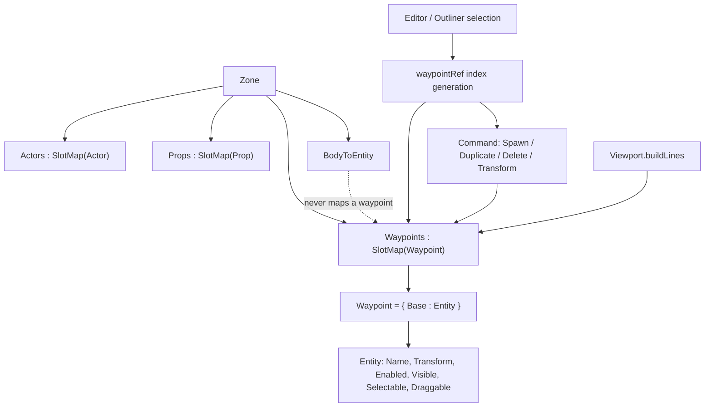

# Data Model: Waypoints

Phase 10's waypoints slice makes a waypoint a first-class zone entity: it
composes the shared `Entity` base instead of carrying a bare position, it lives
in its own generational slot map on the zone, and it carries nothing else — no
renderer, no body, no asset binding. Reusing the entity/ref/command model is the
whole design: it is what makes selection, transform, duplicate, delete, and undo
work on a waypoint without new machinery.



## Waypoint — `world/Entity.fs`

```fsharp
// A point of interest placed in a zone: where to stand (the base transform's
// position) and which way to face (its rotation). Composes the shared base entity
// like actors and props, so the editor can select, drag, and rotate it, but carries
// no renderer, collider, or asset binding.
[<Struct>]
type Waypoint =
    { Base : Entity }
```

```fsharp
// A ref to a waypoint: kind Waypoint, the slot's index and generation, epoch 0
// (epochs scope environment *parts* only).
val waypointRef : index:uint32 -> generation:uint32 -> EntityRef
```

- The record is a struct composing `Entity` (`Name`, mutable `Transform`,
  `Enabled`, `Visible`, `Selectable`, `Draggable`), exactly like `Actor` and
  `Prop` compose it. There is no inheritance and no heap wrapper.
- A waypoint's position and facing are the base transform's `Position` and
  `Rotation`; the facing *direction* is `Vector3.Transform(-Vector3.UnitZ,
  Rotation)` (research Decision 4). `Scale` is carried because the shared
  `Transform` has it, but a waypoint does not use it.
- `Trigger` is unchanged (`{ Position : Vector3 }`) and remains unstored.

## Zone storage and operations — `world/Zone.fs`

```fsharp
type Zone =
    { Name : string
      Actors : SlotMap<Actor>
      mutable Environment : Environment option
      Props : SlotMap<Prop>
      Waypoints : SlotMap<Waypoint>      // + new: capacity 128
      Batch : EnvironmentBatch.EnvironmentBatch
      mutable NextEnvironmentEpoch : uint32
      BodyToEntity : Dictionary<Physics.BodyId, EntityRef>
      mutable Player : Handle voption }
```

```fsharp
// A binding with no asset, for kinds that carry none (waypoints).
val bindingNone : AssetBinding        // { AssetId = None; SubmeshIndex = 0; SubmeshCount = 0 }
```

Extended operations, each gaining a waypoint case:

| Operation | Waypoint behaviour |
|---|---|
| `isAlive` | `zone.Waypoints.IsAlive(handleOf ref)` — a waypoint ref is now live, where it was unconditionally dead before. `Environment` and `Trigger` remain never alive. |
| `tryEntityAt` | `Some waypoint.Base` for a live ref, `None` for a stale or absent one. This is what makes the editor's gizmo, inspector, focus, drag, and nudge work on a waypoint with no branch of their own. |
| `setTransform` | Writes `Base.Transform` into the slot in place; no-op for a stale or absent ref (as for actors and props). No body to recreate. |
| `removeEntity` | `Waypoints.Free(handleOf ref)` when alive; no-op otherwise. Nothing to destroy or release. |
| `setActorWithAsset` | `ensureSlotFree zone.Waypoints ref` then `Waypoints.Occupy(handleOf ref, { Base = entity })` — the restore path for a deleted waypoint, ignoring the binding. |
| `bindingAt` | Returns `bindingNone`. Every other kind without a binding still raises. |

```fsharp
// Spawn a waypoint from its base entity and return its ref. Waypoints carry no
// renderer or body, so no world/assets are needed.
val spawnWaypoint : zone:Zone -> entity:Entity -> EntityRef
```

- `spawnWaypoint` is the only spawn that needs neither the physics world nor the
  asset manager.
- `BodyToEntity` never gains a waypoint entry: a waypoint has no body, so no
  raycast, contact, or body→entity lookup can reach one.

## Editor creation — `editor/Spawning.fs`

```fsharp
// Spawn a waypoint into the active zone and push the command that reverses it,
// selecting the new waypoint.
val spawnWaypoint : state:byref<GameplayState.GameplayState> -> entity:Entity -> unit
```

- `duplicate` gains a `Waypoint` case: `Zone.spawnWaypoint` plus a `Duplicate`
  command carrying `bindingNone`. Duplicating a kind with no entity
  (`Environment`, `Trigger`) still raises.
- Creation must go through this module: `Zone.spawnWaypoint` is only ever called
  here (or in tests), so every spawn is paired immediately with the command that
  reverses it. The alternative — an untracked `Add` — could let a slot named by an
  already-recorded command be reused, and a later undo would hit a taken slot.
- `Selection.duplicateRef` and `Selection.deleteRef` are unchanged: they resolve
  the selected ref through `Zone.tryEntityAt` and `Zone.bindingAt`, both of which
  now answer for a waypoint.

## Editor UI — `editor/Outliner.fs` and `editor/Viewport.fs`

- `Outliner` gains a **Waypoints** collapsing header at the end of the entity
  sections, after the existing **Triggers** header:
  - a row per waypoint (built with the shared `entityRow`: the name selects on
    click, with inline *Del* and *Dup* buttons);
  - *Add Waypoint* — `newWaypoint "Waypoint" transformIdentity`;
  - *Add at Camera* — `newWaypoint "Waypoint" { transformIdentity with Position =
    camera.Position; Rotation = <camera rotation> }`, where the rotation is
    `Quaternion.CreateFromRotationMatrix(Matrix4x4.CreateWorld(camera.Position,
    Camera.forward camera, camera.Up))`;
  - "(none)" when the zone has no waypoints.
  - `newWaypoint (name) (transform)` builds the base entity with
    `Enabled = Visible = Selectable = Draggable = true`.
- `Viewport.buildLines` appends a marker per live waypoint: a wireframe box at
  the position, a facing shaft to `position + forward * gizmoLen` (0.75), and
  four head barbs from the shaft's tip to `basePoint ± right` and
  `basePoint ± up`, where `basePoint = tip - forward * headLen` (0.25) and
  `right`/`up` are the rotation's local X/Y axes scaled by `headRadius` (0.12).
  Colour is the selection colour when selected, white otherwise. The marker
  respects the gizmo accumulator's depth test (drawn after meshes, occluded by
  geometry).

## State transitions

| From | Action | Effect |
|---|---|---|
| editing, zone A active | *Add Waypoint* | waypoint appended to A's `Waypoints` at the origin; selected; `Spawn` pushed |
| editing, zone A active | *Add at Camera* | as above, at the camera's position and view-facing rotation |
| waypoint selected | move/rotate via gizmo or nudge | `Transform` written in place; consecutive moves merge into one undo step |
| waypoint selected | *Dup* in its row | a second waypoint with the same base at a new slot; the copy selected; `Duplicate` pushed |
| waypoint selected | *Del* in its row | slot freed, selection cleared, `Delete` pushed; undo re-occupies the recorded slot with the recorded entity |
| waypoint exists | switch to another zone | A's waypoints stay in A, dormant with the rest of its contents; no marker is drawn while A is inactive |
| play mode | — | waypoints are inert: nothing reads or simulates them, and the editor sections are not drawn |

## Validation rules

- A waypoint ref resolves only against `Zone.Waypoints`, and only while its
  generation matches the slot. A stale ref resolves to `None` and cannot alias a
  waypoint that reused the index.
- `setTransform` and `removeEntity` on a stale or absent waypoint ref are no-ops,
  matching actors, props, and parts.
- `setActorWithAsset` on a slot that is not free raises (`ensureSlotFree`). This
  is the guard that turns an untracked spawn into a loud bug rather than silent
  corruption.
- `bindingAt` returns `bindingNone` for a waypoint and raises for a kind with no
  binding and no waypoint rule; `bindingNone` is only meaningful for a waypoint,
  whose restore path ignores it.
- Duplicating `Environment` or `Trigger` raises (no entity to copy); duplicating
  a waypoint does not.
- A waypoint never has a physics attachment, renderer, or asset id, so no code
  path may assume one exists. Nothing in `physics/` or `render/` knows about
  waypoints.
- A waypoint's facing is well defined for every rotation (the head uses the
  rotation's own perpendicular axes). The camera-seeded rotation is well defined
  wherever the camera's look-at basis is, which is the same precondition the
  camera already has.

## Relationships and compile order

- `world/Entity.fs` (Waypoint record, `waypointRef`) → `world/Zone.fs`
  (`Waypoints`, the operations above) → `editor/Spawning.fs` →
  `editor/Outliner.fs` / `editor/Viewport.fs` → `screen/`. No new file is added
  and no compile-order entry changes.
- `state/Command.fs` is unchanged and still compiles after `Zone`: its commands
  name refs and entities only, and a waypoint is reached through the existing
  kind dispatch in `Zone` — the dependency direction is untouched.
- `Viewport` reads `Camera.forward`/`Camera.Up` for the camera-seeded rotation via
  `Outliner`; `render/Camera.fs` still precedes `editor/`.
- Tests: `test/EntityTests.fs` (the `Waypoint` shape), `test/ZoneTests.fs` (refs,
  transform, removal, slot reuse, own map), `test/SpawningTests.fs` (duplicate,
  delete + undo). All are headless — no display is needed.
