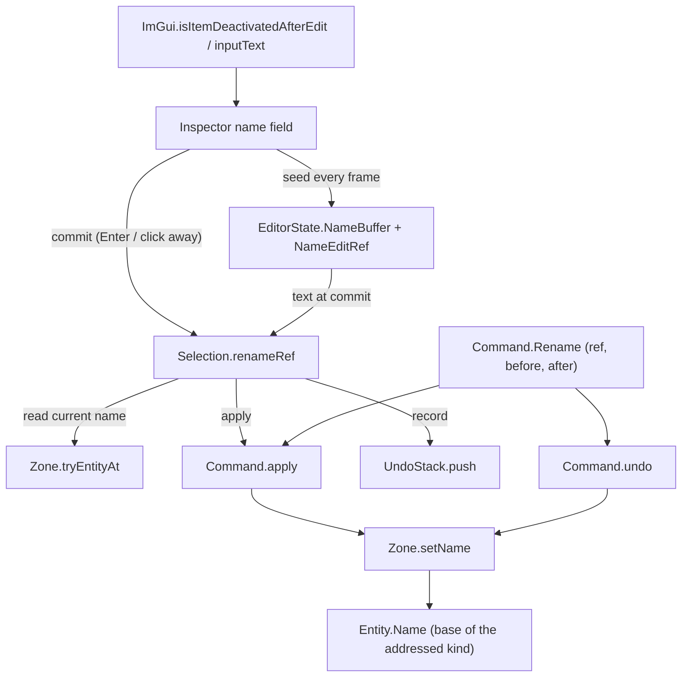

# Data Model: Entity Rename

The feature adds no entity type and no storage. A name stay a `string` on the
shared `Entity` base; what is new is a way to change it undoably (`Command.Rename`
+ `Zone.setName`), a `Selection` entry point that applies and records it, and one
reused text buffer in the Inspector that commits at the right moment.



## Undo command — `state/Command.fs`

```fsharp
type Command =
    | Spawn of Ref : EntityRef * Entity : Entity * Binding : AssetBinding
    | Delete of Ref : EntityRef * Entity : Entity * Binding : AssetBinding
    | Duplicate of Ref : EntityRef * Entity : Entity * Binding : AssetBinding
    | Transform of Ref : EntityRef * Before : Transform * After : Transform
    | Rename of Ref : EntityRef * Before : string * After : string   // + new
    | SetEnvironment of Previous : Environment option * Next : Environment option
```

- `apply` writes `After`, `undo` writes `Before`, both through `Zone.setName`.
  They need neither the physics world nor the assets, but keep the shared
  `apply`/`undo` signatures.
- `UndoStack.push`'s merge rule matches only consecutive `Transform` pairs, so a
  rename is always its own step and never folds into a transform.

## Zone storage — `world/Zone.fs`

```fsharp
// Change an existing entity's name at the ref (Actor/Prop/Part/Waypoint). No-op for
// other kinds or a stale/absent ref. A name is a label, not an identity, so the
// same name may be given to more than one entity.
val setName : zone:Zone -> ref:EntityRef -> name:string -> unit
```

| Ref kind | Behaviour |
|---|---|
| `Actor` | When the slot is live, `actor <- { actor with Base = { actor.Base with Name = name } }`. |
| `Prop` | Same, in `zone.Props`. |
| `Waypoint` | Same, in `zone.Waypoints`. |
| `Part` | Same, in the environment's part map resolved via `partsFor`. |
| `Environment`, `Trigger` | No-op (no base entity to name). |
| stale/absent ref | No-op. |

- No physics, renderer, binding, or `BodyToEntity` involvement: a name does not
  affect where an entity is, what it collides with, or how it draws.
- The dispatch mirrors `setTransform`'s existing per-kind shape. `Entity.Name`
  stays immutable and the payload is reassigned, as `setTransform` already does
  for transforms.

## Selection operation — `editor/Selection.fs`

```fsharp
// Which entity a finished name-field edit should rename, and to what. Pure: it takes
// the owner ref (the entity the text was typed for, never the current selection), the
// field's commit signal, and the text. None means "commit nothing".
val renameTarget : owner:EntityRef option -> finished:bool -> text:string -> (EntityRef * string) option

// Rename a specific entity as one undoable step. No-op when the ref no longer
// resolves or the name is unchanged; raises on an empty name (the UI never
// commits one).
val renameRef : shared:SharedState.SharedState -> state:byref<GameplayState.GameplayState> -> ref:EntityRef -> name:string -> unit
```

- `renameTarget` holds the decision the Inspector used to make inline, so it can be
  tested headlessly: the attribution rule (FR-005) and the empty-name rule (FR-004)
  are asserted in `test/SelectionTests.fs` rather than argued from ImGui's internals.
- `renameRef` mirrors `deleteRef`: resolve the entity (`Zone.tryEntityAt`), build the
  command from the current and new names, `Command.apply` it, then `UndoStack.push` it.
  Selection, drag, and nudge state are left untouched — a rename must not disturb
  what the author is doing.

## Field state — `state/EditorState.fs`

```fsharp
// The entity-name field's buffer, and the ref the buffer's text belongs to. The
// buffer is re-seeded from the selected entity every frame; `NameEditRef` records
// which entity the text was typed for, so a pending edit is never applied to a
// different one.
[<Literal>]
let entityNameBufferSize = 256      // bytes; holds UTF-8's worst case for the limit below
[<Literal>]
let entityNameMaxChars = 63         // characters the field accepts

[<Struct>]
type EditorState =
    { ...
      NewZoneName : byte[]          // existing: the Outliner's zone-name field
      NameBuffer : byte[]           // + new: the Inspector's entity-name field
      NameEditRef : EntityRef option }  // + new: which entity the buffer describes
```

- Both buffers are allocated once in `EditorState.create`.
- `NameEditRef` is set in the same step as each seed, so at the start of a frame
  it always names the entity the buffer's text belongs to. On commit the text goes
  to that entity; the field then takes ownership of the current selection.

## Binding additions — `render/ImGui.fs`

```fsharp
// The one new P/Invoke (already exported by the vendored libcimgui.so):
[DllImport("cimgui", EntryPoint = "igIsItemDeactivatedAfterEdit", CallingConvention = CallingConvention.Cdecl)]
extern bool isItemDeactivatedAfterEdit()

// Input-text flags used by the name field (values from cimgui.h):
let enterReturnsTrue = 1 <<< 6      // 64:   submitting the field reports true
let autoSelectAll = 1 <<< 12        // 4096: opening the field selects the name
```

Existing binding reused unchanged:
`inputText(label, buf, bufSize, flags, callback, userData)`.

## Inspector field — `editor/Inspector.fs`

`Inspector.draw` gains `shared` (its only call site, `Editor.draw`, is updated).

Per frame, with a selection and its entity `e`:

1. **Seed** — encode `e.Name` into `NameBuffer` (at most `entityNameMaxChars`
   characters), NUL-terminate it, and set `NameEditRef <- Some ref`. This is safe
   while the field is active: ImGui's in-widget text takes priority over the
   buffer, so the seed cannot disturb typing, and on the frame the user replaces
   the name the engine has already written the final text back.
2. **Draw** — `inputText("Name", buffer, length, enterReturnsTrue ||| autoSelectAll, 0, 0)`
   (a visible label, so the field is distinguishable from the read-only rows below
   it).
3. **Commit** — `finished` is true when the call returned true (Enter) or
   `isItemDeactivatedAfterEdit()` is true (left the field after an edit). The
   Inspector then asks `Selection.renameTarget` what to commit: the buffer's text up
   to the first NUL, the owner ref from `NameEditRef`, and `finished`. `None` (not
   finished, nothing was being edited, or the text is empty or whitespace-only)
   commits nothing, and the next frame's seed restores the field; `Some (ref, name)`
   calls `Selection.renameRef`, which itself does nothing when the name is
   unchanged, so a no-op edit adds no undo step.

The rest of the panel is unchanged: name, position, rotation, and scale, plus the
actor-only collider toggle and *Set as Player*.

## State transitions

| Field state | Action | Effect |
|---|---|---|
| unfocused, entity selected | frame drawn | buffer seeded from the entity's name; no command |
| focused, unchanged | frame drawn | seed ignored by ImGui; no command, no undo step |
| focused | typing | ImGui owns the text; no command, no undo step |
| focused, edited | Enter | one `Rename` step applied and pushed; field shows the new name |
| focused, edited | click elsewhere | same as Enter (`IsItemDeactivatedAfterEdit`) |
| focused, unedited | click elsewhere | nothing committed, no undo step |
| focused, edited to empty | Enter or click away | nothing committed; field reverts on the next frame |
| focused for entity A, another entity B selected by clicking its row | click | the edit is committed to **A** (it was typed for A), the field then owns B, and B's name is shown from the next frame |
| focused for entity A, A deleted | click | the pending edit is dropped (`setName` no-ops on a dead ref); nothing is created |
| unfocused | undo/redo of a rename | the entity's name changes and the field shows it on the next frame |
| none selected | — | no field is drawn; the buffer is inert |

## Validation rules

- An empty or whitespace-only name is never committed; `Selection.renameRef` raises
  (`invalidOp`) if called with one, as a precondition (the editor's commit gate is
  what prevents it).
- A committed name is trimmed of leading and trailing whitespace.
- A name identical to the entity's current name pushes no command, so it adds no
  undo step.
- A rename addressed to a ref that no longer resolves is a no-op: nothing is
  created, nothing is resurrected, no other entity changes.
- `setName` is defined for the four stored kinds; for `Environment` and `Trigger`
  refs it does nothing rather than raising, matching `setTransform`.
- Names are not unique and are not validated for uniqueness; no code path resolves
  an entity by name.
- A rename never changes the transform, asset binding, physics attachment,
  renderer, or selection. It allocates only the two strings the command holds.
- The field is not drawn when there is no selection, so no rename can be addressed
  to "nothing".

## Relationships and compile order

- `state/Command.fs` compiles after `world/Zone.fs` and gains a case whose
  apply/undo call `Zone.setName`; the dependency direction is unchanged.
- `state/EditorState.fs` → `Entity` (for `EntityRef`) and gains two fields, both
  allocated in `create`. `GameplayState.fs` composes it and is unchanged.
- `editor/Selection.fs` → `Zone`, `Command`, `Spawning` (existing) and gains
  `renameRef`; `editor/Inspector.fs` → `Selection`, `EditorState`, `ImGui`, and
  `Zone` (existing reads).
- `render/ImGui.fs` gains one P/Invoke and two constants; it compiles before
  `editor/` and depends on nothing new.
- Tests: `test/ZoneTests.fs` (extended) and `test/SelectionTests.fs` (new, and
  registered in `test/fsharp-game.Tests.fsproj` between `SpawningTests.fs` and
  `PlayerTests.fs`).
