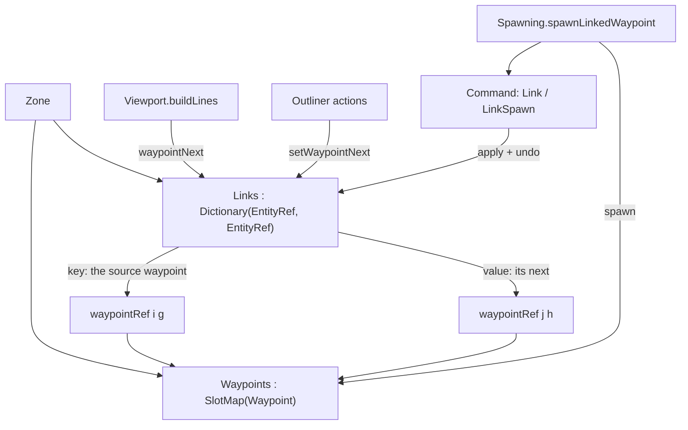

# Data Model: Waypoint Chains

A chain is a succession of waypoints, held as a **zone-level map from a waypoint's
reference to the reference of its next**. The waypoint record itself is unchanged:
the link is a relationship between two entities, kept with the zone exactly as
`BodyToEntity` is, and resolved through the same generation-checked references the
rest of the editor addresses entities with.



## The link map — `world/Zone.fs`

```fsharp
type Zone =
    { Name : string
      Actors : SlotMap<Actor>
      mutable Environment : Environment option
      Props : SlotMap<Prop>
      Waypoints : SlotMap<Waypoint>
      // Which waypoint each waypoint's chain continues at. Keyed by the source, so a
      // waypoint has at most one next; a missing entry means it ends a chain. Entries
      // keyed by (or pointing at) a deleted waypoint are inert, never pruned — see
      // research Decisions 2 and 4.
      Links : Dictionary<EntityRef, EntityRef>
      Batch : EnvironmentBatch.EnvironmentBatch
      mutable NextEnvironmentEpoch : uint32
      BodyToEntity : Dictionary<Physics.BodyId, EntityRef>
      mutable Player : Handle voption }
```

```fsharp
// The waypoint a waypoint's chain continues at, if that link still resolves: the
// source must be a live waypoint, the link must exist, and its target must resolve as
// a live waypoint. Pure — an unresolvable link is left in place, since it becomes live
// again if undo restores its waypoint.
val waypointNext : zone:Zone -> ref:EntityRef -> EntityRef option

// Point a waypoint at another (`Some target`), or end its chain (`None`). Refuses a
// self-link and a target that is not a waypoint; both are preconditions the editor's
// disabled actions make unreachable.
val setWaypointNext : zone:Zone -> ref:EntityRef -> next:EntityRef option -> unit
```

- `Zone.create` initialises `Links = Dictionary()`.
- A new waypoint has no entry, so it starts a chain; a duplicated waypoint has no
  entry, so a copy starts its own chain (spec Assumptions).
- `Zone.setTransform`/`setName` do not touch the map, so moving or renaming a
  waypoint preserves its link with no code.
- Aliveness of the source and target is decided by `Zone.isAlive`, which is
  generation-checked, so a link can never resolve to a waypoint that reused a slot.

## Commands — `state/Command.fs`

```fsharp
type Command =
    | ...
    // A link edit: the next before and after, either of which may be absent.
    | Link of Ref : EntityRef * Before : EntityRef option * After : EntityRef option
    // The extend gesture: create a waypoint and link `From` to it, as one step.
    | LinkSpawn of From : EntityRef * Before : EntityRef option * Ref : EntityRef * Entity : Entity
```

| Command | `apply` | `undo` |
|---|---|---|
| `Link (r, _, after)` | `setWaypointNext zone r after` | `setWaypointNext zone r before` |
| `LinkSpawn (from, _, r, entity)` | occupy `r` with the waypoint (the existing waypoint branch of `setActorWithAsset`), then `setWaypointNext zone from (Some r)` | `setWaypointNext zone from before`, then `removeEntity zone physics r` |

- `Link` carries both sides, so undo and redo are exact even when the previous
  next was another waypoint. It never merges: `UndoStack.push` merges only
  consecutive `Transform` commands, so one link edit is always one step.
- `LinkSpawn` is composite because the gesture changes two things and must be one
  undo step; it mirrors the reference's `Waypoint_spawn_next`.

## Authoring — `editor/Spawning.fs` and `editor/Selection.fs`

```fsharp
// Create a waypoint in the active zone at the camera, link `from` to it, push the one
// command that reverses both, and select the new waypoint.
val spawnLinkedWaypoint : state:byref<GameplayState.GameplayState> -> from:EntityRef -> entity:Entity -> unit
```

```fsharp
// Point `ref` at `next` (`Some`), or break its link (`None`), as one undoable step.
// No-op when it already points there.
val linkRef : shared:SharedState.SharedState -> state:byref<GameplayState.GameplayState> -> ref:EntityRef -> next:EntityRef option -> unit
```

- `linkRef` mirrors `renameRef`/`deleteRef`: resolve the current next, build the
  `Link` command from it and the wanted one, apply it, push it. Selection and drag
  are untouched — retargeting a chain does not change what is being edited.
- `spawnLinkedWaypoint` follows `spawnWaypoint`'s rule: the spawn and the command
  that reverses it are recorded together, so a recorded ref can never name a slot
  a later untracked spawn reused.

## Editor surface — `editor/Outliner.fs`

The Waypoints section, in the order it is drawn:

| Control | Offered | Enabled when | Does |
|---|---|---|---|
| *Add Waypoint* | always | — | a waypoint at the origin (unchanged) |
| *Add at Camera* | always | — | a waypoint at the camera (unchanged) |
| *Add Next at Camera* | always | a waypoint is selected | `Spawning.spawnLinkedWaypoint` with a waypoint built at the camera position and view-facing rotation |
| *Unlink* | always | the selected waypoint has a resolvable next | `Selection.linkRef … None` |
| per-waypoint row: `Link` | after the shared *Del*/*Dup* buttons on each row | a *different* waypoint is selected | `Selection.linkRef … (Some rowRef)` |

- Disabled, not hidden, so the buttons do not move as the selection changes
  (research Decision 8).
- The row's `Link` button reuses the section's existing pattern: `entityRow`
  leaves the line open, so the waypoint section appends its own `sameLine` +
  `smallButton` after it, and `entityRow` itself is untouched.

## Connectors — `editor/Viewport.fs`

`buildLines`, inside the existing per-waypoint iteration:

1. `waypointNext zone (waypointRef i gen)` — nothing to draw when it does not resolve.
2. Resolve the target's position through `Zone.tryEntityAt`.
3. Draw, in `linkColor` (200, 122, 255): a line from the waypoint to the segment's
   midpoint lifted `0.08` in Y, then two wings `0.07` either side of the direction's
   perpendicular from a base `0.15` back from the midpoint.
4. Skip entirely when the two positions are within `0.001` (a zero direction has no
   arrow, and normalising it would produce invalid vertices).

## State transitions

| From | Action | Effect |
|---|---|---|
| waypoint selected, camera placed | *Add Next at Camera* | a new waypoint exists at the camera, the selected one links to it, the new one is selected; one `LinkSpawn` step |
| waypoint selected, another's row | row `Link` | the selected waypoint's next becomes that waypoint (replacing any previous next); one `Link` step |
| waypoint selected with a next | *Unlink* | it has no next; one `Link` step |
| two waypoints linked | either is moved or renamed | the connector and the link are unchanged — the link is a reference, not a position |
| mid-chain waypoint deleted | *Del* | the chain stops at the link that pointed to it; the links that *ran through* it stay in the map, inert |
| delete of a mid-chain waypoint | undo | the waypoint's slot is re-occupied with the same generation, so both inert links resolve again and the chain is whole; one step |
| the deleted waypoint's slot | reused by a new waypoint | the old links do not resolve to the newcomer (generation mismatch) |
| linked waypoint in the active zone | zone switch | the link map is the zone's, so it travels with it; no connectors are drawn for the inactive zone |

## Validation rules

- A waypoint has at most one next, structurally: the map is keyed by the source.
- `setWaypointNext` raises on a self-link (`invalidOp`) and on a source or target
  that is not a waypoint kind. Both are unreachable through the editor, which
  disables the actions that could produce them.
- `setWaypointNext` does *not* require the target to be alive: the `Link` command's
  undo may restore a link whose target is momentarily gone, and such a link is
  inert rather than wrong.
- `waypointNext` requires the source to be alive, the entry to exist, and the
  target to resolve; anything else is `None` and no mutation.
- An entry is never pruned. It cannot resolve to a waypoint other than the one it
  was made to, and it cannot be addressed by a waypoint that reused a slot.
- Links are zone-scoped by construction: the map is a field of the zone, and the
  editor only offers the active zone's waypoints.
- No production code walks a chain, so no rule depends on a chain being acyclic;
  a loop and a shared successor are both representable and untouched.

## Relationships and compile order

- `world/Zone.fs` gains one field and two functions; it already depends on
  `Entity` (refs) and `Physics`, so nothing new is imported.
- `state/Command.fs` compiles after `Zone` and gains two cases whose apply/undo
  call `Zone.setWaypointNext` / `setActorWithAsset` / `removeEntity` — the existing
  direction.
- `editor/Spawning.fs` → `Zone` + `Command`; `editor/Selection.fs` → `Zone` +
  `Command`; `editor/Outliner.fs` → both; `editor/Viewport.fs` → `Zone` (already).
- Tests extend `test/ZoneTests.fs`, `test/SpawningTests.fs`, and
  `test/SelectionTests.fs`; no new test file, so `test/fsharp-game.Tests.fsproj` is
  unchanged.
