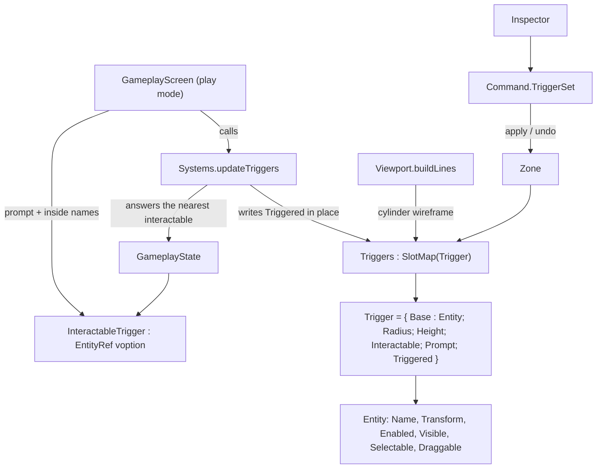

# Data Model: Triggers

A trigger is a zone entity: it composes the shared `Entity` base and adds the
volume's shape, its interaction settings, and its per-frame inside state. Storage,
addressing, and the edit path are the ones `specs/026-waypoints` established for a
new stored kind, so nothing about the command or editor machinery changes.



## The payload — `world/Entity.fs`

```fsharp
// A cylindrical volume that detects the player: where its base sits (the base
// transform's position), how far it reaches up, and how wide it is. Composes the
// shared base entity like actors, props and waypoints, but carries no renderer,
// collider, or asset. `Triggered` is runtime state — whether the player was inside
// as of the last update — and is never authored.
[<Struct>]
type Trigger =
    { Base : Entity
      Radius : float32
      Height : float32
      Interactable : bool
      Prompt : string
      mutable Triggered : bool }

val triggerRef : index:uint32 -> generation:uint32 -> EntityRef
```

- `Position` is the centre of the base; the volume extends up by `Height` and is
  radially symmetric, so `Rotation` never affects containment (FR-002).
- `Base.Enabled` is the trigger's *disabled* flag: a disabled trigger never reports
  the player inside. The field means nothing anywhere else in the port today, so
  no second flag is introduced (spec Assumptions).
- `Base.Transform.Scale` is not the volume's size (FR-014): radius and height are
  the size, and scale is ignored by both the containment rule and the wireframe.
- `Triggered` is `mutable` because the update writes it in place every frame, the
  same reason `Transform`'s fields are mutable.

## Zone storage and writes — `world/Zone.fs`

```fsharp
type Zone =
    { ...
      Props : SlotMap<Prop>
      Waypoints : SlotMap<Waypoint>
      Triggers : SlotMap<Trigger>       // + new: capacity 32
      Links : Dictionary<EntityRef, EntityRef>
      ... }

// Replace a trigger's payload (its shape, flags, and prompt). Raises for a ref of
// another kind; no-op for a stale or absent one.
val setTrigger : zone:Zone -> ref:EntityRef -> trigger:Trigger -> unit
```

Extended operations, each gaining a trigger case (as waypoints already did):

| Operation | Trigger behaviour |
|---|---|
| `isAlive` | a live `Triggers` slot makes the ref alive |
| `tryEntityAt` | `Some trigger.Base` — which is what gives the editor selection, the gizmo, focus, nudge, rename and undo for free |
| `setTransform` | writes `Base.Transform` in place; no body to recreate |
| `removeEntity` | frees the slot; nothing to destroy |
| `setActorWithAsset` | occupies the slot with the payload, ignoring the (absent) binding — the restore path for delete and duplicate |
| `bindingAt` | answers `bindingNone`, so the shared `Delete` command can record a trigger |

- `Triggered` is not part of any command: an edit records the payload as authored,
  and the update rewrites the flag on the next frame it runs.
- A trigger's volume is never added to `BodyToEntity`.

## The edit command — `state/Command.fs`

```fsharp
// One authored change to a trigger's payload (shape, interactable, prompt, or the
// enabled flag). A move or rotate stays a Transform command.
| TriggerSet of Ref : EntityRef * Before : Trigger * After : Trigger
```

- `apply` writes `After` through `Zone.setTrigger`; `undo` writes `Before`.
- It does not merge: `UndoStack.push` merges only consecutive `Transform`
  commands, so one committed property edit is one step.
- The Inspector builds `After` from the live payload it read that frame, so the
  runtime flag is carried through rather than authored.

## Detection — `world/Systems.fs`

```fsharp
// Update every trigger's inside state from the player's position, and answer the
// nearest interactable trigger the player is inside (what a prompt is shown for,
// and what an interaction will act on once triggers can run cues). With no live
// designated player every trigger is cleared and `closest` is set to `ValueNone`. Needs no
// graphics device.
val updateTriggers : zone:Zone -> closest:byref<EntityRef voption> -> unit
```

The containment rule, per trigger:

```text
inside  =  horizontalDistance(player, base) <= radius
        && base.y <= player.y <= base.y + height
```

and the nearest interactable is chosen by squared distance to the volume's centre
(`base.y + height / 2`) among the enabled, interactable triggers reporting inside.

| State | Behaviour |
|---|---|
| no live player | every trigger's `Triggered <- false`; answer `None` |
| trigger disabled (`Base.Enabled = false`) | `Triggered <- false`; never the nearest interactable |
| player inside | `Triggered <- true`; if interactable and enabled, considered for the nearest |
| player outside | `Triggered <- false` |
| inside several | each reports inside; no exclusivity |
| interactable with an empty prompt | still tracked (the prompt just draws nothing) |

- The player's position is the designated actor's entity position (its feet),
  which the body→entity sync has already written earlier in the same frame.
- The rule is inclusive at each boundary, so a boundary position has one answer.

## The tracked interactable — `state/GameplayState.fs`

```fsharp
[<Struct>]
type GameplayState =
    { ...
      mutable InteractableTrigger : EntityRef voption }
```

- Written each play frame by `updateTriggers`, and set to `ValueNone` by the update
  whenever nothing qualifies — so it cannot hold a stale value across a frame in
  which detection ran.
- Read by the play-mode overlay now, and by the interaction once cues exist.

## Editor surfaces

**Outliner — the Triggers section** (present today, showing `(none)`):

| Control | Does |
|---|---|
| *Add Trigger* | `Spawning.spawnTrigger` with a default payload at the origin |
| one row per trigger | the shared row: select on click, *Del*, *Dup* — i.e. `Selection.deleteRef`/`duplicateRef` and the rename field, unchanged |

**Inspector — a trigger block** (the shape the actor-only block established):

| Field | Widget | Command |
|---|---|---|
| Radius, Height | drag floats, committing on release | one `TriggerSet` per edit |
| Interactable | checkbox | one `TriggerSet` per toggle |
| Prompt | text field, committing on Enter or on leaving it (as the name field does) | one `TriggerSet` per edit |
| Enabled | checkbox, writing `Base.Enabled` | one `TriggerSet` per toggle |

Name, position, rotation, and scale stay with the existing name field and gizmo,
and the trigger's runtime `Triggered` flag is deliberately not shown (research
Decision 2).

**Viewport** — for every trigger in the active zone, a cylinder wireframe
(`DebugDraw.cylinder`) at the volume's centre with half-height `Height / 2` and
radius `Radius`, in a dedicated colour, in the selection colour when selected.

**Gameplay screen (play mode only)** — the play-mode overlay: the tracked
interactable trigger's prompt, and the names of the triggers the player is inside.
Both come from the state the update just wrote, so the overlay traverses nothing
new beyond the active zone's triggers.

## State transitions

| From | Action | Effect |
|---|---|---|
| active zone | *Add Trigger* | trigger appended with default size and flags, listed, and selected; one `Spawn` step |
| trigger selected | move/rotate with the gizmo | `Base.Transform` written in place; one `Transform` step |
| trigger selected | change radius, height, interactable, prompt, or enabled | payload replaced; one `TriggerSet` step |
| trigger selected | *Del* / *Dup* | freed / copied through the shared commands, undoably |
| playing, player enters a volume | update | that trigger reports inside; the overlay lists its name |
| playing, player is inside an interactable volume | update | it is the tracked one while nearest; its prompt is drawn |
| playing, player leaves | update | the trigger reports outside, and the tracking clears if it was tracked |
| playing, no player | update | every trigger clears |
| trigger disabled mid-play (cannot happen — panels are hidden) | — | on the next play frame it clears and is never tracked |
| zone switch (editing only) | — | triggers travel with their zone; the inactive zone's are neither updated nor drawn |

## Validation rules

- A trigger ref resolves only against `Zone.Triggers` and only while its
  generation matches; a stale ref resolves to nothing and never aliases a trigger
  that reused the slot.
- `Zone.setTransform`, `setName`, `removeEntity` and `setTrigger` on a stale or
  absent trigger ref are no-ops, as for the other kinds.
- `Zone.setTrigger` raises for a ref of another kind (a programming error), and
  occupies a slot only through the restore path, which raises when the slot is
  taken.
- Containment is inclusive at the radius, the base, and the top; a zero radius or
  height contains only the exact point and must not break (no division by them).
- A disabled trigger reports outside and is never the tracked interactable, and
  the tracked interactable is always one the update found the player inside that
  frame.
- Radius and height are independent of the transform's scale: neither containment
  nor the wireframe reads `Scale`.
- No trigger command is recorded for the runtime flag, and no detection state is
  written while editing.

## Relationships and compile order

- `world/Entity.fs` (payload, `triggerRef`) → `world/Zone.fs` (storage, writes) →
  `world/Systems.fs` (`updateTriggers`, which reads the player designation the zone
  already holds) → `state/` (`TriggerSet`, `InteractableTrigger`) → `editor/` →
  `screen/`.
- `render/DebugDraw.fs` gains a primitive and `render/ImGui.fs` a P/Invoke; both
  precede `editor/`.
- `GameplayScreen` calls the update inside its existing play-mode block (after the
  body→entity sync, so the player's position is the frame's) and draws the overlay
  in its play-mode branch.
- Tests: `test/EntityTests.fs`, `test/ZoneTests.fs`, `test/SpawningTests.fs`
  extended, and `test/SystemsTests.fs` added and registered in
  `test/fsharp-game.Tests.fsproj`.
