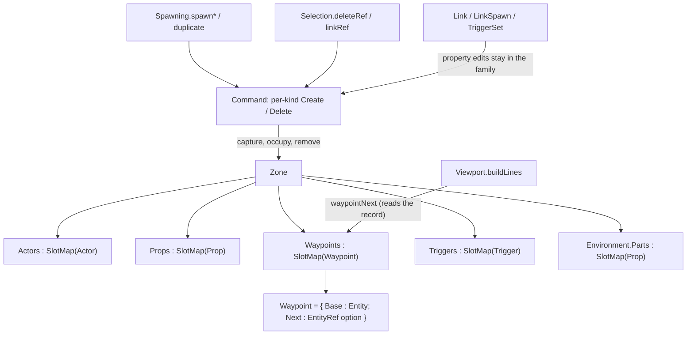

# Data Model: Entity Command Families

The model is unchanged in what a zone stores — one slot map per kind, as
`docs/ARCHITECTURE.md` records — and changes in **what a command carries**: one
create and one delete per kind, holding that kind's own record instead of a shared
base entity. A waypoint's link becomes a field of the waypoint, so the zone's
`Links` table disappears.



## The records — `world/Entity.fs`

One record changes:

```fsharp
// A point of interest placed in a zone. The base transform's position is where to
// stand and its rotation is which way to face. `Next` is the waypoint this one's
// chain continues at, in this zone — authored state, so it is carried by the command
// that records the waypoint and dies with it (FR-014). `None` ends a chain.
[<Struct>]
type Waypoint =
    { Base : Entity
      Next : EntityRef option }
```

`Actor`, `Prop`, and `Trigger` are unchanged. Their fields split three ways:

| Kind | Authored (a command carries it) | Derived (a restore rebuilds it) | Runtime (never recorded) |
|---|---|---|---|
| `Actor` | `Base`, `AssetId`, `ShowCollider` | `Physics`, `Renderer` | — |
| `Prop` (placed) | `Base`, `AssetId`, `SubmeshIndex`, `SubmeshCount` | `Physics`, `Renderer` | — |
| `Prop` (part) | as a placed prop | `Physics`, `Renderer` | — |
| `Waypoint` | `Base`, `Next` | — | — |
| `Trigger` | `Base`, `Radius`, `Height`, `Interactable`, `Prompt` | — | `Triggered` |

The shared `Entity` (`Name`, `Transform`, `Enabled`, `Visible`, `Selectable`,
`Draggable`) is authored for every kind; its `Transform` and `Name` are edited by
the shared `Transform`/`Rename` commands rather than a kind's family.

## Capture, occupy, remove — `world/Zone.fs`

Per kind, three functions, plus the existing spawn:

```fsharp
// Read the record as a command records it: the live record with its derived resources
// (body attachment, renderer) and its runtime flag cleared. A record-update, so a field
// added to the kind later is carried automatically. Raises for a stale or wrong-kind ref
// — every caller has already resolved the ref through `tryEntityAt`.
val captureActor    : zone:Zone -> ref:EntityRef -> Actor
val captureProp     : zone:Zone -> ref:EntityRef -> Prop
val capturePart     : zone:Zone -> ref:EntityRef -> Prop
val captureWaypoint : zone:Zone -> ref:EntityRef -> Waypoint
val captureTrigger  : zone:Zone -> ref:EntityRef -> Trigger

// Restore a recorded record at its ref, rebuilding derived resources. Raises when the
// recorded slot is not free (an untracked Add reused it).
val occupyActor    : zone:Zone -> world:Physics.World -> assets:Assets.AssetManager -> ref:EntityRef -> actor:Actor -> unit
val occupyProp     : zone:Zone -> world:Physics.World -> assets:Assets.AssetManager -> ref:EntityRef -> prop:Prop -> unit
val occupyPart     : zone:Zone -> world:Physics.World -> assets:Assets.AssetManager -> ref:EntityRef -> part:Prop -> unit
val occupyWaypoint : zone:Zone -> ref:EntityRef -> waypoint:Waypoint -> unit
val occupyTrigger  : zone:Zone -> ref:EntityRef -> trigger:Trigger -> unit

// Free the slot and release whatever the kind owns. No-op for a stale ref.
val removeActor    : zone:Zone -> world:Physics.World -> ref:EntityRef -> unit
val removeProp     : zone:Zone -> world:Physics.World -> ref:EntityRef -> unit
val removePart     : zone:Zone -> world:Physics.World -> ref:EntityRef -> unit
val removeWaypoint : zone:Zone -> ref:EntityRef -> unit
val removeTrigger  : zone:Zone -> ref:EntityRef -> unit
```

- `occupyPart` resolves the environment by epoch, exactly as the part branch does
  today: a part restore only runs while the environment it names is loaded, and an
  epoch mismatch is a broken invariant (`failwith`), not a no-op.
- `occupyActor`/`occupyProp`/`occupyPart` build the derived fields from the record's
  asset id and submesh range and ignore the (blanked) recorded ones. Each `occupy*`
  constructs its record field by field over the payload rather than updating it, so a
  field added to a kind fails to build until it is classified as authored, derived, or
  runtime — the restore half of the capture's guarantee (FR-006, SC-004).
- `removeWaypoint` frees the slot; the waypoint's link goes with the record, so no
  link state survives it (SC-008).
- Deleted: `Zone.Links`, `waypointNext` and `setWaypointNext` keep their
  signatures but read and write `Waypoint.Next`:

```fsharp
// The waypoint this one continues at, if it still resolves: the source must be a live
// waypoint and the target must resolve. Pure — a link whose target is gone is left as
// it is and simply answers "no next".
val waypointNext : zone:Zone -> ref:EntityRef -> EntityRef option

// Point a waypoint at another (Some), or end its chain (None). Refuses a self-link and
// a ref of another kind; does not require the target to be alive.
val setWaypointNext : zone:Zone -> ref:EntityRef -> next:EntityRef option -> unit

// Toggle an actor's collider overlay: a direct write, since the overlay is a
// visualisation preference rather than an undo step. The Inspector and a duplicate both
// go through it, so the write has one home.
val setShowCollider : zone:Zone -> ref:EntityRef -> show:bool -> unit
```

## Commands — `state/Command.fs`

```fsharp
type Command =
    // Shared base edits: every kind has a name and a transform.
    | Transform of Ref : EntityRef * Before : Transform * After : Transform
    | Rename of Ref : EntityRef * Before : string * After : string
    // One create and one delete per kind, carrying that kind's own record.
    | ActorCreate    of Ref : EntityRef * Actor : Actor
    | ActorDelete    of Ref : EntityRef * Actor : Actor
    | PropCreate     of Ref : EntityRef * Prop : Prop
    | PropDelete     of Ref : EntityRef * Prop : Prop
    | PartCreate     of Ref : EntityRef * Part : Prop
    | PartDelete     of Ref : EntityRef * Part : Prop
    | WaypointCreate of Ref : EntityRef * Waypoint : Waypoint
    | WaypointDelete of Ref : EntityRef * Waypoint : Waypoint
    | TriggerCreate  of Ref : EntityRef * Trigger : Trigger
    | TriggerDelete  of Ref : EntityRef * Trigger : Trigger
    // Property edits that belong to one kind.
    | Link  of Ref : EntityRef * Before : EntityRef option * After : EntityRef option
    | TriggerSet of Ref : EntityRef * Before : Trigger * After : Trigger
    // The extend gesture: create a waypoint and link `From` to it, as one step.
    | LinkSpawn of From : EntityRef * Before : EntityRef option * Ref : EntityRef * Waypoint : Waypoint
    // Zone-level, not an entity.
    | SetEnvironment of Previous : Environment option * Next : Environment option
```

| Command | `apply` | `undo` |
|---|---|---|
| `KCreate (r, rec)` | `occupyK r rec` | `removeK r` |
| `KDelete (r, rec)` | `removeK r` | `occupyK r rec` |
| `Link (r, _, after)` | `setWaypointNext r after` | `setWaypointNext r before` |
| `TriggerSet (r, _, after)` | `setTrigger r after` | `setTrigger r before` |
| `LinkSpawn (from, _, r, w)` | `occupyWaypoint r w`, then `setWaypointNext from (Some r)` | `setWaypointNext from before`, then `removeWaypoint r` |
| `Transform`/`Rename`/`SetEnvironment` | unchanged | unchanged |

- `KCreate` covers both spawning a new entity and duplicating an existing one
  (research Decision 3); the two were already the same operation, and a duplicate
  differs only in the payload it carries.
- Only consecutive `Transform`s merge in `UndoStack.push`, so every other command is
  exactly one step (FR-009).
- `LinkSpawn` stays composite because it changes two entities; it is the waypoint
  family's own case, and the new waypoint `w` already carries its own (empty) link.

## Authoring — `editor/Spawning.fs` and `editor/Selection.fs`

```fsharp
// The single creation surface, unchanged in shape: each spawn adds the entity and pushes
// the create that reverses it, selecting the new entity.
val spawnActor / spawnProp / spawnWaypoint / spawnTrigger : ... -> unit

// Create a waypoint at the camera and link `from` to it as one `LinkSpawn` step.
val spawnLinkedWaypoint : state:byref<GameplayState.GameplayState> -> from:EntityRef -> entity:Entity -> unit

// Copy an entity into a new slot, pushing the create that reverses it. The copy carries
// every property of the original, its link included (FR-013), but not runtime state.
val duplicate : shared:SharedState.SharedState -> state:byref<GameplayState.GameplayState> -> source:EntityRef -> entity:Entity -> unit

// Delete a specific entity, recording it so undo restores it in full.
val deleteRef : shared:SharedState.SharedState -> state:byref<GameplayState.GameplayState> -> ref:EntityRef -> unit

// Point a waypoint at another, or end its link, as one `Link` step.
val linkRef : shared:SharedState.SharedState -> state:byref<GameplayState.GameplayState> -> ref:EntityRef -> next:EntityRef option -> unit
```

- `deleteRef` builds the command by kind — `captureK` then `KDelete` — so the trigger
  special case it carries today (`tryTriggerAt` → `TriggerDelete`, else `Delete`)
  disappears: every kind is now the same shape of decision.
- `duplicate` builds a `KCreate` from the source's captured record. For a waypoint the
  captured record includes `Next`, so the copy links to the same successor; for a
  trigger the capture has `Triggered = false`, so the copy carries the authored shape
  and not the runtime flag. It then writes that record's kind-specific fields into the
  live copy it spawned (`setShowCollider`, `setWaypointNext`, `setTrigger`), because
  `Zone.spawn*` builds from a base entity plus the kind's defaults; without that step
  the copy and the command reversing it would disagree. The spawn wrappers need no such
  step: they capture *after* spawning, so their payload is read from the entity it
  describes.
- `linkRef` is unchanged in shape: read the current next, build `Link (ref, before,
  next)`, apply, push. It pushes nothing when the link already points where asked.

## State transitions

| From | Action | Effect |
|---|---|---|
| any entity | delete | its slot is freed and its resources released; `KDelete` carries the record |
| that delete | undo | the slot is re-occupied with the same generation and the record restored in full; resources rebuilt |
| any entity | duplicate | a copy in a new slot carrying every authored property, its link included; `KCreate` |
| actor | toggle the collider overlay | written in place, no undo step; carried by the next recorded operation that removes or copies the actor |
| trigger | edit shape / prompt / interactable / enabled | `TriggerSet (before, after)`, one step |
| waypoint | link / re-link / unlink | `Link (before, after)`, one step |
| waypoint selected, camera placed | extend | `LinkSpawn`: the new waypoint exists, `From` points at it, the new one is selected — one step |
| mid-chain waypoint | delete | the chain stops at the link that named it; its own link is gone with it |
| that delete | undo | the whole chain resolves again, because the restored record carries the link it held |
| the freed slot | reused by a new waypoint | no stale link resolves to the newcomer (generation mismatch) |
| linked waypoint | zone switch | the link is the waypoint's, so it travels with the zone's contents; no connectors for an inactive zone |

## Validation rules

- A command payload is a captured record only: derived resources and runtime flags
  are blank by construction, so a restore can never reuse a released body or GPU
  object (FR-007) and can never restore runtime state (FR-008).
- The capture and the restore are mirrors. The capture cannot drop a field silently
  (a record-update carries every field, including a newly added one), and the restore
  cannot pass one through unclassified (`occupy*` constructs the record field by
  field). Adding a field to a kind is therefore a build failure until its author says
  whether it is authored, derived, or runtime (FR-006, SC-004).
- A waypoint has at most one link, structurally: `Next` is a single field.
- `setWaypointNext` raises on a self-link and on a source or target that is not a
  waypoint. It does not require the target to be alive: a `Link` undo may restore a
  link whose target is momentarily gone, and such a link is inert rather than wrong.
- `waypointNext` requires the source alive, a `Some Next`, and the target to
  resolve; anything else is `None`, with no mutation.
- `occupy*` raises when the recorded slot is not free — the guard that turns an
  untracked add into a loud bug rather than silent corruption.
- `occupyPart` raises on an epoch mismatch (a part restore only runs while its
  environment is loaded, which the LIFO stack makes true).
- A create, delete, or restore path matches every `EntityKind`: there is no wildcard
  arm to absorb a kind, so adding one is a non-exhaustive match the compiler names
  (FR-006).
- Every `Transform` gesture still merges into one step; nothing else merges.

## Relationships and compile order

- `world/Entity.fs` (the `Waypoint` field) → `world/Zone.fs` (the per-kind functions,
  the link on the record) → `state/Command.fs` (the families, whose apply/undo call
  `Zone`) → `editor/Spawning.fs` / `editor/Selection.fs` → `screen/`. No new file, so
  no compile-order entry changes, and `Command` still depends on `Entity` and `Zone`
  only.
- `Zone` already depends on `Entity`, `Physics`, and `Assets`; nothing new is
  imported, and `render/` and `physics/` are untouched.
- Tests extend `test/EntityTests.fs` (the `Waypoint` shape), `test/ZoneTests.fs`
  (capture/occupy/remove round-trip per kind, link on the record),
  `test/SpawningTests.fs` (create and extend are one step; a copy carries the link),
  and `test/SelectionTests.fs` (link edit and delete + undo). All are headless.
