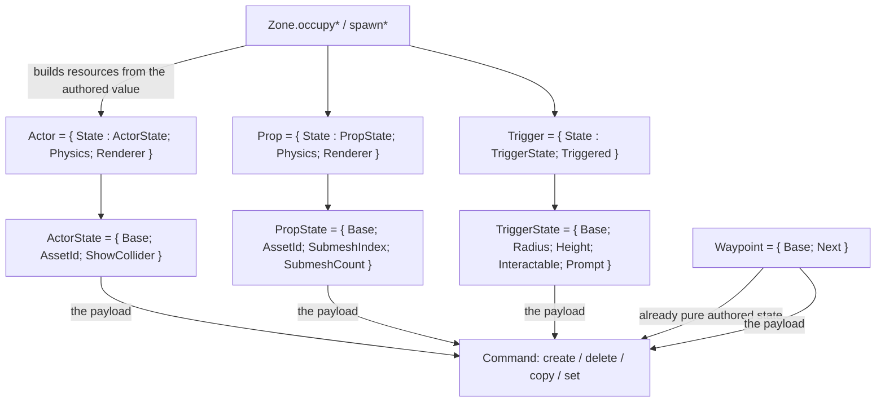

# Data Model: Entity Authored State

Each entity kind that carries anything beyond its authored properties now holds that
state as a value of its own, so what a command records and what an engine rebuilds are
different *types* rather than two functions that agree.



## The records — `world/Entity.fs`

```fsharp
// What the editor authors for an actor: everything a command must carry, and nothing an
// engine rebuilds. The record a create, delete, or copy command holds.
[<Struct>]
type ActorState =
    { Base : Entity
      AssetId : string
      ShowCollider : bool }

[<Struct>]
type Actor =
    { State : ActorState
      mutable Physics : PhysicsAttachment<CapsuleCollider> option
      mutable Renderer : ActorRender.ActorRender }

// A placed prop and an environment part share this shape, as they share `Prop`.
[<Struct>]
type PropState =
    { Base : Entity
      AssetId : string option
      SubmeshIndex : int
      SubmeshCount : int }

[<Struct>]
type Prop =
    { State : PropState
      mutable Physics : PhysicsAttachment<MeshCollider> option
      mutable Renderer : EnvironmentRender.EnvironmentRender }

// A trigger's runtime flag is neither authored nor derived: it is recomputed in place
// every update, so it stays a sibling field.
[<Struct>]
type TriggerState =
    { Base : Entity
      Radius : float32
      Height : float32
      Interactable : bool
      Prompt : string }

[<Struct>]
type Trigger =
    { State : TriggerState
      mutable Triggered : bool }
```

`Entity` and `Waypoint` are unchanged: a waypoint's record is already pure authored
state, so it is its own payload.

| Kind | Authored (the payload type) | Derived (rebuilt) | Runtime (recomputed in place) |
|---|---|---|---|
| `Actor` | `ActorState` | `Physics`, `Renderer` | — |
| `Prop` (and part) | `PropState` | `Physics`, `Renderer` | — |
| `Waypoint` | `Waypoint` (unchanged) | — | — |
| `Trigger` | `TriggerState` | — | `Triggered` |

## Reads and writes

- **A read of an authored property is spelled through `State`**:
  `a.State.Base.Transform.Position`, `t.State.Radius`, `p.State.SubmeshCount`. `State` is
  an immutable field, so this is a field access rather than the struct-returning member
  call a read-through accessor would be.
- **A write is spelled out** for the same reason:
  - an authored write is a whole-record copy-and-update on an authored path —
    `a <- { a with State.ShowCollider = show }`;
  - a derived write is unchanged, because `Physics`/`Renderer` are top-level mutable
    fields — `actor.Renderer <- renderer`, `slot.Value <- { p with Physics = None; Renderer = … }`;
  - an in-place write *through* `State` is what does not compile, which is how the two
    writes in `Systems.syncActors` and the two in tests were found.
- The compiler therefore enumerates every write site — and deleting the accessors made it
  enumerate every read site too, which is how all of them were qualified.

## Commands — `state/Command.fs`

| Command | Payload before | Payload now |
|---|---|---|
| `ActorCreate` / `ActorDelete` | `Actor` | `ActorState` |
| `PropCreate` / `PropDelete` | `Prop` | `PropState` |
| `PartCreate` / `PartDelete` | `Prop` | `PropState` |
| `WaypointCreate` / `WaypointDelete` | `Waypoint` | `Waypoint` (unchanged) |
| `TriggerCreate` / `TriggerDelete` | `Trigger` | `TriggerState` |
| `TriggerSet` | `Trigger` × 2 | `TriggerState` × 2 |
| `Link` / `LinkSpawn` / `Transform` / `Rename` / `SetEnvironment` | unchanged | unchanged |

`apply`/`undo` bodies are otherwise unchanged: a create occupies through `occupy*`, a
delete removes through `remove*`, and each now passes the authored value straight through.

## Zone — `world/Zone.fs`

```fsharp
// Resolve a ref to the value a command carries, raising for a stale or wrong-kind ref.
// No clearing: the authored value is the record itself.
val captureActor    : zone:Zone -> ref:EntityRef -> ActorState
val captureProp     : zone:Zone -> ref:EntityRef -> PropState
val capturePart     : zone:Zone -> ref:EntityRef -> PropState
val captureTrigger  : zone:Zone -> ref:EntityRef -> TriggerState
val captureWaypoint : zone:Zone -> ref:EntityRef -> Waypoint      // unchanged

// Build a live entity from an authored value, producing every derived resource.
// Field by field, so a new derived field fails to build until it is produced.
val occupyActor / occupyProp / occupyPart : zone:Zone -> world:Physics.World -> assets:Assets.AssetManager -> ref:EntityRef -> 'State -> unit
val occupyWaypoint / occupyTrigger : zone:Zone -> ref:EntityRef -> 'State -> unit

// The spawn builders keep their present parameters and assemble the authored value
// inside, which is where a new authored field's initial value is decided — the site US2's
// experiment lands on.
val spawnActor / spawnProp : zone:Zone -> world:Physics.World -> assets:Assets.AssetManager -> entity:Entity -> assetId:string -> EntityRef
val spawnPropBinding / spawnPartBinding : zone:Zone -> world:Physics.World -> assets:Assets.AssetManager -> entity:Entity -> binding:AssetBinding -> EntityRef
val spawnWaypoint / spawnTrigger : zone:Zone -> entity:Entity -> EntityRef
```

- The `set*` writers write the authored value: `setName`, `setTransform`, and
  `setShowCollider` update `State`; `setTrigger` takes a `TriggerState` and leaves
  `Triggered` alone; `setWaypointNext` is unchanged.
- `remove*` is unchanged: freeing the slot and releasing resources does not touch the
  record's shape.
- `deactivateEnvironment` and `attachPart` are unchanged in behaviour; the former's
  record-update now provably touches only the resource fields.

## Where each kind's state can be written

| Write | Kind of state | How it is spelled |
|---|---|---|
| `Zone.setTransform`, `setName` | authored | whole-record update of `State` |
| `Zone.setShowCollider` | authored | whole-record update of `State` |
| `Zone.setWaypointNext` | authored (waypoint) | whole-record update of `Next` |
| `Selection.linkRef`, `updateTriggerRef` | authored | through the command above |
| `Zone.setTrigger` | authored | whole-record update of `State`; `Triggered` untouched |
| `Systems.syncActors` | **authored**, written in place by the simulation | `actor.State.Base.Transform.…` — an in-place write through `State` does not compile, so this site is compiler-found rather than silent |
| `Systems.animate` | runtime | `ActorRender.playClip &actor.Renderer …` |
| `GameplayScreen.advanceActorAnimations` | runtime/derived | `&slot.Value.Renderer` |
| the trigger system | runtime | writes `Triggered` |

## Validation rules

- A command payload is an authored record: it cannot hold a physics attachment, a
  renderer, or a runtime flag (FR-002, FR-003).
- Adding an authored property is carried by everything that records the kind, because
  the whole authored value passes through; adding a derived property fails the build in
  `occupy*`/`spawn*` until it is produced (FR-006).
- No code path clears derived fields; `capture*` reads and never writes (FR-005).
- `State` is an immutable field, so no authored write can bypass the whole-record update
  and leave a caller's copy stale.
- The authored value is a struct with no reference to engine resources, so recording one
  retains nothing the engine owns (030's FR-007, now by type).
- Reads of the derived fields keep working: they are top-level mutable fields of the
  entity, not part of the authored value.

## Relationships and compile order

- `world/Entity.fs` (the authored records and reshaped entities) → `world/Zone.fs`
  (capture/occupy/spawn/set) → `state/Command.fs` (payload types) →
  `editor/{Inspector,Selection,Spawning}.fs`. No new file, so no compile-order entry
  changes and no `.fsproj` change.
- `render/`, `physics/`, and `core/` are outside this feature — none of them reads an
  entity's authored state; `screen/GameplayScreen.fs` changes only in that its three
  authored reads are spelled through `State`. The renderers and attachments are values the
  same fields still hold.
- Tests extend seven shape/behaviour modules — `Entity`, `Zone`, `Systems`, `Spawning`,
  `Selection`, `GameplayState`, and `Player` — which is where the construction helpers and
  the two in-place writes live.
