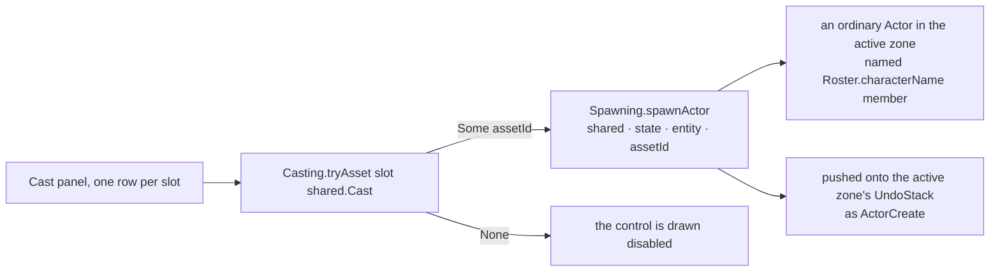

# Data Model: Spawning a Cast Member from the Cast Panel

This feature adds **no data**. It adds one caller of data that already exists: a `Slot` is asked
what asset it is bound to, and the answer either becomes an ordinary actor or leaves the control
disabled.



## The row's decision

| Slot state | The row shows | Activating the control |
|---|---|---|
| bound to `assetId` | the combo previewing that asset's `Name`, and an enabled **Spawn** | creates one actor with that asset, named with the member's case name |
| unassigned | the combo previewing `(none)`, and a **disabled** Spawn | nothing — the control cannot be activated |

There is no third state and no default: `Casting.tryAsset` answering `None` is the same absence the
`(none)` preview already renders, and it is the spec's FR-005.

## What is created

An ordinary actor, authored exactly as `Spawning.baseEntity` authors one:

```fsharp
{ Name = Roster.characterName character    // the cast member's case name
  Transform = transformIdentity            // the same placement the Asset Browser's spawn gets
  Enabled = true
  Visible = true
  Selectable = true
  Draggable = true }
```

and then the same path the Asset Browser takes: `Zone.spawnActor` builds the model's renderer and its
capsule collider from the asset, and `Spawning` records `ActorCreate` with the new entity's authored
value and selects it. So the actor has a body, a renderer, and a name — and nothing else that this
feature put there.

## What is deliberately unchanged

| | Why |
|---|---|
| `Casting.Slot`, `Casting.Cast`, `Casting.tryAsset` | spawning reads the binding; it never writes it (SC-004) |
| `Roster.Character`, `Roster.characterName` | the name is read from the case name, which is what the member already renders as |
| `ActorState`, `Actor`, `Command` | the actor carries no cast identity (FR-009); the create reuses `ActorCreate` rather than adding a command |
| `State/Zone.fs`, `world/Casting.fs` | no new field, and no new operation |
| Every zone's `UndoStack` discipline | one activation is one step, because the create is paired with its reversal in one place — the place that already existed |

## Validation rules

- A slot with an assignment offers exactly one spawn control; one without offers none that can be
  activated (SC-001).
- The created actor's asset is the slot's bound asset, and its name is the member's case name
  (SC-002).
- One activation is one undo step that removes exactly the actor it created (SC-003).
- Spawning writes no binding (SC-004).
- An actor spawned here and one spawned from the Asset Browser for the same asset differ only in
  name, because both are built by one literal (SC-005).
