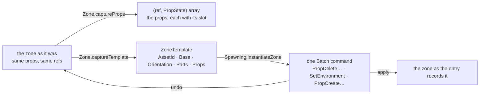

# Data Model: A Registered Zone's Placed Props

One field on a record, one command case, and a reversal that has to be exact. The live model does not
change at all: `Zone`, `Prop`, `PropState` and the slot maps are as they are.



## The entry — `world/ZoneTemplate.fs`

```fsharp
type ZoneTemplate =
    { AssetId : string
      Base : Entity
      Orientation : Quaternion
      Parts : PropState array   // pieces of the environment asset
      Props : PropState array } // assets of their own standing in the zone
```

| Field | What it is | How it is read |
|---|---|---|
| `Parts` | the environment's own geometry, one entry per part the author left standing | the environment's live parts slot map |
| `Props` | the zone's placed props, one entry per prop the author left standing | the zone's live props slot map |

### A prop is not a part

Both are a `PropState`, and one field tells them apart — which is how the code already distinguishes
them, not a convention this feature introduces:

| | `AssetId` | Submesh range | Lives in | Belongs to |
|---|---|---|---|---|
| a **part** | `None` | the piece of the environment asset it draws | `environment.Parts` | the environment: it has no existence without it |
| a **prop** | `Some id` | `0, 0` — the whole asset | `zone.Props` | the zone: it stands where it was placed |

So the entry keeps them in separate fields *and* each entry says which it is (FR-003). A props array
holding something shaped like a part is a broken registration and raises (research Decision 8).

### What a replacement has to hold

The command that reverses an instantiation carries, for each prop it removed, the ref that prop was at
and its authored value — because restoring it means putting it back *there*, at that generation, so a
ref the author held before the instantiation names the same prop after it. That is what
`SlotMap.Occupy` does and why `captureProps` reads refs as well as values (research Decision 4).

## The replacement, step by step

`Spawning.instantiateZone` does, in order:

| # | What happens | Which is recorded as |
|---|---|---|
| 1 | every prop the zone holds is captured (ref + value) | a `PropDelete (ref, value)` each |
| 2 | and removed, by applying those very commands | — (the apply above *is* the removal) |
| 3 | the environment is loaded from the entry's environment half and becomes current | `SetEnvironment (previous, Some next)` |
| 4 | the entry's props are placed, each at a fresh slot | a `PropCreate (ref, value)` each, with the ref it landed at |
| 5 | and the three groups are pushed as **one** command | `Batch [PropDelete…; SetEnvironment…; PropCreate…]` |

Undo walks that list backwards, and the order is what makes it exact:

1. undo the `PropCreate`s — the placed props are removed, freeing the slots they took, which are
   frequently the very slots the replaced props had;
2. undo the `SetEnvironment` — the previous environment value, its parts map intact, is re-activated,
   so the previous parts come back as they were;
3. undo the `PropDelete`s — each replaced prop is re-occupied at its recorded ref, restoring the
   generation the slot had when the prop was removed, so **the author's old refs resolve again** to
   the props they named.

Redo replays the same list forwards, and every `Occupy` finds its slot free because its counterpart was
just removed. Nothing about this needs the props to come back in any particular order, and nothing in
the record depends on the order they were placed in.

## Validation rules

| Rule | Requirement |
|---|---|
| A zone with *n* props registers *n*, counted over deletions and duplicates | FR-001, FR-002, SC-001 |
| The props afterwards are exactly the entry's, and none of the previous ones remain | FR-004, SC-003 |
| One instantiation is one reversal, restoring settings, parts and props | FR-005, SC-004 |
| The entry, every other place, and the zone's actors, waypoints and triggers are untouched | FR-006, FR-009 |
| Registering still requires an environment and still records no undo step | FR-007, FR-008, SC-005 |
| A prop naming an asset the game does not have raises | Research Decision 8, via the existing prop-render path |

## What is deliberately unchanged

| | Why |
|---|---|
| `Environment`, `Prop`, `PropState`, `Zone`, the slot maps | props and parts are already the right shapes; this feature records them, it does not reshape them |
| `Zone.loadEnvironmentFrom` | it loads the environment half, which is all an environment is; the props are placed beside it as part of the same step (research Decision 9) |
| `SetEnvironment`, `PropCreate`, `PropDelete`, and every other command | the compound command composes them; none of them changes |
| `editor/AssetBrowser.fs` | its environment load builds from an asset id, which is a different question from installing a record; behaviour is untouched (research Decision 6) |
| The registry's map, the panel's tree, the Register control's rules | one field grows on the value; nothing about the key, the lookup or the direct write moves |
