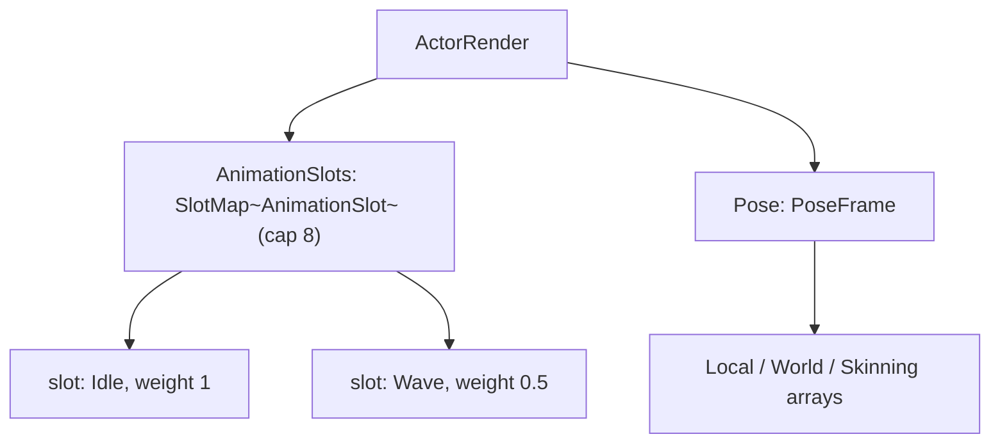

# Data Model: Actor Animation Slots with Weights

The feature changes one existing record's shape and adds pure operations over it. No new
record type is introduced: the actor's set of clips is the existing `SlotMap<'T>` generic,
instantiated at `AnimationSlot`.

## `AnimationSlot` — `world/Actor.fs` (changed)

```fsharp
[<Struct>]
type AnimationSlot =
    { AnimIndex : int
      mutable Frame : float32       // the clip's playback position, in frames
      PlaybackFps : float32
      mutable Weight : float32      // NEW: mutable — set in place by the Inspector and callers
      Loop : bool
      mutable Enabled : bool }      // NEW: mutable — set in place
```

- `Weight` is relative: only its proportion against the other contributing slots matters (FR-004), and it
  is clamped to 0..1 when set (FR-006). A slot at weight 0 is a **held** clip that contributes nothing —
  distinct from an absent slot, and the state an added clip starts in (research Decision 7).
- `Enabled` gates both the clock (FR-009) and the blend; a disabled slot does not advance and does not
  contribute, whatever its weight.
- `AnimIndex` names a clip in the actor asset's `Iqm.Model.Anims`; a slot's identity for find-or-add and
  for remove is this index (one slot per clip — spec assumption).

## `MaxAnimationSlots` — `world/Actor.fs` (new)

```fsharp
[<Literal>]
let MaxAnimationSlots = 8
```

The capacity of an actor's slot set (FR-002). `ActorRender.create` builds the map with it and the Inspector
reports the degenerate "at maximum" case with it (FR-017).

## `ActorRender` — `world/ActorRender.fs` (changed)

```fsharp
[<Struct>]
type ActorRender =
    { Asset : ActorAsset.ActorAsset
      AnimationSlots : SlotMap<Actor.AnimationSlot>   // was: mutable Animation : Actor.AnimationSlot
      Pose : Actor.PoseFrame
      BoneBuffer : Gpu.Buffer
      BoneStorageBuffers : nativeint array
      BoneTransfer : Gpu.TransferBuffer
      BoneBytes : byte array }
```

- A struct holding a **reference** to the slot map, as it already holds references to `Asset` and the byte
  array; copies of the struct (its `upload`/`draw` are passed by value) share the one map. The map is
  fixed-capacity, so no per-frame growth.
- `Pose : PoseFrame` is unchanged in shape: three reused `Matrix4x4 array`s (`Local`, `World`, `Skinning`),
  and `blendPose` writes all three exactly as `samplePose` does. No scratch arrays are added — the blend
  accumulates in per-joint locals (research Decision 5).

## `PoseFrame` — `world/Actor.fs` (unchanged)

```fsharp
type PoseFrame =
    { Local : Matrix4x4 array
      World : Matrix4x4 array
      Skinning : Matrix4x4 array }
```

## Relationships



## The blend, as a state function

> `blendPose` is a pure function of (model, the alive slots with their frames and weights): for each joint
> it produces the weighted average of the contributing clips' local transforms, or the joint's bind-pose
> local when nothing contributes, then composes world and skinning from those locals.

- **Contribution** — a slot contributes iff it is alive, `Enabled`, `Weight > 0`, and its `AnimIndex`
  names a clip with at least one frame. Otherwise it is skipped, contributing nothing and affecting no
  joint (spec edge case: a clip with no frames contributes nothing).
- **Translation and scale** — `Σ(valueᵢ · wᵢ) / Σwᵢ`; with `Σwᵢ` shared by both.
- **Rotation** — an incremental running average, `r ← Slerp(r, rᵢ, wᵢ / (Σw)·…)`; the result is a valid
  rotation and two equal weights give the rotational midpoint.
- **Fallback** — if no slot contributes, the joint's local is its bind pose (`joint.Translate/Rotate/Scale`),
  so an actor with none held, or all zeroed, stands in its rest pose (FR-008).
- **Composition** — `Local` then `World = Local * parentWorld` (or `Local` for a root), then
  `Skinning = InverseBind * World`. Joints are parent-before-child, as `createModel` assumes.

## The slot algebra

> The set is manipulated only through four pure operations, so the rules live in one place.

- `setSlotWeight m slots animIndex weight` — find the alive slot whose `AnimIndex` matches and set its
  weight (clamped 0..1) and `Enabled = true`; if none matches, **add** a slot for that clip seeded at that
  weight. Adding beyond capacity raises through `SlotMap.Add` (FR-002). An out-of-range index raises.
- `removeSlot slots animIndex` — free the alive slot whose `AnimIndex` matches; a no-op if none does.
- `advanceSlotsInPlace m slots dt` — advance every alive, enabled slot on its own clock (FR-009).
- `blendPose m slots pose` — produce the pose above.

## The authored / runtime boundary

> The slots are runtime state, and the type system is what keeps them out of a command payload.

- `ActorState` (what `ActorCreate`/`ActorDelete` carry, and what `Zone.captureActor` answers) has no
  animation field and gains none (FR-019). A payload holds an `ActorState`, which holds neither a body nor
  a renderer — so it cannot hold the slots either.
- `Zone.occupyActor` and `Zone.spawnActor` build the renderer through `Assets.createActorRender`, which
  calls `ActorRender.create`; an actor restored by undo, or spawned afresh, therefore holds the default
  single slot (Idle/first/none), not the slots it had before it was deleted (spec edge case).

## Validation rules

- A set holds at most `MaxAnimationSlots` clips; an add beyond that raises (FR-002).
- A weight set through the API is clamped to 0..1 (FR-006); a clip already held is adjusted, not duplicated
  (FR-007); a clip name the asset does not define raises (FR-010).
- One slot at weight 1 produces the same pose as `samplePose` for that clip (FR-011).
- No contributing slot ⇒ the bind pose, never a zeroed pose (FR-008).
- `blendPose` allocates nothing (FR-012).
- The slots are not persisted, not recorded by a command, and not carried in `ActorState` (FR-019).
