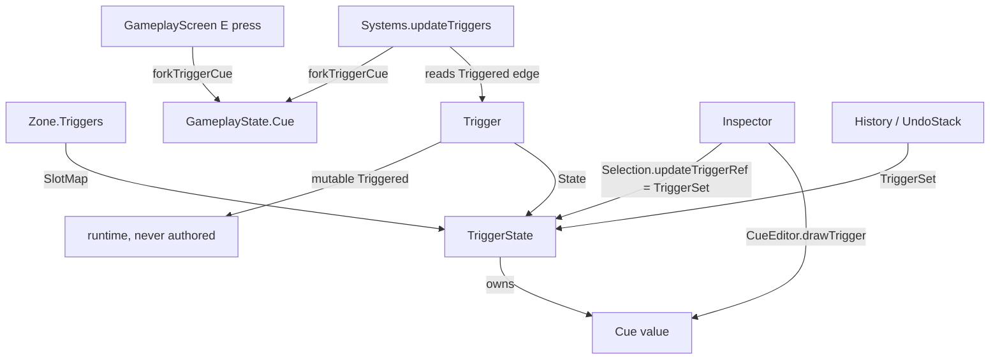

# Phase 1 Data Model: Trigger Cue

## `world/Entity.fs` — `TriggerState` (CHANGED)

```fsharp
[<Struct>]
type TriggerState =
    { Base : Entity
      Radius : float32
      Height : float32
      Interactable : bool
      Prompt : string
      Cue : Cue.Cue }          // NEW — the cue forked into the running cue when this trigger fires
```

- **`Cue`**: the trigger's **authored** cue — the value forked into the screen's running cue when it fires. An
  immutable cue value; `Fin` (the terminal, empty cue) is "no cue". Like every other field here it is authored state,
  so it is what `Zone.captureTrigger` reads and what a `TriggerSet` step carries (`FR-001`, `FR-008`).
- **Validation / rules**:
  - `Radius`, `Height`, `Interactable`, `Prompt` are unchanged.
  - `Cue` carries no resource, collider or asset (`FR-012`); it is a value.
  - A cue edit is a whole-record write (`TriggerSet`), never a partial one.

## `world/Entity.fs` — `Trigger` (UNCHANGED)

```fsharp
[<Struct>]
type Trigger =
    { State : TriggerState
      mutable Triggered : bool }
```

`Triggered` remains the **runtime** flag: recomputed each play frame, never authored, never recorded. `Cue` is on
`State`, not here, so it is never confused with runtime state.

## `world/Zone.fs` — `defaultTrigger` (CHANGED)

```fsharp
let private defaultTrigger (entity: Entity) : TriggerState =
    { Base = entity
      Radius = 1.0f
      Height = 2.0f
      Interactable = false
      Prompt = ""
      Cue = Cue.Fin }
```

A new trigger starts with no cue. `occupyTrigger` already resets `Triggered = false` on restore, so an undo/redo never
replays a fire.

## `state/GameplayState.fs` — `Cue` (UNCHANGED)

```fsharp
mutable Cue : Cue.Cue   // the screen's running cue; where a fired cue is forked in
```

No field is added. A fire writes this existing field via `forkInto`.

## `state/EditorState.fs` — inline trigger-cue editor state (NEW fields)

```fsharp
// Which node of the selected trigger's cue is selected, and the reused buffer for its text field. Kept apart
// from the Cue panel's fields so the two editors cannot share a selection or a buffer.
TriggerCueSelection : int list option
TriggerCueRef : EntityRef option       // the trigger the fields above belong to (reset when it changes)
TriggerCueTextBuffer : byte[]
TriggerCueTextPath : int list option
TriggerCueEditing : bool
```

- **Rules** (`FR-007`, `FR-010`, `FR-011`): the selection and text field are the Inspector's transient state, never
  written into a cue. `TriggerCueRef` records which trigger they belong to; when the selected trigger differs the
  fields reset, so a path or text typed for one trigger is never applied to another. The text buffer is reused (one
  allocation for the state's lifetime), sized `cueTextBufferSize`.
- **State transitions**: selection `None` → click a row → `Some path`; a structural edit (add/remove) moves it as
  `CueTree.drawEditor` returns; a selection that no longer resolves clears to `None`.

## `world/Systems.fs` — fire surfaces (CHANGED)

```fsharp
// Fork a trigger's authored cue into `cue`: no-op for a ref that does not resolve, an empty (`Fin`) cue, or no ref.
let forkTriggerCue (zone : Zone.Zone) (ref : EntityRef voption) (cue : byref<Cue>) : unit

// CHANGED signature — the screen cue is forked into on an entry fire.
let updateTriggers (zone : Zone.Zone) (closest : byref<EntityRef voption>) (cue : byref<Cue>) : unit
```

- **Rules** (`FR-002`, `FR-003`, `FR-004`, `FR-005`): `forkTriggerCue` is the one place the "resolve, skip `Fin`,
  `forkInto`" rule lives; both the entry loop and the interact key call it. `updateTriggers` fires an enabled,
  non-interactable trigger only on the rising edge (`inside && not was`), and never re-fires while the player remains
  inside. An interactable trigger never fires on entry (its only effect there is being tracked).

## `screen/GameplayScreen.fs` — play chain (CHANGED)

- `updateTriggers zone &state.InteractableTrigger &state.Cue` (new third argument).
- After it, while playing: if `Input.isPressed Input.Key.E`, `Systems.forkTriggerCue zone state.InteractableTrigger
  &state.Cue`.
- The cue still ticks last (`CueEngine.tick`), so a fired cue begins on the following tick.

## `editor/CueEditor.fs` + `editor/CueTree.fs` (MOVED — see plan)

- `CueTree` is unchanged: the same rows, lock rule and node editor.
- `CueEditor` gains `drawTrigger (shared) (state) (ref) : unit` — the selected trigger's cue drawn through the control,
  with its own id prefix (`"triggercue"`), selection and text field, committing each accepted edit through
  `Selection.updateTriggerRef` (one `TriggerSet` step). Its per-node text and waypoint-combo helpers are parameterised
  over the transient field state so the Cue panel and the inline editor share them.

## Relationships



## Commands (UNCHANGED)

`TriggerCreate`, `TriggerDelete`, `TriggerSet` all carry `TriggerState`; adding `Cue` needs no change to
`state/Command.fs` or `state/History.fs`. A trigger-cue edit is a `TriggerSet` step and is **not** pruned on entering
play (only `SetCue` is).
