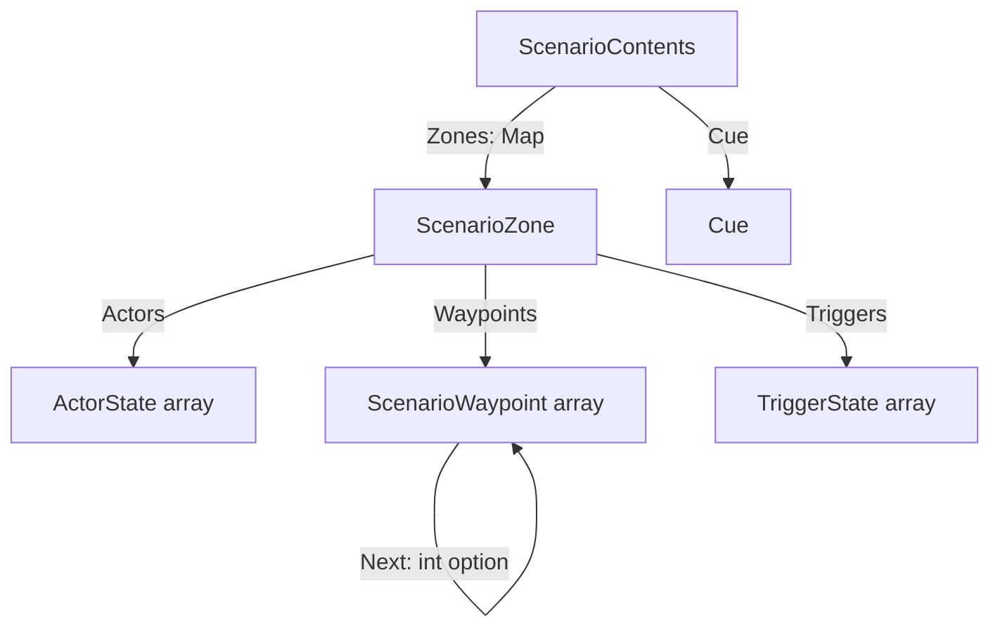

# Data Model: Trim Scenario Scope to Narrative Only

**Feature**: `specs/076-scenario-narrative-only` | **Date**: 2026-10-11

This feature has no new entities. It narrows two existing records — the scenario zone and the scenario contents —
and deletes one supporting type. The shapes below are the *as-is* and *to-be*; field names and types match the code
so `/speckit-tasks` can act on them directly.

## As-is (world/ScenarioZone.fs, world/ScenarioRegistry.fs)

```fsharp
// world/ScenarioZone.fs
type ScenarioEnvironment =
    { AssetId : string
      Base : Entity
      Orientation : Quaternion
      Parts : PropState array }              // the environment's parts, as authored

type ScenarioWaypoint =
    { Base : Entity
      Next : int option }                    // index of the next waypoint in this zone's own array

type ScenarioZone =
    { Environment : ScenarioEnvironment option
      Light : Texture.LightSettings
      Actors : ActorState array
      Waypoints : ScenarioWaypoint array
      Triggers : TriggerState array
      Player : int option }                  // index of the player among Actors

// world/ScenarioRegistry.fs
type ScenarioContents =
    { Zones : Map<Place, ScenarioZone>
      Active : Place                         // the place that was active at capture
      Cue : Cue.Cue }
```

Supporting private helpers that exist only for the removed fields:

- `ScenarioZone.captureEnvironmentParts (environment: Environment) : PropState array`
- the player-index half of `ScenarioZone.captureActors (zone: Zone) : ActorState array * int option`

## To-be

```fsharp
// world/ScenarioZone.fs
type ScenarioWaypoint =
    { Base : Entity
      Next : int option }                    // unchanged: an index into this zone's own array

type ScenarioZone =
    { Actors : ActorState array
      Waypoints : ScenarioWaypoint array
      Triggers : TriggerState array }

// world/ScenarioRegistry.fs
type ScenarioContents =
    { Zones : Map<Place, ScenarioZone>
      Cue : Cue.Cue }
```

### Deleted

- `ScenarioEnvironment` (the type, from `world/ScenarioZone.fs`).
- `captureEnvironmentParts` (private helper, `world/ScenarioZone.fs`).
- The player-index computation in `captureActors`, which becomes `(zone: Zone) : ActorState array` (`world/ScenarioZone.fs`).

### Changed signatures

| Function | As-is | To-be |
|---|---|---|
| `ScenarioZone.capture` | `(zone: Zone) -> ScenarioZone` | unchanged signature; reads only actors, waypoints, triggers |
| `ScenarioRegistry.capture` | `(zones) (active: Place) (cue) -> ScenarioContents` | `(zones) (cue) -> ScenarioContents` |
| `editor/ScenarioPanel` Register call | `capture state.Zones state.ActiveZone state.Cue` | `capture state.Zones state.Cue` |

### Unchanged

- `world/Scenario.fs` — the scenario vocabulary (`Scenario`, `scenarioName`, `all`).
- `ScenarioRegistry.Registry`, `create`, `tryContents`, `setContents` — the store.
- `state/Command.fs`'s `SetScenario` case — it names `ScenarioContents`, and only that type shrinks; the case itself
  is unchanged.
- `state/History.fs`'s `SetScenario` runner (`setContents`).
- `editor/ScenarioPanel.fs`'s `commit` and its row preview (`contents.Zones.Count`).
- `world/Cue.fs` and every cue op — no vocabulary is added.

## Validation rules

- **Ref-free.** A `ScenarioZone` holds no `EntityRef`: waypoint chains are indices into its own `Waypoints` array.
  (The player-by-index rule no longer applies — there is no player field.)
- **Complete zone walk.** `ScenarioRegistry.capture` records **every** present zone, keyed by its `Place`, including
  a place with no entities (an empty `ScenarioZone`). This is confirmed by the spec's Clarifications.
- **Chain integrity.** A captured `ScenarioWaypoint.Next` that names a waypoint not in the same zone raises, exactly
  as today (`world/ScenarioZone.fs`); the trim does not change this.
- **Immutability for the undo step.** The zones map stays an immutable `Map` and the cue an immutable value, so a
  `ScenarioContents` is still a value the `SetScenario` before/after step can hold.

## Relationships



A `ScenarioContents` holds one cue and one `ScenarioZone` per present place. A `ScenarioZone` holds three arrays and
nothing else. `ScenarioWaypoint.Next` points at another waypoint in the same array by index.

## Explicitly out of the record (where the concept lives instead)

| Concept | Removed from | Lives on |
|---|---|---|
| Environment (asset, base, orientation, parts) | `ScenarioZone` | the place's `ZoneTemplate` (`world/ZoneTemplate.fs`, `specs/034`/`specs/035`) |
| Light | `ScenarioZone` | the zone/place's authored setting (`Texture.LightSettings`, `specs/043`) |
| Player designation | `ScenarioZone` | `Zone.Player` (`specs/045`) |
| Active place | `ScenarioContents` | `GameplayState.ActiveZone` (`specs/061`) |

Placed props were already outside the record (they are environment decoration) and this feature does not reopen
that.
