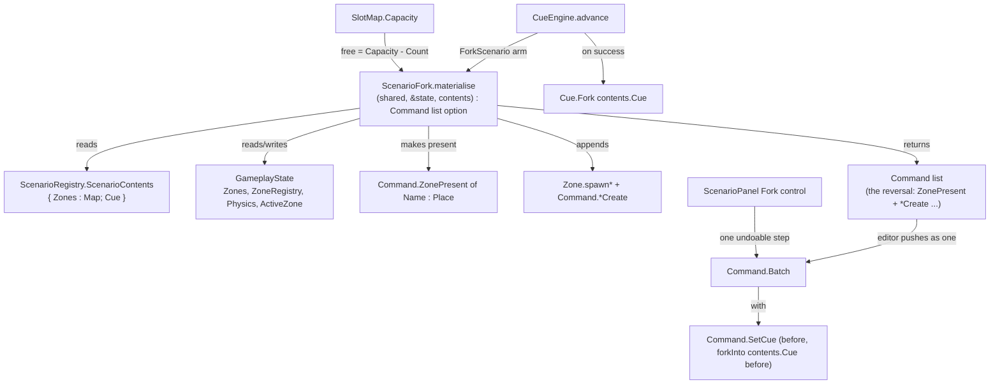

# Data Model: Fork a Scenario into the Scene

**Feature**: `specs/078-fork-scenario` | **Date**: 2026-10-11

A fork is a **mutation of the live scene plus a returned charge for reversing it**. It introduces two new
values — one command case and one cue-op case — and one small member on the core slot map, and it consumes the
scenario values `specs/070`/`076` already defined. Nothing is persisted.

## Overview



## New and changed values

### 1. `Command.ZonePresent of Name : Place` *(new — `state/Command.fs`)*

A **state-level step**: it makes a place present **without entering it**, and reverses to its removal.

| Field | Type | Meaning |
|-------|------|---------|
| `Name` | `Place` | the place made present |

- **`placeOf`** answers `None` (joins the state-level group: `ZoneMove`, `ZoneAdd`, `ZoneDelete`, `SetCue`, `Advent`, `SetScenario`). It carries no `Previous`, because it never changes the active place — the active place is always present, so a `ZonePresent` only ever names an **absent** place.
- **apply** (`History.apply`): `GameplayState.presentZone shared &state name template`, where `template = ZoneRegistry.tryTemplate name state.ZoneRegistry` (streams the registered template in, else leaves the zone empty). This is the same resolution the cue's `AddZone` uses, so the command carries only the place.
- **undo** (`History.undo`): `GameplayState.deleteZone shared &state name`. The place is not the active one when this runs: a later `ZoneMove` onto it was undone first (LIFO), the same invariant `ZoneDelete`'s undo relies on.
- **zone-level runner**: `Command.apply`/`Command.undo` treat it as a state-level step and `invalidOp` if it ever reaches them (mirrors `ZoneAdd`/`ZoneDelete`).

**Why not `ZoneAdd`?** `ZoneAdd` makes a place present **and active** (`GameplayState.addZone` swaps to it). A fork must not switch the layout (FR-004), so the presence act needs a step of its own.

### 2. `SlotMap.Capacity` *(new member — `core/SlotMap.fs`)*

```fsharp
member _.Capacity : uint32 = uint32 slotCount
```

`Count` (live slots) already exists; `Capacity` (the fixed size) does not. Free room is exactly
`Capacity - Count` — every non-alive slot is on the free list — so this member is what the capacity pre-check
reads. The capacities themselves stay in `Zone.create`: actors `64`, waypoints `128`, triggers `32`
(props `32` are not forked — a `ScenarioZone` carries no props).

### 3. `Cue.ForkScenario of scenario : Scenario` *(new cue op — `world/Cue.fs`)*

A no-progress leaf naming a scenario; `world/Scenario.fs` is compiled just before `Cue.fs`, so the op can name
one. It is **not** part of the authored vocabulary the editor types — the scenario is chosen from the closed set.

- **`children`** → `[]`; **`executing`** → `false`; **`label`** → `"Fork scenario: " + scenarioName`; **`kindName`** → `"Fork scenario"`; **`placeOf`** → `ValueNone`.
- **`advance`** (`world/CueEngine.fs`): the arm in "The cue op" below.
- **`CueTree`**: a `"Scenarios"` group in `kinds`, a `withScenario` writer, and a chooser in `CueEditor` reading `Scenario.all`.
- `ForkScenario` inherits `Fork`'s constraint: its returned `Fork` is only meaningful at a **Sequence's current op** (a bare `Fork` raises `invalidOp`, as today). This is the spec's documented assumption, not a new fault.

### 4. `ScenarioFork.materialise` *(new module + function — `world/ScenarioFork.fs`)*

The one seam both entry points call. Compiled **after `state/GameplayState.fs`, before `world/CueEngine.fs`**:
it mutates the gameplay state (needs `GameplayState`, `Zone`, `ZoneRegistry`, `Command`, `ScenarioRegistry`,
`SharedState`) and both `CueEngine` (the op) and `ScenarioPanel` (the control) call it.

```fsharp
/// Append `contents` into the live scene: create each absent place (from its registry template, else empty),
/// append every recorded zone's entities into its place, detaching actor bodies built into an inactive place.
/// Returns the commands that undo the scene work, in apply order, or `None` when the capacity pre-check refuses.
val materialise
    : SharedState.SharedState
      -> byref<GameplayState.GameplayState>
      -> ScenarioRegistry.ScenarioContents
      -> Command list option
```

| Result | Meaning |
|--------|---------|
| `Some commands` | Applied. `commands` reverse the scene work; may be **empty** (an empty scenario over present places — the cue still forks). |
| `None` | The capacity pre-check refused: **nothing** was changed (no place, no entity). The caller forks no cue (FR-010). |

The `option` is what distinguishes "applied, nothing to add" from "refused"; a bare `Command list` cannot, and
the cue op must fork the cue in the first case and not the second.

**Algorithm**

1. **Capacity pre-check (all-or-nothing, up front — FR-010).** For each `(place, zone)` in `contents.Zones`, if `place` is absent it will be created (free room = full `Zone.create` capacity); if present, free room = `SlotMap.Capacity - Count`. Sum the `Actors`/`Waypoints`/`Triggers` lengths the materialiser will add and, if any target lacks room for any kind, `eprintln` the reason and return `None`. Nothing has been touched.
2. **Create absent places.** For each absent place, `GameplayState.presentZone shared &state place (ZoneRegistry.tryTemplate place state.ZoneRegistry)`, and record `ZonePresent place`. The active place is never named (it is always present), so it is never created here.
3. **Append entities, per place.** Bind `let zone = state.Zones.[place]` and `let active = state.ActiveZone` as locals. Actors, then waypoints, then triggers:
   - **Actors**: `Zone.spawnActor zone state.Physics shared.Assets actor.Base actor.AssetId`; write the authored overlay (`Zone.setShowCollider zone ref actor.ShowCollider` — `spawnActor` opens it off); detach the body when `place <> active` (guarded by `Physics.isAdded`, mirroring `CueEngine.detachIfInactive`); record `ActorCreate (place, ref, Zone.captureActor zone ref)`.
   - **Waypoints, two passes** (chains are indices into the scenario's own array): first `Zone.spawnWaypoint zone wp.Base` for every entry, collecting the new refs into an array; then for each `Next = Some i`, `Zone.setWaypointNext zone refs.[k] (Some refs.[i])`; then record one `WaypointCreate (place, refs.[k], Zone.captureWaypoint zone refs.[k])` — the captured payload carries the **resolved** `Next : EntityRef option`, so no separate `Link` command is needed and redo is faithful.
   - **Triggers**: `Zone.spawnTrigger zone t.Base`; write the authored shape (`Zone.setTrigger zone ref t` — `spawnTrigger` builds a default); record `TriggerCreate (place, ref, Zone.captureTrigger zone ref)`. No body to detach.
4. **Return** the recorded commands in apply order: `[ ZonePresent ... ; ...per-place creates... ]`.

**Ordering.** Forward order creates the place before its entities. `Batch` undo runs backwards, so entities are removed before the place is deleted — a clean teardown.

### 5. `ScenarioPanel.fork` *(new — `editor/ScenarioPanel.fs`)*

The editor entry point, public so it is drivable headlessly (like `ScenarioPanel.commit`).

```fsharp
/// Fork a registered scenario as ONE step on the one history: the materialised scene plus the cue fork.
val fork : SharedState.SharedState -> byref<GameplayState.GameplayState> -> Scenario -> unit
```

1. `match ScenarioRegistry.tryContents scenario state.Scenarios with None -> () | Some contents ->`
2. `match ScenarioFork.materialise shared &state contents with None -> () | Some commands ->` (a refused fork does nothing, as the cue op does).
3. `let before = state.Cue`; when `contents.Cue.IsFin` the cue is left alone (the running cue is genuinely untouched, US1 #4); otherwise `let next = Cue.forkInto contents.Cue before` and `state.Cue <- next`, and a `SetCue (before, next)` joins the step.
4. `state.Editor <- { state.Editor with Undo = UndoStack.push state.Editor.Undo (Batch (commands @ cueStep)) }` — pushed **without** re-applying (the scene work is already done), exactly as `Spawning.instantiateZone` does.

The panel draws a `smallButton "Fork"` per row, `beginDisabled (Option.isNone registered)` (FR-008).

## Existing values consumed

| Value | Where | Role in a fork |
|-------|-------|----------------|
| `ScenarioContents` | `world/ScenarioRegistry.fs` | `{ Zones : Map<Place, ScenarioZone>; Cue }` — the material forked |
| `ScenarioZone` | `world/ScenarioZone.fs` | `{ Actors : ActorState array; Waypoints : ScenarioWaypoint array; Triggers : TriggerState array }` |
| `ScenarioWaypoint` | `world/ScenarioZone.fs` | `{ Base : Entity; Next : int option }` — index into `Waypoints` |
| `ActorState` | `world/Entity.fs` | `{ Base : Entity; AssetId : string; ShowCollider : bool }` |
| `TriggerState` | `world/Entity.fs` | `{ Base; Radius; Height; Interactable; Prompt }` |
| `Scenario` / `Scenario.all` | `world/Scenario.fs` | the closed vocabulary; `all` fills the chooser and `defaultOfKind` |
| `Cue.forkInto` | `world/Cue.fs` | `forkInto joined current` → `joined` when `current = Fin`, else `Parallel(current, joined)` |
| `Command.Batch` | `state/Command.fs` | the editor's one-step wrapper (already spans places, spec 077) |
| `UndoStack.push` | `state/EditorState.fs` | push-without-apply (the state is already mutated) |

## Validation rules (requirement trace)

| Rule | Source | Enforced by |
|------|--------|-------------|
| Add **every** entity of every recorded zone (actors, chained waypoints, triggers) | FR-001 | materialise step 3 |
| Make an absent place present (template, else empty) **without** activating it | FR-002 | materialise step 2 + `ZonePresent` |
| Fork the cue **in parallel**, disturbing nothing in flight | FR-003 | `Cue.forkInto` / `Fork contents.Cue` |
| Never change active place / camera / selection | FR-004 | materialiser never calls `switchZone`; commands carry their place |
| Non-idempotent; duplicates allowed | FR-005 | append only, never de-dup |
| Cue op is a runtime effect (not on the history) | FR-006 | `advance` discards the returned commands |
| Editor fork is **one** undoable step | FR-007 | one `Batch` pushed once |
| Fork control disabled when unregistered | FR-008 | `beginDisabled (Option.isNone registered)` |
| Unregistered scenario = no-op + diagnostic | FR-009 | `tryContents → None` → `noOp`, `ValueSome Fin` |
| Over-capacity = log + do **nothing at all** | FR-010 | pre-check → `None` before any mutation |
| Scenario chosen from the closed set, runs in `Fork` position | FR-011 | `CueTree`/`CueEditor` chooser; `Fork contents.Cue` |
| Play-pruning reaches into the batch | FR-012 | `pruneCueSteps` recurses into `Batch` |
| No other scenario ops / toggles | FR-013 | not implemented |
| Headless coverage | FR-014 | `test/ScenarioForkTests.fs` |
| Guiding docs updated | FR-015 | `docs/ARCHITECTURE.md`, `docs/EDITOR_DESIGN.md`, `docs/ROADMAP.md` |

## State transitions

**Editor fork (one step).**

```text
before:  scene S, cue C, history H
apply:   materialise mutates S -> S'   (records cmds)
         C -> C' = forkInto contents.Cue C   (skipped when contents.Cue = Fin)
push:    H -> H . [ Batch (cmds @ [SetCue(C, C')]) ]
after:   scene S', cue C', one step on H

undo:    History.undo the batch, backwards:
           SetCue(C', C) -> cue back to C
           reverse each *Create -> entities removed
           ZonePresent -> deleteZone of each created place
         scene S, cue C            (active place, camera, selection untouched)
redo:    History.apply the batch forwards -> S', C' exactly
```

**Cue op (runtime effect, not on the history).**

```text
advance(ForkScenario s):
  tryContents s = None        -> noOp (diagnostic);            ValueSome Fin
  materialise = None          -> (already logged: no capacity) ValueSome Fin
  materialise = Some _        -> ValueSome (Fork contents.Cue)   // runs beside the rest
```

`pruneCueSteps` walks the batch and drops its nested `SetCue`, keeping the `ZonePresent`/`*Create` commands
(falling back to dropping an emptied batch), so entering Play leaves the entity part undoable and removes the
cue effect (FR-012).
