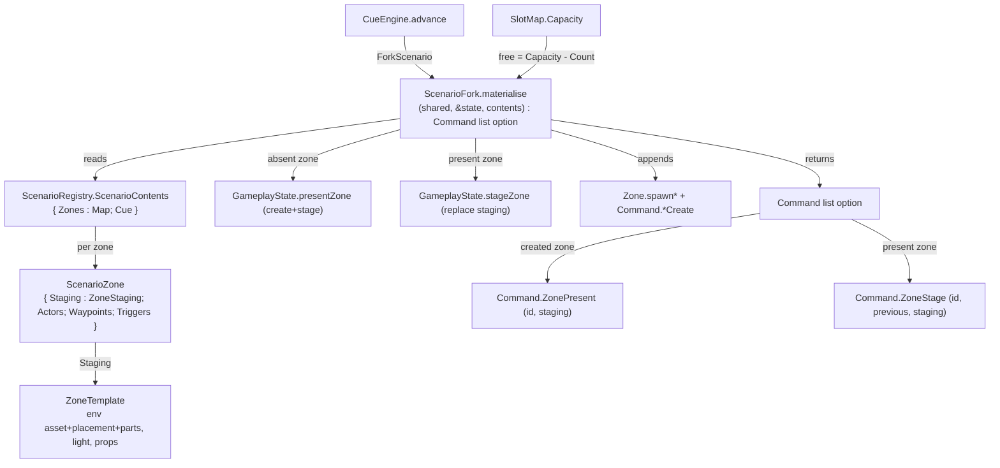

# Data Model: Scenario-Owned Zones

**Feature**: `specs/079-scenario-owned-zones` | **Date**: 2026-10-11

A scenario gains its zones' **staging**, a zone is identified by a **name** (`string`), and a fork **ensures** each
zone, **restages** it, **appends** its entities and **forks** its cue. Two stores retire (the closed `Place`
vocabulary and the `ZoneRegistry`); one command is added (`ZoneStage`) and one changes (`ZonePresent` carries its
staging). Nothing is persisted.

## Overview



## New and changed values

### 1. A zone id is a `string` *(retires `world/Place.fs`)*

| Was | Becomes |
|-----|---------|
| `Place` (closed union, `ArtRoom of Period` / `Island`) | `string` (a name) |
| `Place.start` | `GameplayState.startZone : string = "start"` |
| `Place.placeName p` | the string itself (drop) |
| `Place.all` (the enumeration the panels walk) | the present zones (`state.Zones` keys) |
| `Zones : Dictionary<Place, Zone>` | `Zones : Dictionary<string, Zone>` |
| `ActiveZone : Place` | `ActiveZone : string` |
| content command first field `Place` | `string` |
| `ZoneMove/ZoneAdd/ZoneDelete of … : Place` | `of … : string` |

A zone the code does not declare can now exist; a typo is a name that resolves to nothing (as for actors,
`specs/072`).

### 2. `ScenarioZone` gains staging *(reverts `specs/076`)*

```fsharp
// world/ZoneTemplate.fs — a zone's authored staging: an optional environment plus an always-present light and
// placed props, so an environment-less zone round-trips (spec 079).
type ZoneStaging =
    { Environment : ZoneTemplate option
      Light : Texture.LightSettings
      Props : PropState array }

// world/ScenarioZone.fs
type ScenarioZone =
    { Staging : ZoneStaging
      Actors : ActorState array
      Waypoints : ScenarioWaypoint array     // chains by index
      Triggers : TriggerState array }

// capture: staging + narrative entities, ref-free
let captureStaging (zone: Zone) : ZoneStaging =
    { Environment = Zone.captureTemplate zone
      Light = zone.Light
      Props = Zone.captureProps zone |> Array.map snd }

let capture (zone: Zone) : ScenarioZone =
    { Staging = captureStaging zone
      Actors = captureActors zone
      Waypoints = captureWaypoints zone
      Triggers = captureTriggers zone }
```

`ZoneTemplate` (unchanged) is the staging: `{ AssetId; Base; Orientation; Light; Parts : PropState array;
Props : PropState array }`. `ScenarioContents.Zones` is keyed by `string`.

### 3. `Command.ZonePresent` carries its staging; a new `Command.ZoneStage` *(state/Command.fs)*

```fsharp
// a place was made present; staging rides the command so redo needs no store
| ZonePresent of Name : string * Staging : ZoneStaging

// a present zone's staging was replaced (a fork into an existing zone)
| ZoneStage of Name : string * Previous : ZoneStaging * Next : ZoneStaging
```

| Command | `placeOf` | `History.apply` | `History.undo` |
|---------|-----------|-----------------|----------------|
| `ZonePresent(name, staging)` | `None` | `GameplayState.presentZone shared &state name staging` | `GameplayState.deleteZone shared &state name` |
| `ZoneStage(name, previous, next)` | `None` | `GameplayState.stageZone shared &state name next` | `GameplayState.stageZone shared &state name previous` |

Both are **state-level**: `Command.apply`/`Command.undo` (the zone-level runner) `invalidOp` if either reaches them.

### 4. `GameplayState.stageZone` — the one restager *(absorbs `Spawning.instantiateZone`)*

```fsharp
/// Replace a zone's staging: release/load the environment, replace its placed props, set the light; detach the
/// bodies it built when the zone is not the active one, so an inactive zone does not simulate.
val stageZone : SharedState -> byref<GameplayState> -> name:string -> ZoneStaging -> unit
```

- `Some template` → release the current environment, `Zone.loadTemplate` the new one, replace props, set the light.
- `None` → clear the environment and props, restore `Texture.defaultLight`.
- Detaches (`Zone.deactivatePhysics`) when `name <> state.ActiveZone`; the active zone is left simulating.

### 5. `ScenarioFork.materialise` — ensure, restage, append

```fsharp
val materialise : SharedState -> byref<GameplayState> -> ScenarioContents -> Command list option
```

| Result | Meaning |
|--------|---------|
| `Some commands` | Applied. Commands reverse it; may be empty. |
| `None` | The capacity pre-check refused; nothing changed; no cue forked. |

**Algorithm**

1. **Capacity pre-check (all-or-nothing, up front, FR-009).** For each target zone, the appended entities and the
   scenario's props must fit (`SlotMap.Capacity - Count` for entities; `newProps ≤ capacity` for props, which replace
   all present props). Any shortfall → `eprintln` the reason, return `None`, change nothing.
2. **Per zone, in `contents.Zones`:**
   - **absent** → `GameplayState.presentZone shared &state id sz.Staging`; record `ZonePresent(id, sz.Staging)`.
   - **present** → if `Zone.captureTemplate zone <> sz.Staging`, `GameplayState.stageZone shared &state id sz.Staging`
     and record `ZoneStage(id, previous, sz.Staging)`; else skip. (`previous = Zone.captureTemplate zone`.)
   - **append entities** — actors (`Zone.spawnActor` + overlay + detach if inactive + `ActorCreate`), waypoints in
     two passes (`spawnWaypoint` all, `setWaypointNext` from the scenario's indices, one `WaypointCreate` each), then
     triggers (`spawnTrigger` + `setTrigger` + `TriggerCreate`). (Unchanged from `specs/078`.)
3. **Return** the recorded commands in apply order.

### 6. Cue ops *(world/Cue.fs, world/CueEngine.fs)*

- **Retired**: `AddZone`, `PreloadZone` (their staging source is gone; a fork supplies it).
- **Kept**: `SetZone of place: string`, `RemoveZone of place: string` (switch / make absent — no staging).
- **Unchanged**: `ForkScenario of scenario: Scenario` (materialise, then `Fork contents.Cue`; a runtime effect).

## Validation rules (requirement trace)

| Rule | Source | Enforced by |
|------|--------|-------------|
| A scenario records each zone's staging and its narrative entities | FR-001/002 | `ScenarioZone.Staging` + `capture` |
| A fork ensures each zone by name (create/reuse, never duplicate) | FR-003 | the `Zones` map keyed by name; materialise step 2 |
| A fork applies staging to every zone — load (created) / replace (present) | FR-004 | `presentZone` / `stageZone` |
| Entities are appended; a fork is not idempotent | FR-005 | materialise step 2 (unchanged from 078) |
| The scenario's cue is forked in parallel | FR-006 | `Fork contents.Cue` (unchanged) |
| Active zone / camera / selection unchanged | FR-007 | neither `presentZone` nor `stageZone` switches |
| Cue op is a runtime effect; editor fork is one undoable step | FR-008 | `advance` discards; editor pushes one `Batch` |
| Over-capacity (entities **and** props) = log + nothing at all | FR-009 | pre-check → `None` |
| Zones are named; no closed vocabulary gates existence | FR-010 | `string` ids; `Place` retired |
| The Zone Registry (store + panel) retires | FR-011 | `ZoneRegistry.fs` / `ZoneRegistryPanel.fs` removed |
| Staging-dependent cue ops retire; `SetZone`/`RemoveZone` remain | FR-012 | `Cue.fs`/`CueEngine.fs` |
| Player designation is not staging | FR-013 | `ZoneTemplate` carries no player; a fork never writes `Zone.Player` |
| Headless coverage | FR-014 | `test/ScenarioForkTests.fs` (+ updated suite) |
| Guiding docs updated | FR-015 | `docs/ARCHITECTURE.md`, `EDITOR_DESIGN.md`, `ZONE_MODEL_DECISION.md`, `ROADMAP.md` |

## State transitions

**Editor fork (one step).** `materialise` mutates the scene and records the reversal; the panel sets the screen cue
and pushes one `Batch` (no re-apply).

```text
absent zone:   ZonePresent(id, staging)                     redo: presentZone(id, staging)   undo: deleteZone(id)
present zone:  ZoneStage(id, previous, staging)             redo: stageZone(id, staging)     undo: stageZone(id, previous)
entities:      ActorCreate / WaypointCreate / TriggerCreate  redo: occupy*                    undo: remove*
cue:           SetCue(before, forkInto contents.Cue before)  redo: write cue                  undo: restore cue
```

Undo reverses the batch; a created zone is removed last (after its entities); a restaged zone is restored to its
previous staging. Redo replays exactly.

**Cue op (runtime effect, not on the history).**

```text
advance(ForkScenario s):
  not registered        -> noOp (diagnostic);                     ValueSome Fin
  materialise = None    -> (capacity already logged)               ValueSome Fin
  materialise = Some _  -> ValueSome (Fork contents.Cue)
```
