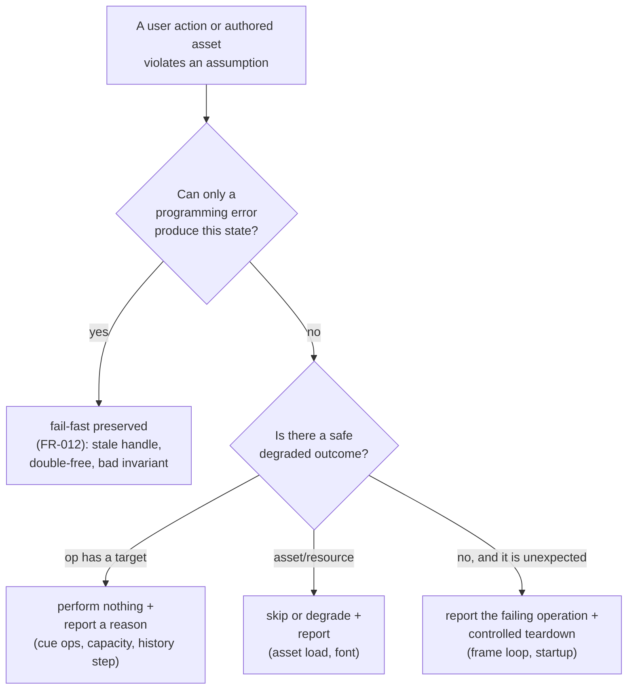

# Data Model: Graceful Failure on User-Facing Paths

**Feature**: `specs/080-user-path-hardening` | **Date**: 2026-10-12

This feature adds **no new entities, records, or containers**. It changes the *routing* of failures at
existing seams: a state that was fatal becomes a no-effect-and-report (or skip-and-report) outcome. The
"model" here is therefore the mapping from each user action to the invariant it can violate and the
defined outcome it now produces.

## Overview

## Changed behaviours

No value gains or loses a field. The changes are to *what happens* when a reference or a bound cannot be
satisfied.

| # | Site | Value / structure involved | Invariant that can be violated by user state | New outcome |
|---|------|----------------------------|---------------------------------------------|-------------|
| US1 | `world/ActorRender.fs` `playClip` | `ActorRender` animation slots, the asset's clip list | "the requested clip exists" | fall back to another clip / the held pose; report once |
| US2 | `world/CueEngine.fs` `SetCamera`/`FlyCamera`, `Fork` | `GameplayState.Camera`, the active `Zone`'s waypoints, the cue value | "the named place/waypoint/path resolves; speed > 0; a `Fork` sits at a sequence front" | perform no effect + report; a bare `Fork` runs its inner cue |
| US3 | `editor/CueTree.fs` `withChildren` | the cue value's shape | "every shape `children` describes can be rebuilt" | the `If` shape is rebuilt like the others |
| US4 | `state/History.fs` `apply`/`undo` | the one `UndoStack`, `GameplayState.Zones`, `ActiveZone` | "a step's place is still present" | skip + report; mutators stay fail-fast for direct misuse |
| US5 | `editor/Spawning.fs`, `Outliner.fs`, `AssetBrowser.fs` | `SlotMap<'T>` (`Capacity`, `Count`) | "the kind's map has room" | refuse + report; no entity created |
| US6 | `world/ScenarioZone.fs` `captureWaypoints` | a waypoint's `Next` link; `ScenarioZone` | "a captured link resolves" | capture the link as absent, as the runtime does |
| US7 | `world/Assets.fs` `scan`/`loadActors`; `render/Ui.fs` font | the asset dictionaries; the `Ui` font/text objects | "the asset file parses and uploads" | skip + report (assets); text-disabled (font); clean exit for a resource with no degrade |
| US8 | `Engine.fs` loop; `Program.fs` | the frame loop and its phase labels | (none — a genuine unexpected failure) | report the failing phase + controlled teardown / clean exit |

## Failure outcome vocabulary

Three outcome kinds are used, and each is already established in the codebase:

- **No effect + report** — the cue engine's existing contract (`CueEngine.noOp`/`noOpTrigger`); extended to
  the camera ops, the history runner, and the creation surfaces.
- **Skip / degrade + report** — the asynchronous asset path's existing contract (`Assets.pump` →
  `failAsset`); extended to the eager scan and to the font.
- **Report + controlled teardown** — new, one site each in `Engine.fs` and `Program.fs`; it reports and
  ends the run, and never swallows.

## Validation rules

- A report is emitted **once per event**, never per frame (SC-006).
- A no-op leaves the world byte-for-byte unchanged apart from the diagnostic.
- A skipped asset leaves the asset dictionary without that entry (it is absent, not `Failed`, on the eager
  path; the async environment path keeps its existing `Failed` residency).
- Fail-fast sites not listed above are untouched (FR-012).
