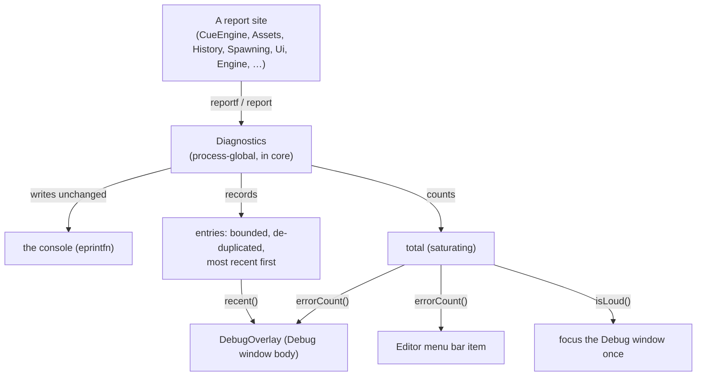

# Data Model: Error Visibility

**Feature**: `specs/081-error-visibility` | **Date**: 2026-10-12

The feature adds one small value and one process-global collection. Nothing is persisted, and no existing
record changes shape.

## Overview

## The value and the collection

### 1. `Report` *(new, `core/Diagnostics.fs`)*

One distinct non-fatal message, with how many times it has occurred.

| Field | Type | Meaning |
|---|---|---|
| `Message` | `string` | The exact text; the de-duplication key. |
| `Count` (mutable) | `int` | How many times this exact message has been reported. |

### 2. `Diagnostics` *(new module state, `core/Diagnostics.fs`)*

The process-global tally. Module-level mutable state, mirroring `Gpu.UploadStats`.

| Member | Kind | Meaning |
|---|---|---|
| `entries` | `List<Report>` (private) | Bounded (32), most-recent-first, de-duplicated. |
| `total` (private) | `int` | Reports made this run; saturates at 1,000,000. |
| `report` | `string -> unit` | Write the console line (`eprintfn`) **and** record (FR-001, FR-006). |
| `reportf` | `StringFormat<'T, unit> -> 'T` | `report` with formatting; the drop-in for `eprintfn` at each call site. |
| `errorCount` | `unit -> int` | The running total. |
| `lastMessage` | `unit -> string` | The most recent message, or `""`. |
| `recent` | `unit -> Report list` | The distinct reports, most recent first. |
| `isLoud` | `unit -> bool` | `total >= loudThreshold`. |
| `clear` | `unit -> unit` | Reset (a fresh session; tests). |
| `loudThreshold` | `int` (constant) | The escalation threshold (10). |

### 3. Display surfaces *(changed, no new value)*

| Surface | File | Reads | Shows |
|---|---|---|---|
| Debug window body | `screen/DebugOverlay.fs` | `errorCount`, `lastMessage`, `recent`, `isLoud` | Nothing when zero; else a red `N error(s): <last>` and the `xN  <message>` list; focuses the window once when loud |
| Menu bar item | `editor/Editor.fs` | `errorCount` | `(!) N error(s)` when non-zero; clicking focuses the Debug window |

## Validation rules

- A report with the same text as an existing entry increments that entry's `Count`; it never adds a second
  entry (FR-002).
- `entries` never exceeds 32; the oldest entry is dropped first.
- `total` is monotone non-decreasing and never exceeds 1,000,000.
- The Debug window's `name` is a constant (`"Debug"`): the count is shown in the body, never the title, so the
  window keeps a stable ImGui identity (docking/`imgui.ini`).
- With `errorCount() = 0` the Debug body draws only its ordinary read-outs and no menu-bar item appears
  (FR-003, SC-005).
