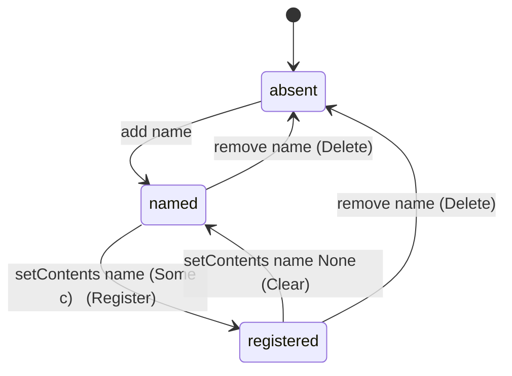

# Data Model: Scenarios as a String-Keyed Ordered Library

## `world/Scenario.fs` — deleted

The vocabulary module is removed: no `Scenario` union, no `scenarioName`, no `all`, no reflection. Nothing
references it once the cue op carries a string (D2).

## `world/ScenarioRegistry.fs` — the library, not a keyed dictionary of a fixed set

```fsharp
// before (spec 070)
type ScenarioContents = { Zones : Map<string, ScenarioZone>; Cue : Cue.Cue }   // unchanged
type Registry = { Entries : Dictionary<Scenario, ScenarioContents> }

// after
open Prime

type ScenarioContents = { Zones : Map<string, ScenarioZone>; Cue : Cue.Cue }   // unchanged
type Registry = OMap<string, ScenarioContents option>
```

`ScenarioContents` and `capture` are unchanged. The `Registry` becomes the whole model — the keys *are* the
vocabulary, and a key present with `None` is a scenario **named but not registered**.

| Operation | Signature | Meaning |
|-----------|-----------|---------|
| `create` | `unit -> Registry` | the empty library |
| `names` | `Registry -> string list` | the scenario names, in the order added |
| `exists` | `string -> Registry -> bool` | whether the name is in the library (registered or not) |
| `tryContents` | `string -> Registry -> ScenarioContents option` | the registered contents, or `None` (absent **or** unregistered) |
| `add` | `string -> Registry -> Registry` | name a scenario with no contents yet; a name already present is left **unchanged**, so a duplicate add never clears a registered scenario's contents (FR-007) |
| `remove` | `string -> Registry -> Registry` | remove the name and any contents |
| `setContents` | `string -> ScenarioContents option -> Registry -> Registry` | register (`Some`) or clear (`None`) a name |
| `normalise` | `string -> string` | trim surrounding whitespace |
| `capture` | `Dictionary<string, Zone> -> Cue.Cue -> ScenarioContents` | read the live scene (unchanged) |

`setContents name None registry` keeps the name (a clear); `remove name registry` drops it (a delete). Clear is
only offered on an existing row, so `setContents name None` on an absent name — which would create a named entry — is
never reached from the panel.

## `state/GameplayState.fs`

```fsharp
// before
Scenarios : ScenarioRegistry.Registry

// after (an OMap is a value, so a change stores a new library)
mutable Scenarios : ScenarioRegistry.Registry
```

Ownership is unchanged — the library stays on the gameplay world (not `SharedState`): only the gameplay screen and
its editor read it. `create` keeps `ScenarioRegistry.create ()`.

## `state/Command.fs` — the step's payload

```fsharp
// before
| SetScenario of Name : Scenario * Previous : ScenarioContents option * Next : ScenarioContents option

// after (whole-library pair; OMap is persistent, so a snapshot is a reference pair)
| SetScenario of Previous : ScenarioRegistry.Registry * Next : ScenarioRegistry.Registry
```

`Command.placeOf` still returns `None` for it; `Command.apply`/`undo` still refuse it as a zone-level step.
`state/History.fs` assigns `next`/`previous`:

```text
apply | SetScenario (_, next)       -> state.Scenarios <- next
undo  | SetScenario (previous, _)   -> state.Scenarios <- previous
```

## `world/Cue.fs` — the fork op carries a string

```fsharp
// before (spec 078)
| ForkScenario of scenario: Scenario

// after
| ForkScenario of scenario: string
```

`world/Cue.fs` no longer `open Scenario`.

## `world/CueEngine.fs` — the run

```text
ForkScenario scenario ->
    match ScenarioRegistry.tryContents scenario state.Scenarios with
    | None            -> noOp "ForkScenario" scenario "it is not registered"; ValueSome Fin
    | Some contents   -> (match ScenarioFork.materialise shared &state contents with
                          | None      -> ValueSome Fin          // no room: logged already, nothing forked
                          | Some _    -> ValueSome (Fork contents.Cue))
```

Behaviour is unchanged from `specs/078`/`specs/079`; only the payload type and the name in the diagnostic change.

## Library states



- **absent**: no key — no such scenario.
- **named**: key present, value `None` — a scenario the author added but has not registered; the row shows "(none)",
  Fork is unavailable.
- **registered**: key present, value `Some contents` — Register files contents; Clear (`setContents name None`) returns
  it to **named**; Delete (`remove name`) returns it to **absent**.

## Editor

### `state/EditorState.fs` — a new buffer

```fsharp
ScenarioNameBuffer : byte[]    // NEW — the Scenario panel's text field, beside AdventNameBuffer; sized entityNameBufferSize
```

### `editor/ScenarioPanel.fs` — rewritten

```text
[ text field ]  [ Add ]        // Add disabled for a blank-after-trim or already-present name; clears the field on add
─────────────────────────────────────────────────────────────────
Intro        2 zone(s)   [ Register ] [ Clear ] [ Fork ] [ Delete ]
Boss Fight   (none)      [ Register ] [ Clear ] [ Fork ] [ Delete ]
(no rows -> "(none)")
```

`Register` files `capture state.Zones state.Cue`; `Clear` empties the contents but keeps the name; `Fork` (enabled
only when registered) runs the materialiser; `Delete` removes the name. Each is **one** `SetScenario` step, pushed by
one private `commit shared &state (next: Registry)` that reads `before = state.Scenarios`.

### `editor/CueTree.fs` — labels, defaults, chooser

| Concern | Before | After |
|---------|--------|-------|
| `label` | `"Fork scenario: " + Scenario.scenarioName scenario` | `"Fork scenario: " + scenario`, suffix omitted when `scenario = ""` |
| `defaultOfKind` | `ForkScenario (List.head Scenario.all)` | `ForkScenario ""` |
| `withScenario` | takes a `Scenario` | takes a `string` |
| module opens | `open Scenario` | (dropped) |

`editor/CueEditor.fs`'s `drawNodeText` gains `scenarios: string list`; its `ForkScenario` chooser becomes
`filteredNameCombo` over those names (pick or type). `draw` and `drawTrigger` pass
`ScenarioRegistry.names state.Scenarios`.

## Validation rules

- **Ordered, de-duplicated**: the library reads in the order names were added; adding a present name is a no-op and
  leaves its contents (if any) untouched — `add` returns the library unchanged when the name is present, so a
  registered scenario survives a repeated add (FR-007).
- **Trimmed, then exact**: a typed name is trimmed of surrounding whitespace, then matched exactly (ordinal,
  case-sensitive). A blank-after-trim add is refused.
- **One step per change**: every accepted add, delete, clear and register is a single `SetScenario` step
  (whole-library before/after) on the one history; undo restores the exact before library, redo the exact after,
  including order.
- **No vocabulary, no cross-check**: a cue's scenario string is never validated against the library; typing a name in
  a cue does not add it; deleting a name does not rewrite or warn about cues.
- **Nothing persisted**: the library is session state; nothing is written to disk.
- **Fork semantics unchanged**: ensure each recorded zone by name, append entities, fork the cue, non-idempotent for
  entities, refuse-with-no-change when a target zone lacks room.
