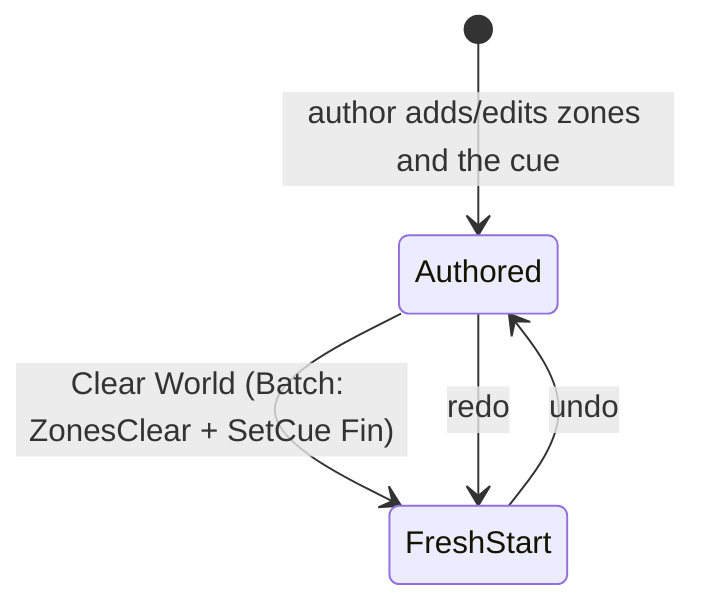

# Data Model: Clear the World Back to a Fresh Start

The feature adds one command, one state helper, one `Zone` value, one `Input` key and two editor lines. Nothing is
added to or removed from the build.

## `state/Command.fs` — the step

```fsharp
// NEW, beside ZoneDelete/ZonePresent/SetCue/… (a state-level step)
| ZonesClear of Previous : (string * ZoneContents) list * PreviousActive : string
```

- **Payload**: the whole previous world — every present zone's name paired with its captured `ZoneContents`
  (`Zone.captureZone`), and the name of the active place.
- **`placeOf`**: `None` (added to the `None` arm with `ZoneMove`, `ZoneDelete`, `ZonePresent`, `SetCue`, `Advent`,
  `SetScenario`).
- **Zone-level runner**: refused — added to the `invalidOp` arm of both `Command.apply` and `Command.undo` (it spans
  zones and needs the physics world, the GPU device and the active place).
- **One step**: an accepted clear is exactly one `ZonesClear` on the one history; undo restores the payload, redo
  installs the fresh start again.

## `world/Zone.fs` — "a fresh start" as a value

```fsharp
// NEW, beside captureZone/occupyZone
/// The contents of a fresh, empty zone — what a reset installs as the new `start` place.
let emptyContents : ZoneContents =
    { Actors = []; Props = []; Waypoints = []; Triggers = []
      Environment = None; Light = Texture.defaultLight; Player = ValueNone }
```

`ZoneContents` (its record, `captureZone`, `occupyZone`) is **unchanged** — it is reused as the restore payload, the
same shape `ZoneDelete` carries.

## `state/GameplayState.fs` — the world swap

```fsharp
// NEW
let replaceZones
    (shared: SharedState.SharedState)
    (state: byref<GameplayState>)
    (zones: (string * Zone.ZoneContents) list)
    (active: string) : unit
```

Steps:

1. **Retire the present world** — for each present zone, collect its environment's asset id (a `HashSet`, so a shared
   environment is released once) and `Zone.release zone state.Physics shared.Gpu.Device`. Then
   `Assets.releaseEnvironment shared.Assets assetId` for each distinct id. `state.Zones.Clear()`.
2. **Bring the new world up** — for each `(name, contents)`: `state.Zones.[name] <- Zone.create ()`;
   `Zone.occupyZone state.Zones.[name] state.Physics shared.Assets contents`; and if `name <> active`,
   `Zone.deactivatePhysics state.Zones.[name] state.Physics` (the build-then-detach `ZoneDelete`'s undo uses).
3. **Settle the view** — `invalidOp` if `active` is not among `zones` (a broken invariant); `state.ActiveZone <-
   active`; `state.InteractableTrigger <- ValueNone`; drop `Selection`/`Drag`/`NudgeBefore`.

Apply and undo both route through it:

```text
apply | ZonesClear _             -> replaceZones shared &state [ (startZone, Zone.emptyContents) ] startZone
undo  | ZonesClear (zones, active) -> replaceZones shared &state zones active
```

The retired `Zone` objects are managed values; dropping them from the map is their disposal. Only the native bodies
(`Physics.releaseBody` via `Zone.release`), the renderers/batches (`Zone.release`) and the GPU environment resources
(`Assets.releaseEnvironment`) need the explicit teardown.

## `state/History.fs` — the runner and the write path

```fsharp
apply | ZonesClear _               -> GameplayState.replaceZones shared &state [ (GameplayState.startZone, Zone.emptyContents) ] GameplayState.startZone
undo  | ZonesClear (zones, active) -> GameplayState.replaceZones shared &state zones active

// NEW — the single public write path the menu and the shortcut share; snapshot taken once, on invoke
let clearZones (shared: SharedState.SharedState) (state: byref<GameplayState>) : unit =
    let zones = state.Zones
    let previous = [ for KeyValue (name, zone) in zones -> name, Zone.captureZone zone ]
    let cueSteps = if state.Cue.IsFin then [] else [ SetCue (state.Cue, Cue.Fin) ]
    do commit shared &state (Batch (ZonesClear (previous, state.ActiveZone) :: cueSteps))
```

The cue reset rides the existing `SetCue` step in the same `Batch`, so `ZonesClear` stays zones-only and one clear is
still one step. `pruneCueSteps` already reaches into a batch on Play and drops the nested `SetCue` while keeping the
zone step undoable.

## `core/Input.fs` — the key

```fsharp
// in `type Key`
| W | A | S | D | Q | E | F | Z | Y | C      // C appended

// in `Key.mask` (bit 22 is the next free bit; nothing renumbers)
| C -> 1u <<< 22

// in `keyMap`
int SDL.Scancode.C, Key.mask Key.C
```

## `editor/Editor.fs` — the surfaces

```text
// Edit menu (in `draw`, after Redo) — `idle = Drag = None && not (wantTextInput())` is already computed
if ImGui.menuItem("Clear World", "Ctrl+Shift+C", false, idle) then
    do History.clearZones shared &state

// App-level shortcut (in `handleShortcuts`, inside `if state.Editing` and the `Drag = None` guard)
if Input.isCtrl input && Input.isShift input && Input.isPressed Input.Key.C input then
    History.clearZones shared &state
```

## World states



- **Authored**: any present zones with an active place, and a running cue — what the gesture captures.
- **FreshStart**: exactly one zone, at the start place, empty (no entities, no environment, default light, no player),
  active, **and the running cue empty (`Fin`)**. The camera, scenario library, fade and dialogue are untouched.

## Validation rules

- **Exactly one zone after a clear**: the fresh start place, empty, active (FR-002, FR-003).
- **One step, exact reversal**: undo restores every removed zone at its original refs and the previously active place
  (FR-004, FR-010), **and the previous running cue**; the payload is total, so undo needs no other store.
- **No leak**: every removed zone's bodies are destroyed and its renderers/batch freed; each environment is unloaded
  once when no remaining zone uses it (FR-007).
- **Zones and the running cue**: the scenario library is untouched, and the camera is left where it is (FR-008,
  FR-010).
- **No dangling selection**: a selection/drag of a removed entity is dropped (FR-009).
- **Gated**: the shortcut does not fire while a text field has focus or mid-drag; neither surface is available outside
  edit mode (FR-005, FR-006).
- **Nothing persisted**: the world is session state; nothing is written to disk.
