# Phase 1 — Data Model: Actor Sway Bones

Five records, three of them new. The authored chain is the only thing a human writes; the rest
is derived at load or allocated once per instance. No record here is rebuilt per frame — each is
mutated in place (constitution IV, V).

## The authored chain — one per manifest entry

`world/Sway.fs`. The shape the manifest's `Sway` field parses into; `[<SymbolicExpansion>]` for
named fields, exactly as `ActorAsset.PortraitPaths` and `ActorAsset.MorphDefinition` already are.

```fsharp
[<SymbolicExpansion>]
type SwayChain =
    { Bones : string array    // ordered root → tip, named against this actor's skeleton
      Stiffness : float32 }       // (0, 1] — 0 leaves no return force (FR-004)
```

Authored in `assets/actors/<id>/<id>.manifest` as an array on the actor. The joint names are
**bare atoms**, which is how Prime renders a `string array` — a quoted member parses as nothing,
so a quoted manifest silently yields no chains (there is a test pinning this):

```text
[Sway [[[Bones [J_Sec_Hair1_01 J_Sec_Hair2_01 J_Sec_Hair3_01 J_Sec_Hair3_01_end]]
        [Stiffness 0.15]]
       [[Bones [...]] [Stiffness 0.15]]]
```

There is **no wind field** — the reference's `affected_by_wind` is dropped, not defaulted
(spec Assumptions), so a later wind feature adds one field rather than changing an existing
one's meaning.

## The resolved chain — shared per asset

`world/Sway.fs`. One per authored chain that passed validation; held on `ActorAsset`, so it is
resolved once and shared by every instance (matching how a morph set and a portrait set are).

```fsharp
type SwayChainDef =
    { Joints : int array          // Bones resolved to skeleton joint indices, same order
      Stiffness : float32 }
```

## The pose — extended, still shared per actor

`world/Actor.fs`. `PoseFrame` today is three parallel `Matrix4x4 array`s (`Local`, `World`,
`Skinning`), allocated once by `createPoseFrame` and mutated every frame. Sway needs the
rotations the blend computed, and a way to recompose after writing one:

```fsharp
type PoseFrame =
    { Local : Matrix4x4 array
      World : Matrix4x4 array
      Skinning : Matrix4x4 array
      Translation : Vector3 array      // NEW — the blend's per-joint translation
      Rotation : Quaternion array      // NEW — the blend's per-joint *local* rotation (sway writes it)
      Scale : Vector3 array            // NEW — the blend's per-joint scale
      WorldRotation : Quaternion array // NEW — the per-joint world rotation (sway reads it) }
```

`composeJoint` already receives `(t, r, s)`; it now also writes `Translation`, `Rotation` and
`Scale`, and `WorldRotation` (`parent's world rotation ⊗ local`, or the local one at a root).
`composeAll` re-runs `composeJoint` for every joint from the stored TRS — the one pass sway
costs, and the analogue of the reference re-running `UpdateModelAnimation`.

## The runtime state — per instance

`world/Sway.fs`. Allocated in `ActorRender.create` from the asset's defs, freed with the
renderer. `[<Struct>]` where it is stepped per frame:

```fsharp
[<Struct>]
type SwayPoint =
    { Joint : int                    // skeleton joint index
      mutable Rest : Vector3         // posed world position this frame (the anchor is never moved)
      mutable Position : Vector3     // simulated world position
      mutable Previous : Vector3     // previous frame's Position (Verlet velocity)
      mutable RestLength : float32 } // distance to the previous point in the animated pose

[<Struct>]
type SwayChainState =
    { Def : SwayChainDef
      Points : SwayPoint array
      mutable SeedAnchor : Vector3   // the anchor's posed position when last seeded
      mutable Seeded : bool }

type SwayState =                     // on `ActorRender`
    { Chains : SwayChainState array }
```

`SwayState` is empty (`Chains = [||]`) for an actor that declares nothing: every entry point
early-returns, so an undeclared actor is byte-identical to today (FR-002).

## Validation rules

Checked by the pure `Sway.resolveAll` (which applies `resolve` to each chain and owns the whole-actor
cap), in this order, each returning `Error` with a message naming
what failed (D7). A failed chain is reported and dropped; the actor still loads (FR-009).

| Rule | Condition | Source |
|---|---|---|
| A chain needs a segment | `Bones.Length >= 2` | FR-010 |
| Every joint exists | each name matches a joint in this model, by name | FR-009 |
| A chain is a path | each joint's skeleton `Parent` is the previous chain joint | D3/FR-006 |
| Stiffness is in range | `0.0 < Stiffness <= 1.0` — `0` is refused, because it leaves no return force (FR-004) | FR-010 |
| A chain is bounded | `Bones.Length <= MaxSwayJointsPerChain` (16) | FR-012 |
| An actor is bounded | chains per actor `<= MaxSwayChainsPerActor` (16) | FR-012 |

The path rule exists because D3's "the segment a bone drives" is the segment to its child: a
list of bones that are not a parent→child path has no such segment.

## State transitions

```mermaid
stateDiagram-v2
    [*] --> Unseeded: create
    Unseeded --> Seeded: first play frame (or a teleport) — points take their posed positions
    Seeded --> Seeded: play frame — step, constrain, apply
    Seeded --> Unseeded: leaving play (the editor) — chains hold the animated pose
    Seeded --> Seeded: not playing — no step; the pose is the blend alone
    Unseeded --> Unseeded: not playing — nothing is simulated
```



Only two transitions write: **seed** (points := posed positions, `Previous := Position`, rest
lengths recomputed, `SeedAnchor := the anchor's posed position`) and **clear**
(`Seeded := false`), which is what makes FR-008 hold — the editor shows the blend, and resuming
Play starts from rest rather than from a frozen mid-swing pose. The teleport rule (D6) is the
same transition mid-play: a play frame whose anchor moved by more than `SwayTeleportDistance`
from `SeedAnchor` re-seeds instead of stepping.

## What is not modelled

- **No wind** (spec Assumptions) — no force term, no field.
- **No collision** — the rope is kinematic, as the reference's non-goals state; a chain may pass
  through the body or the ground.
- **No per-instance overrides** — stiffness is the asset's, as in the reference.
- **Nothing persisted, nothing authored per instance** — sway is not a command, not an undo
  step, and not part of a zone template or a scenario capture.
