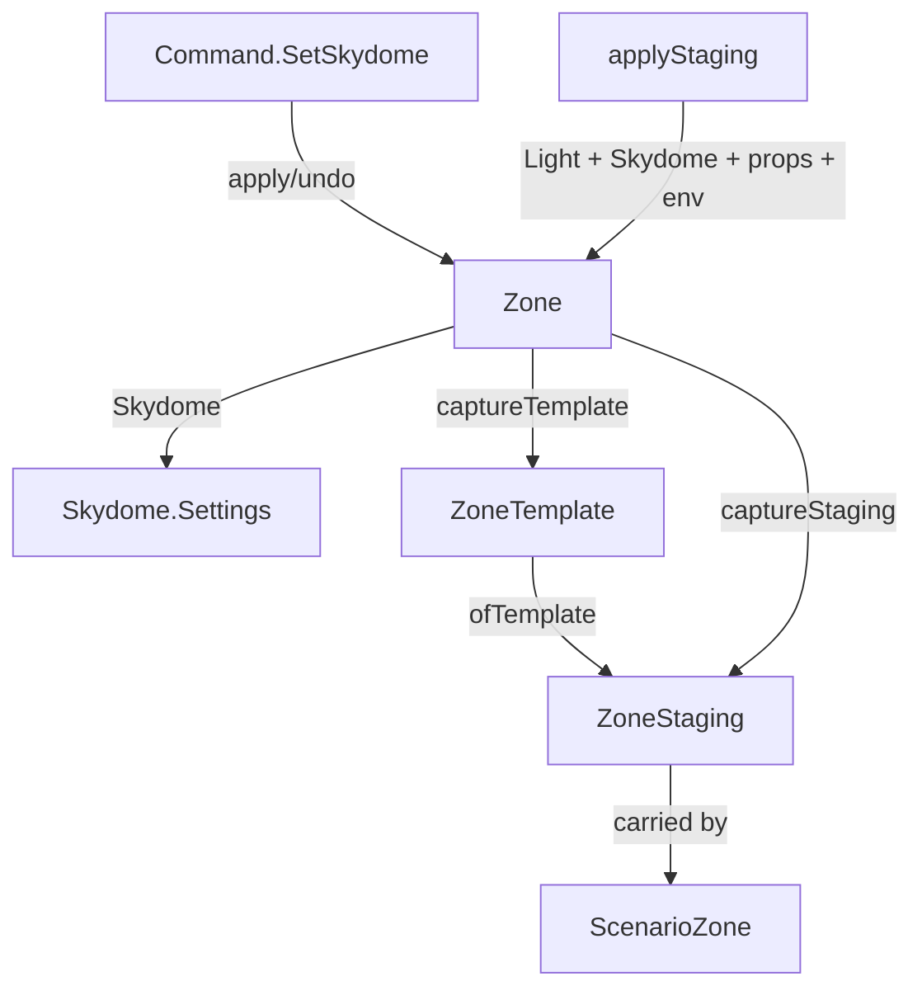

# Data Model: Zone Skydome

## `Skydome.Settings` (new — `render/Skydome.fs`)

A zone's authored sky. `[<Struct>]`, so it is copied by value like `Texture.LightSettings`.

| Field | Type | Meaning |
|-------|------|---------|
| `Enabled` | `bool` | Whether the zone draws a sky. Defaults to **false** (FR-001). |
| `Zenith` | `Vector3` | Linear RGB of the colour overhead. |
| `Horizon` | `Vector3` | Linear RGB of the colour at and below the horizon. |

```fsharp
[<Struct>]
type Settings =
    { Enabled : bool
      Zenith : Vector3
      Horizon : Vector3 }
```

**Default** (`Skydome.defaultSettings`): `Enabled = false`; `Zenith`/`Horizon` are `odin-game`'s colours
(`89,140,217` / `140,179,217` sRGB) converted to the port's linear space, so enabling a fresh sky shows a
sensible blue without the author first picking colours.

**Validation / invariants**: none beyond the type; the colours are any linear RGB, the same freedom the
light colour has.

## `Zone` (changed — `world/Zone.fs`)

| Field | Type | Change |
|-------|------|--------|
| `Skydome` | `mutable Skydome.Settings` | **Added**, beside `Light`. |

`Zone.create` sets it to `Skydome.defaultSettings`.

## `ZoneTemplate` (changed — `world/ZoneTemplate.fs`)

| Field | Type | Change |
|-------|------|--------|
| `Skydome` | `Skydome.Settings` | **Added**, beside `Light`. |

`ZoneTemplate.ofEnvironment` gains a `skydome` parameter; `Zone.captureTemplate` passes `zone.Skydome`.

## `ZoneStaging` (changed — `world/ZoneTemplate.fs`)

| Field | Type | Change |
|-------|------|--------|
| `Skydome` | `Skydome.Settings` | **Added**, beside `Light`. |

`empty` carries `Skydome.defaultSettings`; `ofTemplate` carries `template.Skydome`.

## `Command.SetSkydome` (new — `state/Command.fs`)

```fsharp
| SetSkydome of ZoneId : string * Previous : Skydome.Settings * Next : Skydome.Settings
```

- **placeOf**: `Some zone` (a zone-level step, like `SetLight`).
- **apply**: `zone.Skydome <- next`.
- **undo**: `zone.Skydome <- previous`.

## `EditorState` (changed — `state/EditorState.fs`)

Two reused `float32 array` colour buffers (zenith, horizon) and two `bool` live-editing flags, mirroring
`LightColorBuffer`/`LightColorEditing`. Not persisted; transient UI state.

## Relationships



## State transitions

- **Authored off → on**: `SetSkydome` flips `Enabled`; the next frame draws the sky (nothing else changes).
- **Capture → fork**: a zone's `Skydome` rides `ZoneStaging` into a `ScenarioZone`; `applyStaging` on a
  created or present zone assigns it back. No dependency on the environment being present.
