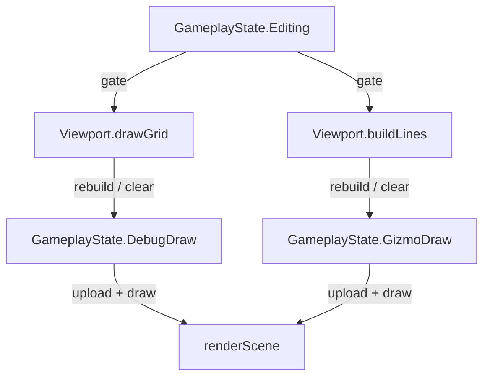

# Data Model: Editor-Only Reference Grid

The feature adds **no authored data**. It changes the lifetime of one existing runtime accumulator. No
zone, staging, scenario, command or persisted type is touched (FR-005).

## `GameplayState.DebugDraw` (unchanged type — `state/GameplayState.fs`)

The grid's **own** line accumulator: a `DebugDraw.DebugDraw` value (a `[<Struct>]` record holding a
reused `Data : float32 array` and `Count : int`, plus GPU handles unused by the CPU paths). Its only
writer is `Viewport.drawGrid`.

| Field | Type | Change |
|-------|------|--------|
| `DebugDraw` | `mutable DebugDraw.DebugDraw` | **No type change.** Its value's `Count` is now held at `0` while playing (emptied each play frame) and rebuilt while editing. |

`GameplayState.create` is unchanged; both accumulators still start from the drawers the engine builds.

## `GameplayState.Editing` (unchanged — `state/GameplayState.fs`)

The **gate**. `bool`; `true` while editing, `false` while playing (toggled by backtick in
`editor/Editor.fs`). Already gates the editor panels, markers, colliders, chain links and gizmo; the
grid now reads it too. No change to the field or how it is set.

## `GameplayState.GizmoDraw` (unchanged — `state/GameplayState.fs`)

The markers + transform gizmo accumulator. Already editor-only (rebuilt by `Viewport.buildLines` while
editing, emptied by `GameplayScreen.draw` while playing). **Not touched** by this feature; it is the
precedent the grid now follows.

## Relationships

## State transitions

- **Edit frame** → `Editing = true`: `drawGrid` rebuilds the grid into `DebugDraw` (`Count > 0`).
- **Play frame** → `Editing = false`: `drawGrid` empties `DebugDraw` (`Count = 0`).
- **Edit → Play (one frame)**: the accumulator is emptied in `draw`, before `renderScene` uploads it, so
  no editing-frame vertices draw in play (FR-002).
- **Play → Edit (one frame)**: the accumulator is rebuilt the next `draw`, restoring the grid (FR-003).

## Invariants

- `DebugDraw` is written **only** by `Viewport.drawGrid`; nothing else may fill it (that is what makes
  "hide the grid" equal to "empty the accumulator").
- The gate is `Editing` and nothing else; there is no separate grid-visibility flag.
